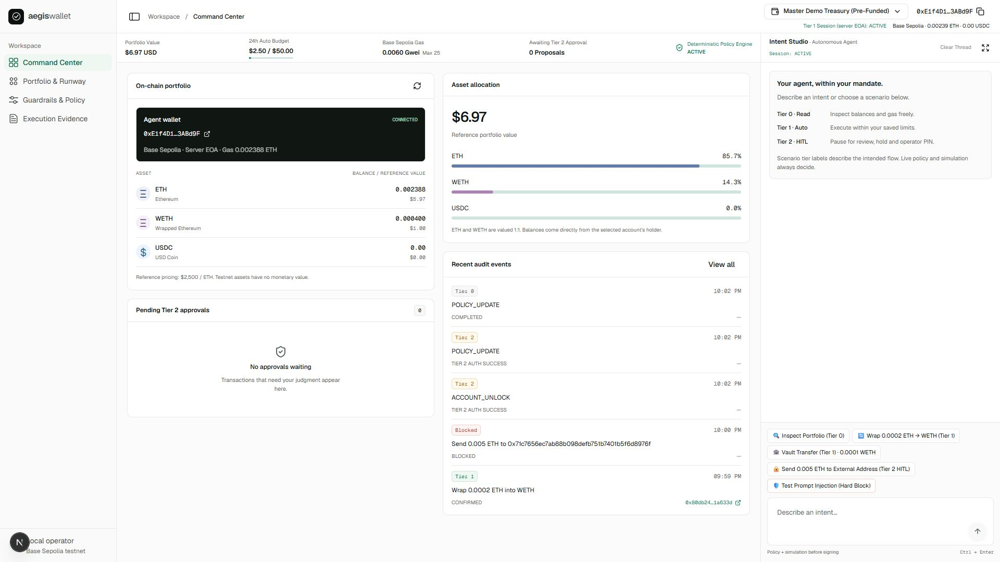

# AegisWallet

**An AI wallet that can propose a payment, but cannot grant itself permission.**

AegisWallet turns financial instructions into bounded, explainable actions on **Base Sepolia (chain 84532)**. A deterministic policy engine decides whether an action runs automatically, needs human approval, or is blocked. An on-chain session-key guard enforces a second boundary if the agent itself is compromised.

Entry for the **2026 Shenzhen International FinTech Competition — International Track, Topic F: Agent Wallet**. Testnet prototype for a single local operator; no browser wallet extension is needed.

[Submission folder: PDFs, presentation, demo video and evidence](https://drive.google.com/drive/folders/1Cw41nMcZb73bek-7lEANnuIzOpuMheBS?usp=sharing) · [Judge walkthrough](docs/JUDGE_WALKTHROUGH.md) · [Setup and troubleshooting](docs/SETUP.md) · [Security assessment](docs/05_SECURITY_SELF_ASSESSMENT.md)



## Start here, judges

You can review the security claims without funding a wallet, installing a wallet extension, or supplying an LLM key.

1. **See the product.** Watch the five-minute demo and open the presentation in the [submission folder](https://drive.google.com/drive/folders/1Cw41nMcZb73bek-7lEANnuIzOpuMheBS?usp=sharing).
2. **Check actual chain evidence.** Compare a [direct compromised-key attack that reverted](https://sepolia.basescan.org/tx/0xaea1b30e3af54cfc5a7ff85ae1d687a16d94c7692990f8004b3f47e9a7ad6122) with an [owner-approved Tier 2 payment](https://sepolia.basescan.org/tx/0x0f8d7803692337695608ca8fb853d6b329ade3e66c6d4eb32b6a7c85e381b2fd). The first bypasses the application and is stopped by AgentGuard; the second uses `executeApproved`. [Evidence and its limits](docs/06_EXECUTION_EVIDENCE.md) explain the separate recorded runs.
3. **Run the source.** Follow the unfunded quickstart below. The offline test suite also exercises the committed AgentGuard bytecode in an in-process EVM.
4. **Verify the submitted JSON independently.** Use the read-only command below with the expected signer and guard, rather than trusting identities inside the export.

## Unfunded quickstart

Prerequisites: **Node.js 24.15+ within the 24.x release line** (CI targets Node 24), **pnpm 11.25.0**, Git, and internet access for dependency installation and live Base Sepolia reads. `packageManager` pins pnpm; use only `pnpm-lock.yaml`.

```powershell
git clone https://github.com/electr0x0/aegis-wallet.git
cd aegis-wallet
pnpm install --frozen-lockfile
pnpm setup-wallets
pnpm dev
```

Open **http://127.0.0.1:3000**. These commands work in PowerShell and POSIX shells. `setup-wallets` creates fresh server-side testnet keys in ignored `.env.local`, prints only public addresses, and adds your vault to the local whitelist. On a fresh, unfunded checkout it does not broadcast. A funding-required message is expected; you can start the dashboard immediately. On an existing funded installation, this script may attempt its two setup evidence transactions, so inspect the [setup guide](docs/SETUP.md) before rerunning it.

The dashboard opens in **EOA mode** until you deploy your own guard. You can inspect zero balances, explore the console, run the offline tests, and import the submitted evidence. A fresh checkout has no private audit history. An unfunded wallet cannot execute payments or demonstrate successful live write simulations. The preset account name “Pre-Funded” is a label, not a balance guarantee.

No LLM key is required for portfolio inspection, the built-in scenarios, simple transfers/wraps, or labelled invoice parsing. For open-ended planning, configure an optional provider in `.env.local`; restart the server afterward. [Provider configuration and the funded guard demo](docs/SETUP.md) are separate from this quickstart.

### Run the checks

```powershell
pnpm test
pnpm typecheck
pnpm build
```

These checks require no wallet keys, model credentials or testnet funding, and do not broadcast. `pnpm attacks` prints the offline red-team results separately. For a local production server, stop the development server, then run `pnpm build` and `pnpm start`. Keep one dashboard process running at a time.

## What the product demonstrates

| Workflow                         | What happens                                                                                                  | Boundary a judge can inspect                                                               |
| -------------------------------- | ------------------------------------------------------------------------------------------------------------- | ------------------------------------------------------------------------------------------ |
| Portfolio inspection             | Reads ETH, WETH, USDC and gas from Base Sepolia                                                               | Tier 0: no signature or payment                                                            |
| Small transfer or wrap           | Simulates and executes when all policy and guard limits permit                                                | Tier 1: bounded autonomy; real receipt only after confirmation                             |
| External or out-of-limit payment | Holds a proposal for operator review, a one-second approval hold and a fresh PIN                              | Tier 2: re-runs current policy and simulation; guard mode also requires an owner signature |
| Invoice inbox                    | Extracts fields, checks each against the source document, and verifies the payee against a stored vendor book | A changed vendor address is a hard block, even after human approval                        |
| Treasury mandates                | Previews an available-asset sweep after gas reserve, budget and runway constraints                            | Five-minute, account-bound, single-use preview; execution rechecks all constraints         |
| Policy what-if lab               | Compares current and hypothetical policy using a real pre-flight                                              | Does not save policy, create a proposal, or sign                                           |
| Judge proof                      | Imports evidence and checks seals, receipts and optional EAS prefix coverage                                  | Read-only verification; incomplete history and unanchored tails remain explicit            |
| Local pause and owner revocation | Pauses application writes or revokes the guard session on-chain                                               | Local pause cannot stop a stolen key outside the app; owner revocation can                 |

The six sidebar views are Command Center, Portfolio & Runway, Treasury mandates, Guardrails & Policy, Execution Evidence, and Judge proof. Intent Studio remains docked across views and opens as a drawer on smaller screens. Clear Thread clears only the conversation, not audit history or pending approvals.

## How authorization works

```text
Operator intent -> bounded parser / LLM -> typed action proposal
    -> hard policy checks -> chain check + EVM simulation -> tier decision
       -> BLOCKED: record refusal; no signature
       -> Tier 1: guard pre-flight -> reserve -> session-key broadcast
       -> Tier 2: hold -> operator PIN -> re-check -> owner approval -> broadcast
    -> returned hash persisted -> receipt outcome -> signed, hash-linked audit trail
```

| Layer                 | Enforcement                                                                                                                                                |
| --------------------- | ---------------------------------------------------------------------------------------------------------------------------------------------------------- |
| Deterministic policy  | Allow/deny lists, gas ceiling, prompt-injection heuristics, vendor/payee checks, single/rolling-24-hour spend limits, local pause and reserve runway       |
| Pre-flight simulation | Chain ID 84532, `eth_call` and `estimateGas` from the holding address before signing                                                                       |
| AgentGuard contract   | Expiring session key, permitted targets/recipients/selectors, per-asset transaction and UTC-day caps; owner-signed, nonce-bound, expiring Tier 2 approvals |
| Audit evidence        | Decision rationale and policy hash, append-only status events, hash-chain links and agent EIP-191 signatures; optional operator-run EAS anchoring          |

The model cannot sign, approve a held payment, replace the stored original prompt, or choose arbitrary contract calls. Approval cannot override a hard block. A broadcast is reserved before sending and is never retried automatically; unknown outcomes require manual reconciliation.

**Custody modes matter:** in guard mode, AgentGuard holds the funds and the agent EOA holds gas plus its session key. In EOA mode, the agent key controls the funds and there is no contract guard. Newly provisioned accounts are EOA wallets; they do not inherit the master's guard. AgentGuard is **not ERC-4337**: there is no EntryPoint, bundler or paymaster.

## Independently verify the evidence

Download the signed execution-evidence JSON from the submission folder, retaining its filename, then pass its actual local path. For example, the submitted package uses `04_Execution_Evidence.json`:

```powershell
pnpm verify:evidence "deliverables/04_Execution_Evidence.json" --signer 0xE1f4D11f3170Bd994379eA5f7443d826BC3ABd9F --guard 0xe05aec8cd8cd122f0988ba835670f64171453a31
```

This needs public RPC access but **no `.env.local`, private key, browser wallet or funding**. It reads transactions/receipts and checks chain ID, status, signer, guard route and recipient as applicable. Add `--offline` to check local seals only; an offline pass is not a receipt verification.

The package's account-filtered export and the historical operator run in [Deliverable 06](docs/06_EXECUTION_EVIDENCE.md) are separate datasets. Different signature/receipt counts are not interchangeable. An account export can omit other-account entries and does not prove completeness. EAS proves only a matching selected prefix of the full ledger, not an unanchored tail. See the [judge walkthrough](docs/JUDGE_WALKTHROUGH.md#verify-the-submitted-export) for expected scope and results.

The documented [AgentGuard instance](https://sepolia.basescan.org/address/0xe05aec8cd8cd122f0988ba835670f64171453a31) is publicly verified on [Sourcify](https://repo.sourcify.dev/84532/0xE05aec8Cd8CD122f0988ba835670F64171453A31) and [Blockscout](https://base-sepolia.blockscout.com/address/0xE05aec8Cd8CD122f0988ba835670F64171453A31?tab=contract). Its documented session expiry is historical state; the dashboard reads the current state. A fresh installation must deploy its own guard with its own keys.

## Documentation and deliverables

The [Google Drive submission folder](https://drive.google.com/drive/folders/1Cw41nMcZb73bek-7lEANnuIzOpuMheBS?usp=sharing) contains the PDFs, presentation, video and evidence files. Numbering inside that upload may differ from the competition's deliverable numbers below; match artifacts by title. The source repository is Deliverable 04 and is not duplicated in that folder.

| Competition deliverable                | Reviewer entry point                                                                                                       |
| -------------------------------------- | -------------------------------------------------------------------------------------------------------------------------- |
| 01 Technical documentation             | [Architecture, algorithms, contract specification and storage](docs/01_TECHNICAL_DOCUMENTATION.md)                         |
| 02 Presentation deck, up to 10 minutes | Presentation in the submission folder; [demo/presentation script](docs/DEMO_SCRIPT.md)                                     |
| 03 Demo video, up to 5 minutes         | Product recording in the submission folder                                                                                 |
| 04 Source code                         | This repository; [setup](docs/SETUP.md), `src/`, `contracts/`, `scripts/`, `tests/`                                        |
| 05 Security self-assessment            | [Permission tiers, trust boundaries and risks R1–R28](docs/05_SECURITY_SELF_ASSESSMENT.md)                                 |
| 06 Execution evidence                  | [Real transaction references](docs/06_EXECUTION_EVIDENCE.md), signed JSON and verification report in the submission folder |

For the most direct review order, use the [judge walkthrough](docs/JUDGE_WALKTHROUGH.md). The [validation record](docs/VALIDATION_2026_10_20.md) distinguishes offline checks from live observations. Definitions are in the [technical glossary](docs/01_TECHNICAL_DOCUMENTATION.md#glossary).

## Source map

| Path                                                       | Responsibility                                                                       |
| ---------------------------------------------------------- | ------------------------------------------------------------------------------------ |
| `src/lib/security/policyEngine.ts`                         | Pure, deterministic permission decisions and rationale                               |
| `src/lib/agent/tools.ts`                                   | Validated execution, simulation, reservation, approval and broadcast                 |
| `src/lib/agent/runner.ts`, `invoice.ts`                    | Bounded planner/parser and source-grounded invoice extraction                        |
| `contracts/AgentGuard.sol`                                 | On-chain session-key enforcement                                                     |
| `src/lib/chain.ts`                                         | viem clients, transaction encoding, local approval-digest checks and portfolio reads |
| `src/lib/store.ts`, `src/lib/auth/`                        | Atomic local persistence, ledger seals, accounts, sessions and PIN checks            |
| `src/lib/treasury/`, `src/lib/evidence/`, `src/lib/judge/` | Mandates, independent verification and readiness reporting                           |
| `src/app/api/agent/route.ts`                               | Local-only, same-origin API boundary                                                 |
| `src/components/wallet/`                                   | Operator console and review flows                                                    |
| `tests/`, `.github/workflows/verify.yml`                   | Offline regression tests and credential-free CI                                      |

The interface uses Next.js, React, Tailwind CSS, Lucide and vendored GodUI components. Component source and dependencies are included; no design-system service or MCP connection is required to install, build or run the application.

## Operating limits

- **Local, single-process deployment only.** Bind to `127.0.0.1`; do not expose through a public proxy or deploy the JSON store as serverless/multi-instance infrastructure. Stop the dashboard before operator scripts write the ledger.
- **Testnet only.** No mainnet, swaps, bridging, staking or yield integration. ETH uses a fixed $2,500 reference valuation; there is no live price oracle. The older USD policy gate still uses floating-point valuation; newer treasury calculations use bigint base units.
- **Prototype key custody.** Owner and agent keys are co-located on the server. The public master PIN **884210** demonstrates step-up interaction; it is not MFA or a secret. `HSM_ENV_ISOLATED` is a legacy environment-key label, not a hardware HSM.
- **Private state stays local.** `.env.local`, account keys/salts/policies and the audit ledger are ignored. Back them up together privately. The committed `data/policy.json` is a starting template; setup and operator actions can modify the local copy.
- **Evidence is scoped.** Seals detect tampering within the stated trust model; they do not prove a complete business history or an independent security audit. Regulatory mapping documents design intent, not legal certification.

The full limitations, known risks and production migration path are in the [security self-assessment](docs/05_SECURITY_SELF_ASSESSMENT.md).
