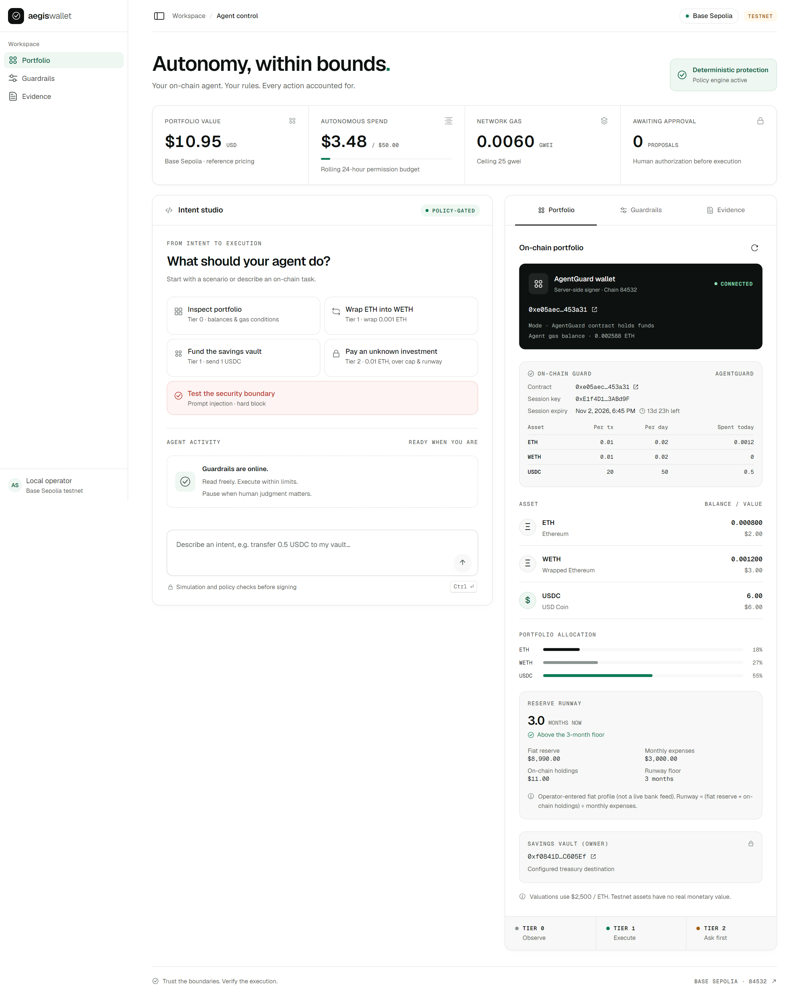

# AegisWallet

AegisWallet is an AI agent wallet on Base Sepolia, built as risk-control infrastructure for AI agents that act on-chain. It combines a deterministic policy gate, an on-chain session-key guard that holds the funds, a cash-reserve runway rule and a sealed, signed ledger. It runs on testnet only and does no trading and no yield. It is an entry for the 2026 Shenzhen International FinTech Competition, International Track, Topic F "Agent Wallet".

It treats the model as a financial participant working under a mandate, not as a key holder:

- **Proposing.** A language model, or a deterministic parser when no model is configured, turns plain-English instructions into typed proposals.
- **Deciding.** A deterministic policy engine decides whether each proposal runs autonomously, waits for a human, or is refused. Every write is simulated from the funded address before anything is signed.
- **Holding.** The funds sit in AgentGuard, a small on-chain contract. The agent holds only an expiring session key, limited by per-asset caps, recipient and call allowlists, and owner-signed approvals. These limits hold even if the model, the agent logic or the session key is compromised.
- **Recording.** Every decision goes into a hash-chained ledger signed by the agent key, with a rationale a person can read.

## For judges: verify in 3 minutes

No step needs a private key or a funded wallet.

1. **The guard.** Open the AgentGuard contract on BaseScan: [`0xe05aec8cd8cd122f0988ba835670f64171453a31`](https://sepolia.basescan.org/address/0xe05aec8cd8cd122f0988ba835670f64171453a31). It holds the master account's funds; the agent has only a session key.
2. **A blocked attack and an approved payment.** Open [the reverted attack](https://sepolia.basescan.org/tx/0xaea1b30e3af54cfc5a7ff85ae1d687a16d94c7692990f8004b3f47e9a7ad6122) ([docs/06](docs/06_EXECUTION_EVIDENCE.md), row 4). The session key called the guard directly, skipping every off-chain check, and AgentGuard reverted it with `RecipientNotAllowed`. Then open [the Tier 2 payment](https://sepolia.basescan.org/tx/0x0f8d7803692337695608ca8fb853d6b329ade3e66c6d4eb32b6a7c85e381b2fd) (row 8). It went through `executeApproved`, which AgentGuard accepts only with a valid owner signature.
3. **Run the tests.** `pnpm install --frozen-lockfile`, then `pnpm test`.
4. **Run the attack suite.** `pnpm attacks`. It runs offline with the chain mocked and prints a table per attack category.
5. **Verify the evidence.** `pnpm verify:evidence <file>` re-checks every hash, signature and receipt on Base Sepolia. It needs the evidence export (`aegis-evidence.json`) submitted with deliverable 06, or the operator's `data/audit_log.json`. The AgentGuard source is verified on [Sourcify](https://repo.sourcify.dev/84532/0xE05aec8Cd8CD122f0988ba835670F64171453A31) and [Blockscout](https://base-sepolia.blockscout.com/address/0xE05aec8Cd8CD122f0988ba835670F64171453A31?tab=contract).
6. **Read the security assessment.** In docs/05, read [the permission-tier implementation](docs/05_SECURITY_SELF_ASSESSMENT.md#2-permission-tier-implementation) and [the known-risk list](docs/05_SECURITY_SELF_ASSESSMENT.md#3-known-risk-list). [The regulatory mapping](docs/05_SECURITY_SELF_ASSESSMENT.md#7-regulatory-mapping) links each control to published guidance.

## How it works



| Layer                                                 | Enforces                                                                                                                                                                                                                                                                                                      |
| ----------------------------------------------------- | ------------------------------------------------------------------------------------------------------------------------------------------------------------------------------------------------------------------------------------------------------------------------------------------------------------- |
| 1. Policy engine (`src/lib/security/policyEngine.ts`) | Tier 0 read, Tier 1 autonomous within caps, Tier 2 human in the loop, or blocked. Checks whitelist and blacklist, single-transaction and rolling 24-hour USD caps, gas ceiling, prompt-injection heuristics, and a reserve-runway floor computed from an operator-entered fiat profile (not a live bank feed) |
| 2. Pre-flight simulation                              | `eth_call` and `estimateGas` from the address that holds the funds, on chain 84532 only                                                                                                                                                                                                                       |
| 3. AgentGuard (`contracts/AgentGuard.sol`)            | Session expiry, per-asset per-transaction and per-UTC-day caps, target, recipient and selector allowlists (the session key cannot `approve`), and Tier 2 approvals as owner EIP-191 signatures verified on-chain with a nonce and deadline                                                                    |

The ledger head (last entry hash, entry count, policy hash) can be anchored on EAS by the operator. This is a fixed, zero-value call sent from the agent EOA through `executeAction`; it is never a planner tool.

AgentGuard is not an ERC-4337 account. There is no EntryPoint, bundler or paymaster; the session key pays its own gas. Details are in [docs/01](docs/01_TECHNICAL_DOCUMENTATION.md). Risks and limitations are in [docs/05](docs/05_SECURITY_SELF_ASSESSMENT.md).

## Quickstart

The navbar starts on **Master Demo Treasury (Pre-Funded)**, bound to `AGENT_PRIVATE_KEY`. The name is a demo preset: its balances and guard session are always read from Base Sepolia. The master operator PIN is **884210**, available through the demo quick-fill button. `HSM_ENV_ISOLATED` is a compatibility status for an environment-held software key; this prototype does not use a hardware HSM.

Use **Provision New Agent Wallet** to create a PIN-encrypted EOA. Conservative, Balanced and Aggressive presets set $1/$2/$10 single-transfer caps and $5/$10/$50 daily caps, respectively, without changing the master policy. Switching accounts requires that account's PIN. An unlocked account session expires after 30 minutes or a server restart. The default local master remains available when no session cookie is present.

New accounts receive a one-time attempt to fund 0.0003 ETH from the master EOA when its balance is strictly above 0.002 ETH. The transfer still must pass the master policy, remaining daily budget, chain check and simulation. This gas drip does not include USDC. Skips, blocks and unresolved outcomes are shown with a manual-funding address; nothing is retried automatically. The existing master guard protects only its own holder funds; newly provisioned wallets use EOA mode and are labeled accordingly.

Every Tier 2 approval and policy save requires a fresh operator PIN. The demo quick-fill applies only to the master; custom wallets use their chosen PIN. Five failed attempts lock an account for five minutes, and successful/failed checks are recorded in the sealed audit trail. Accounts, encryption salt, account policies and audit history are private local state in `data/`; keep them together in private backups. See [the security assessment](docs/05_SECURITY_SELF_ASSESSMENT.md) for the limits of six-digit PIN protection.

Requires a current Node.js release (developed on Node 24) and pnpm 11. `packageManager` pins pnpm 11.25.0, and `pnpm-lock.yaml` is the only lockfile.

```powershell
pnpm install --frozen-lockfile
pnpm setup-wallets
```

1. **Create the wallets.** `pnpm setup-wallets` creates `.env.local` without printing any key. It generates the agent key and a vault key and address, adds the vault to the whitelist, and prints the agent and vault addresses.
2. **Fund the agent address** with Base Sepolia ETH and USDC.
   - The ETH covers gas plus the amount moved into the guard.
   - For the full demo in [docs/DEMO_SCRIPT.md](docs/DEMO_SCRIPT.md), the guard needs at least 0.011 ETH.
   - Optionally rerun `pnpm setup-wallets` once funded. It executes two small evidence transactions (0.50 USDC to the vault, a 0.0002 ETH wrap) through the normal policy path, each attempted only once.
3. **Compile and deploy the guard.**

   ```powershell
   pnpm guard:compile
   pnpm guard:deploy --eth 0.015
   ```

   `guard:compile` rebuilds `src/lib/guard/AgentGuard.json` from source with solc 0.8.37. `guard:deploy` then:
   - deploys AgentGuard
   - writes `GUARD_ADDRESS` to `.env.local`
   - moves `--eth` ETH (default 0.002) and all of the agent's USDC (or `--usdc <amount>`) into the guard
   - records each step in the ledger

4. **Run the dashboard.**

   ```powershell
   pnpm dev
   ```

   Open http://127.0.0.1:3000. Restart the dev server after any change to `.env.local`.

   The full-height agent chat is at http://127.0.0.1:3000/agent (sidebar → Agent chat). The dashboard's Intent studio shows the same conversation. Each reply states the outcome in plain words (done, waiting for approval, or blocked and why), and the raw API result sits behind "Technical details".

No fake balances or transaction hashes are ever generated. An unfunded checkout shows no on-chain evidence.

## Environment variables

`.env.example` lists every variable. `.env.local` is git-ignored and must never be committed.

| Variable               | Required                                     | Purpose                                                                                                                                      |
| ---------------------- | -------------------------------------------- | -------------------------------------------------------------------------------------------------------------------------------------------- |
| `AGENT_PRIVATE_KEY`    | Yes (created by `setup-wallets`)             | Agent EOA. Signs transactions, is the guard's session key, pays gas, and signs ledger entries                                                |
| `VAULT_ADDRESS`        | Yes (created by `setup-wallets`)             | Savings vault. Whitelisted off-chain, and the only allowed recipient on the guard. The default destination for "send … to the savings vault" |
| `VAULT_PRIVATE_KEY`    | For guard mode (created by `setup-wallets`)  | AgentGuard owner key; signs Tier 2 approvals. In this prototype it sits beside the agent key (see docs/05, R2)                               |
| `GUARD_ADDRESS`        | Optional (written by `guard:deploy`)         | Enables guard mode. An invalid value is a hard error, never a silent fallback                                                                |
| `SESSION_HOURS`        | Optional, default `24`                       | Session-key lifetime used by `guard:deploy` and `--renew`                                                                                    |
| `BASE_SEPOLIA_RPC_URL` | Optional, default `https://sepolia.base.org` | RPC endpoint                                                                                                                                 |
| `GEMINI_API_KEY`       | Optional                                     | Enables the LLM planner through Gemini's OpenAI-compatible endpoint                                                                          |
| `GEMINI_MODEL`         | Optional, default `gemini-3.5-flash-lite`    | Planner model                                                                                                                                |
| `OPENAI_API_KEY`       | Optional                                     | Used only when `GEMINI_API_KEY` is not set                                                                                                   |
| `OPENAI_MODEL`         | Optional, default `gpt-4.1-mini`             | Planner model for OpenAI                                                                                                                     |

The five dashboard scenarios, single wraps and transfers, portfolio reads and address audits all work without an LLM key.

## Commands

```powershell
pnpm dev                          # dashboard on http://127.0.0.1:3000
pnpm test                         # Vitest
pnpm attacks                      # offline red-team suite with per-category summary (chain mocked)
pnpm typecheck
pnpm build
pnpm start                        # production server, loopback only

pnpm guard:compile                # rebuild the AgentGuard ABI and bytecode
pnpm guard:deploy                 # deploy and fund (--eth, --usdc), or:
pnpm guard:deploy --fund-only     #   top up an existing guard
pnpm guard:deploy --renew         #   extend the session; after a revoke the owner sends setSession itself
pnpm guard:deploy --revoke        #   emergency stop: revoke the session key on-chain
pnpm guard:deploy --force         #   redeploy (old guard funds need an owner-signed call to recover)

pnpm guard:attack                 # compromised session key against AgentGuard: three simulated attacks
pnpm guard:attack --broadcast     # also send attack (a), producing a reverted transaction on BaseScan

pnpm guard:verify                 # publish the AgentGuard source to Sourcify and Blockscout (--address 0x...)
pnpm verify:evidence [path]       # independent read-only ledger check: hashes, signatures, receipts (--offline, --signer)
pnpm ledger:anchor                # attest the ledger head on EAS (registers the schema once if missing)
pnpm ledger:anchor --dry-run      #   policy and simulation only; nothing is signed
```

The demo prompts and the recording script are in [docs/DEMO_SCRIPT.md](docs/DEMO_SCRIPT.md).

## Deliverables

| #   | Deliverable                                               | Location                                                                                                                                |
| --- | --------------------------------------------------------- | --------------------------------------------------------------------------------------------------------------------------------------- |
| 01  | Technical documentation                                   | [docs/01_TECHNICAL_DOCUMENTATION.md](docs/01_TECHNICAL_DOCUMENTATION.md)                                                                |
| 02  | Presentation deck (final presentation, ≤ 10 minutes)      | Outline and speaker notes in [docs/DEMO_SCRIPT.md](docs/DEMO_SCRIPT.md#5-10-slide-deck-outline); submitted separately                   |
| 03  | Demo video (optional, ≤ 5 minutes)                        | Recorded from [docs/DEMO_SCRIPT.md](docs/DEMO_SCRIPT.md); submitted separately                                                          |
| 04  | Source code, tests and deployment steps                   | This repository: `src/`, `contracts/`, `scripts/`, `tests/`, this README                                                                |
| 05  | Security self-assessment                                  | [docs/05_SECURITY_SELF_ASSESSMENT.md](docs/05_SECURITY_SELF_ASSESSMENT.md)                                                              |
| 06  | Execution evidence (real Base Sepolia transaction hashes) | [docs/06_EXECUTION_EVIDENCE.md](docs/06_EXECUTION_EVIDENCE.md), and Dashboard → Evidence → Export, generated from `data/audit_log.json` |

## Operating constraints

This is a testnet-only prototype for a single local operator:

- The server binds to loopback and accepts only same-origin mutations. Do not expose it through a public proxy.
- Run one Node process. The ledger has a single writer.
- Back up `data/audit_log.json` and `.env.local` privately. Neither is committed.
- ETH is valued at a fixed $2,500 reference price, not an oracle.
- No swaps or yield integrations exist; such requests are refused.
- Approval re-runs simulation and the current policy, and a hard block cannot be overridden.
- Every broadcast is reserved before sending and never retried automatically. An unknown outcome stays reserved for manual reconciliation.

## GodUI design system

The dashboard uses official GodUI and GodUI Lab source components. [docs/GODUI_INTEGRATION.md](docs/GODUI_INTEGRATION.md) documents the MCP configuration, the component mapping and the local adaptations. Run `pnpm godui:check` to verify the installed MCP server.
