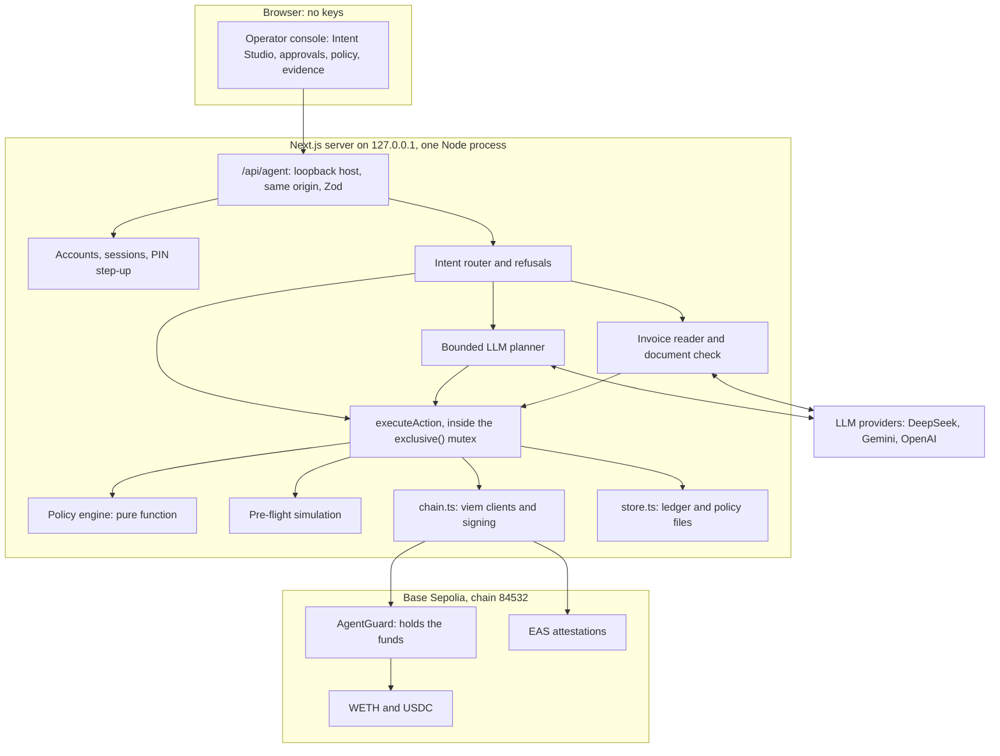
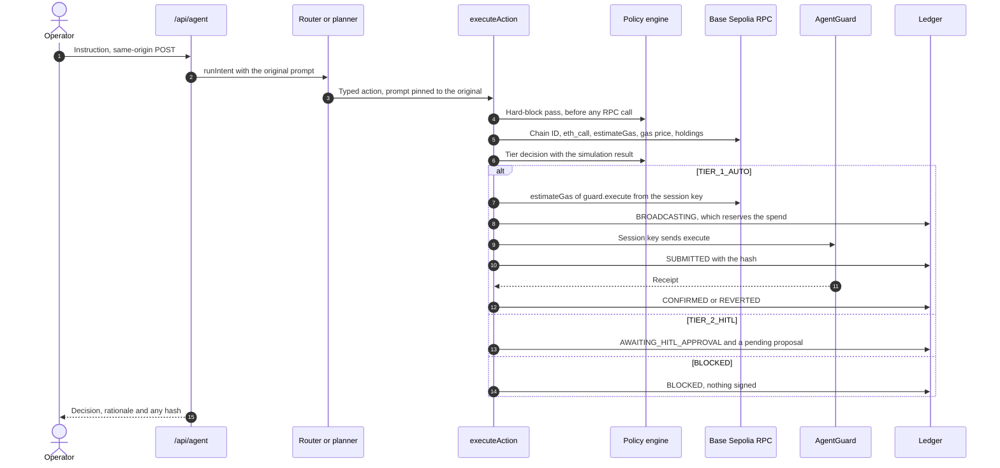
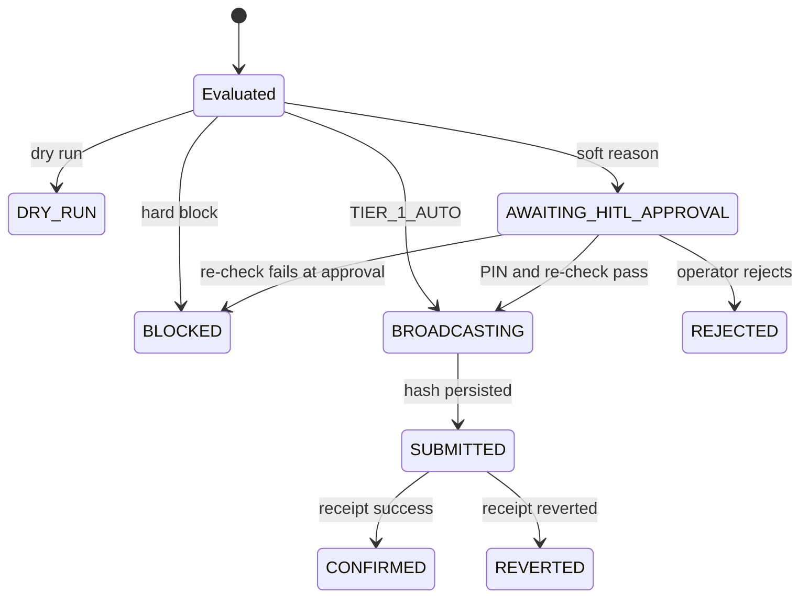

# 01 — Technical documentation

AegisWallet is an agent wallet on Base Sepolia (chain ID 84532). An operator gives an instruction in plain language. A language model, or a deterministic parser when no model is configured, turns it into a typed proposal. Deterministic code then decides whether the proposal executes on its own, waits for a human, or is refused. An on-chain contract, AgentGuard, holds the funds and enforces its own limits, which hold even if every off-chain component is compromised. Every decision is written to a hash-chained, signed ledger with a rationale a person can read.

This document follows the three parts the competition asks for. The security self-assessment, [05](05_SECURITY_SELF_ASSESSMENT.md), holds the known-risk list (R1–R28), the attack demonstration and the regulatory mapping; this document refers to it rather than repeating it. Real transaction hashes are in [06](06_EXECUTION_EVIDENCE.md). Terms are explained in the [glossary](#glossary).

| Part                                                   | Sections | Answers                                                                                                             |
| ------------------------------------------------------ | -------- | ------------------------------------------------------------------------------------------------------------------- |
| [I. System architecture](#part-i--system-architecture) | 1–7      | What the components are, how a request flows through them, where keys and data live                                 |
| [II. Core algorithms](#part-ii--core-algorithms)       | 8–15     | How an instruction is routed, how its permission tier is decided, how invoices are read, how the ledger is sealed   |
| [III. Security design](#part-iii--security-design)     | 16–23    | Threat model, security goals, defence in depth, the AgentGuard contract, key handling, failure states, test results |
| [IV. Deployment](#part-iv--deployment-and-operations)  | 24       | Commands that reproduce the system                                                                                  |

**At a glance**

| Item               | Value                                                                                                                                                                       |
| ------------------ | --------------------------------------------------------------------------------------------------------------------------------------------------------------------------- |
| Network            | Base Sepolia only, chain ID 84532, checked before every simulation                                                                                                          |
| Assets             | Native ETH, WETH, USDC                                                                                                                                                      |
| Agent capabilities | Read the portfolio, audit an address (advisory), wrap ETH, unwrap WETH, transfer a token                                                                                    |
| Operator-only      | A one-time onboarding gas drip for a new account, and an EAS anchor of the ledger head. Neither is reachable by the model                                                   |
| Permission tiers   | `TIER_0` read, `TIER_1_AUTO` autonomous, `TIER_2_HITL` held for a human, `BLOCKED`                                                                                          |
| Enforcement        | Policy engine (off-chain, deterministic) → pre-flight simulation → AgentGuard (on-chain)                                                                                    |
| Signing            | Server-side with viem. The browser never holds a key                                                                                                                        |
| Audit trail        | Append-only ledger; keccak256 hash chain; EIP-191 signature on every entry; optional anchor on the Ethereum Attestation Service (EAS)                                       |
| Stack              | Next.js 15, React 19, TypeScript, viem 2, Zod 3, Solidity 0.8.37, Vitest                                                                                                    |
| Tests              | 357 tests in 22 files (`pnpm test`, 20 October 2026), including 51 contract tests on an in-process EVM and a 60-attack suite                                                |
| Deployed guard     | [`0xe05aec8cd8cd122f0988ba835670f64171453a31`](https://sepolia.basescan.org/address/0xe05aec8cd8cd122f0988ba835670f64171453a31), source verified on Sourcify and Blockscout |

# Part I — System architecture

## 1. Design principles

Six rules shape the design. Each one is enforced in code, not by convention.

1. **The model proposes; it never decides.** Every write passes through one function, `executeAction`, and one pure decision function, `evaluateTransactionPolicy`. The model has no signing tool and no approval tool, and it cannot replace the operator's original prompt, which is what the policy reads.
2. **Hard blocks are final.** A blacklisted recipient, a failed simulation, the wrong chain or a gas price above the ceiling cannot be overridden by human approval. Approval re-runs simulation and the current policy.
3. **Limits hold even when the server is wrong.** Funds sit in AgentGuard, which enforces its own caps and allowlists on-chain. The agent holds only an expiring session key.
4. **Reserve before broadcast; never retry automatically.** A spend is persisted as `BROADCASTING` before the transaction is sent, and its hash is persisted before the receipt is awaited. An unknown outcome stays reserved until a human reconciles it.
5. **Every decision is evidence.** Each attempt, refusals included, becomes a sealed ledger entry with a template-generated rationale and the hash of the policy in force.
6. **Nothing is invented.** No placeholder balance, hash or success state appears anywhere. A missing amount becomes `0`, which is always blocked.

## 2. Enforcement layers

Value moves only when three independent layers accept it.

| Layer                    | Runs in                                                 | Enforces                                                                                                                                                                                                                                                                                         | Holds against                                                                                                                      |
| ------------------------ | ------------------------------------------------------- | ------------------------------------------------------------------------------------------------------------------------------------------------------------------------------------------------------------------------------------------------------------------------------------------------ | ---------------------------------------------------------------------------------------------------------------------------------- |
| 1. Policy engine         | Server, `src/lib/security/policyEngine.ts`              | The tier decision: pause switch, blacklist and whitelist, prompt-injection pattern, verification of payee against the vendor book, single-transaction and rolling 24-hour USD caps, gas ceiling, reserve-runway floor                                                                            | Model error and manipulated instructions. The model proposes; this code decides                                                    |
| 2. Pre-flight simulation | Server to RPC, `simulate()` in `src/lib/agent/tools.ts` | Chain ID 84532; `eth_call` and `estimateGas` of the inner call from the address that holds the funds; an ERC-20 `transfer` must return `true`. A failure is recorded as one sentence, such as "Insufficient ETH: the wallet holds 0.0008 ETH, this needs 0.001 ETH.", rather than a raw RPC dump | Calls that would revert, the wrong network, malformed calldata                                                                     |
| 3. AgentGuard            | Base Sepolia, `contracts/AgentGuard.sol`                | Session-key expiry; per-asset per-transaction and per-UTC-day caps; target and recipient allowlists; a fixed set of permitted call shapes (no `approve`, `transferFrom` or `permit`); owner-signed approvals                                                                                     | Compromise of the model, the agent logic, the off-chain policy or the session key itself. Not compromise of the owner key (05, R2) |

**Operating modes.** When `GUARD_ADDRESS` is set, the master account runs in _guard mode_: funds are held by AgentGuard, the agent key is its session key, and Tier 1 calls are wrapped as `guard.execute(target, value, data)`. Without it, and for every account provisioned in the dashboard, the wallet runs in _EOA mode_: funds sit in the account's own address and Layer 3 is absent. The dashboard always shows which mode is active.

**Where Layer 3 does not apply, even in guard mode.**

- **Owner-approved calls** (`executeApproved`). The contract checks the owner's signature, nonce and deadline instead of the session caps and allowlists; the owner's signature is the authority. Layers 1 and 2 have run again before the owner signs.
- **The onboarding gas drip** (section 5.4). It is paid from the master EOA's own gas balance, not from the guard.
- **The EAS ledger anchor** (section 14.4). EAS is not an allowed guard target, so the anchor is sent from the agent EOA. It carries zero value and the policy pins its target and schema.

## 3. Component architecture

### 3.1 Logical view



The router, planner, executor and policy gate are separate code paths inside one Node process, not separately deployed services. Reads (portfolio and address audit) do not pass through `executeAction`; every write does.

### 3.2 Module map

| Path                                                                    | Role                                                                                                                                                                       |
| ----------------------------------------------------------------------- | -------------------------------------------------------------------------------------------------------------------------------------------------------------------------- |
| `src/app/api/agent/route.ts`                                            | The only API. Loopback host and exact same-origin checks, Zod-validated request bodies, optional NDJSON progress stream                                                    |
| `src/lib/agent/runner.ts`                                               | Intent routing and refusals, the deterministic demo parser, the bounded LLM planner, invoice payment                                                                       |
| `src/lib/agent/invoice.ts`                                              | Invoice reading: model extraction under a strict schema, a deterministic fallback parser, and the check that every field is written in the document                        |
| `src/lib/agent/tools.ts`                                                | `executeAction`: validation, simulation, policy, guard pre-flight, reservation, broadcast, approvals. Also treasury execution and the read-only policy comparison          |
| `src/lib/agent/progress.ts`                                             | Request-scoped observer that reports real execution events to the streamed response                                                                                        |
| `src/lib/security/policyEngine.ts`                                      | Pure tier decision, verification of payee, ledger-anchor decision and the deterministic rationale (`explainDecision`). No I/O                                              |
| `src/lib/security/bytecode.ts`                                          | Static bytecode heuristics for the address-audit tool. Advisory only; not part of the tier decision                                                                        |
| `src/lib/chain.ts`                                                      | viem clients, token constants, call encoding, guard call wrapping (`outerCall`), owner-approval signing with a local digest check, guard error decoding, portfolio reads   |
| `src/lib/store.ts`                                                      | Atomic JSON persistence, the process-wide `exclusive()` mutex, ledger sealing and `verifyLedger`                                                                           |
| `src/lib/auth/`                                                         | Local accounts, encrypted account keys, PIN verification and lockout, sessions, and the request-scoped account context                                                     |
| `src/lib/treasury/`                                                     | Reserve-aware transfer calculation and short-lived, server-held treasury quotes                                                                                            |
| `src/lib/evidence/`                                                     | Independent evidence verifier, EAS checkpoint check and the dashboard import path. Does not import `store.ts` or any key                                                   |
| `src/lib/judge/readiness.ts`                                            | The judge-readiness view, derived from public configuration and live reads                                                                                                 |
| `contracts/AgentGuard.sol`, `src/lib/guard/AgentGuard.json`             | The on-chain session-key guard and its generated ABI and bytecode                                                                                                          |
| `scripts/`                                                              | Wallet setup, guard compile, deploy, renew and emergency stop, compromised-key attack demo, ledger anchor, source verification, evidence verification                      |
| `src/components/wallet/`, `src/components/godui/`, `src/components/ui/` | Operator console, built on GodUI and shadcn components                                                                                                                     |
| `data/policy.json`                                                      | Committed default policy. The ledger (`data/audit_log.json`), `data/accounts.json`, `data/auth_salt.json` and `data/accounts/<id>/policy.json` are private and git-ignored |
| `tests/`, `.github/workflows/verify.yml`                                | Vitest suites (section 22) and the CI workflow that runs tests, type check and build                                                                                       |

## 4. Request lifecycle

The sequence below follows a write instruction in guard mode from the operator to the chain.



A Tier 2 proposal waits until the operator approves it with a fresh PIN. Approval runs the same algorithm again on the stored action, then has the owner key sign an approval that AgentGuard verifies (section 18.5).

## 5. Accounts, sessions and key custody

### 5.1 Keys

| Key                      | Held in                                 | Used for                                                                                                    |
| ------------------------ | --------------------------------------- | ----------------------------------------------------------------------------------------------------------- |
| Agent key                | `AGENT_PRIVATE_KEY` in `.env.local`     | The master account's signer and AgentGuard session key. It also signs every ledger entry, for every account |
| Owner (vault) key        | `VAULT_PRIVATE_KEY` in `.env.local`     | AgentGuard's immutable owner. Signs Tier 2 approval digests, and sends the emergency stop and recovery      |
| Provisioned account keys | `data/accounts.json`, encrypted at rest | Signers for accounts created in the dashboard (EOA mode only)                                               |

No private key, PIN verifier or salt is ever logged, returned by the API, exported or exposed to the browser. Owner-key co-location with the agent key is a prototype limitation (05, R2).

### 5.2 Accounts and PIN step-up

`src/lib/auth/accountStore.ts` keeps `data/accounts.json` under the `exclusive()` mutex. It seeds the master record from `AGENT_PRIVATE_KEY`, with custody label `HSM_ENV_ISOLATED` and the fixed demonstration PIN `884210`. The label means "environment-held software key", not a hardware HSM. The PIN is public on purpose: the dashboard offers it as a quick-fill button for judges, so on the master account the PIN step is an audited confirmation, not authentication. Roles (`INSTITUTIONAL_ADMIN` for the master, `OPERATOR` for new accounts) are labels; no code grants permissions by role. The "Pre-Funded" name is a preset; live RPC balances are authoritative.

**Provisioning a new account** generates a viem keypair and protects it as follows:

- **Key derivation.** scrypt (Node defaults: N = 16384, r = 8, p = 1) over the six-digit PIN with a 128-bit per-account salt and a 256-bit server salt from `data/auth_salt.json` gives a 256-bit key.
- **Encryption.** The private key is encrypted with AES-256-GCM under a fresh 96-bit IV. The additional authenticated data is `id:address:role`, so a ciphertext cannot be moved to another account unnoticed. After decryption the address is recomputed and must match the stored one.
- **PIN verifier.** HMAC-SHA256 of a fixed label under the derived key, compared with `timingSafeEqual`. Neither the PIN nor the derived key is stored, and malformed input still runs scrypt so timing does not reveal it.
- **Policy.** The new account gets a copy of the master's current policy file (whitelist, blacklist, vendor book, gas ceiling, "always ask", pause, treasury), with the single and daily caps set by its preset: $1/$5, $2/$10 or $10/$50. At most 50 accounts can be created.

**Sessions.** Creating or unlocking an account issues a random 256-bit token in the `aegis_session` cookie: HttpOnly, SameSite=Strict, Secure on HTTPS, cleared when the browser closes. The session lasts 30 minutes from unlock, with no sliding renewal, and the decrypted key exists only in server memory for that time. After a server restart the dashboard shows a locked account chooser. A request with no cookie acts as the local master, for judge onboarding, so for the master account the security boundary is the loopback, same-origin API (section 6), not the session.

**Step-up.** Approving a Tier 2 proposal and saving a policy each need a fresh PIN check inside `exclusive()`. Each check is recorded as `TIER_2_AUTH_SUCCESS` or `TIER_2_AUTH_FAILED` with its purpose (approval, policy update or account unlock). A PIN is never a reusable grant. Rejecting a proposal needs no PIN, because it can only stop a payment. Five failures lock the account for five minutes. The lockout is persisted, shared by unlock, approval and policy, and attempts during it fail and count.

### 5.3 Request-scoped account context

`src/lib/auth/context.ts` binds each request's account ID, signer, guard mode and reserved onboarding recipient through AsyncLocalStorage; the policy file is derived from the account ID. The master keeps the configured AgentGuard and `data/policy.json`. Each new account uses EOA mode and its own `data/accounts/<id>/policy.json`, and cannot operate the master's guard. Pending proposals, ledger entries and the rolling budget are bound to an account ID; entries without one belong to the master. Every API operation except account create and switch must name the expected account ID, so a request from a stale browser tab after an account switch is rejected.

### 5.4 Onboarding gas drip

Creating an account attempts one small gas drip to it from the master. `autoDrip` calls `executeAction` with the server-only `fund_account` kind; it never signs directly. `executeAction` accepts that kind only when all of these hold:

- the recipient is the account being provisioned in this request (`onboardingRecipient`);
- it is not a dry run and not an approval;
- the token is native ETH and the amount is exactly `0.0003`;
- the master EOA holds more than 0.002 ETH, compared in bigint base units.

The one-time eligibility is consumed before the balance check, so a failed drip is never retried. The drip is sent from the master EOA, not the guard, and all hard checks, spend caps and the runway floor still apply. If the policy would hold it for a human, it is blocked instead: onboarding never creates a Tier 2 proposal. Its hash and outcome are recorded on the master's ledger.

## 6. API boundary, storage and concurrency

**Network boundary.** `pnpm dev` and `pnpm start` listen on `127.0.0.1` only, so the API is not reachable from another machine. `GET` and `POST /api/agent` also require the `Host` header to name a loopback host (`localhost`, `127.0.0.1`, `[::1]`), which stops DNS-rebinding attacks from a web page. `POST` requires an `Origin` header exactly equal to the request's own origin, which stops cross-site requests.

**Operations.** Every `POST` body is one member of a Zod discriminated union on `type`. All except account create and switch must carry the active `accountId`.

| Operation          | Bounds                                                                                                                                                                                                                                                   | Effect                                                 |
| ------------------ | -------------------------------------------------------------------------------------------------------------------------------------------------------------------------------------------------------------------------------------------------------- | ------------------------------------------------------ |
| `intent`           | Prompt of 1 to 4,000 characters                                                                                                                                                                                                                          | Routes and, if allowed, executes (sections 8 and 9)    |
| `approval`         | Proposal UUID, approve or reject, PIN (at most 64 characters)                                                                                                                                                                                            | Approves with a PIN, or rejects without one            |
| `policy`           | Caps 0 to 10,000 USD; gas ceiling above 0 and at most 1,000 gwei; at most 100 whitelisted (strict EIP-55) and 100 blacklisted addresses; at most 50 vendors (name up to 80 characters, strict EIP-55 address); treasury figures bounded; pause flag; PIN | Saves the policy and records a `POLICY_UPDATE` entry   |
| `account_create`   | Name 1 to 80 characters; preset `CONSERVATIVE`, `BALANCED` or `AGGRESSIVE`; a six-digit PIN                                                                                                                                                              | Provisions an account and attempts the onboarding drip |
| `account_switch`   | Account ID and PIN                                                                                                                                                                                                                                       | Unlocks an account and starts a session                |
| `treasury_preview` | Maximum transfer up to $10,000 (at most 6 decimals); gas reserve 0.00001 to 1 ETH; asset `AUTO`, `USDC`, `WETH` or `ETH`                                                                                                                                 | Returns a five-minute quote (section 13). Read only    |
| `treasury_execute` | Quote UUID                                                                                                                                                                                                                                               | Executes the stored quote through `executeAction`      |
| `policy_compare`   | One wrap, unwrap or transfer, and hypothetical caps and "always ask"                                                                                                                                                                                     | Read-only comparison (section 13)                      |
| `evidence_verify`  | Evidence text up to 2,000,000 characters, expected signer, online flag, optional EAS UID and guard address                                                                                                                                               | Read-only verification (section 15)                    |

**Streaming.** `intent`, `approval` and `treasury_execute` can answer as `application/x-ndjson`. An AsyncLocalStorage observer reports real events from the execution path: invoice extraction, policy decision, simulation, durable submission and receipt. A hash is emitted only after it has been persisted. Observer errors and client disconnects do not interrupt a reserved transaction, and the client never retries an interrupted stream; it sends the operator to Execution Evidence.

**Storage.** Every data file (policy, ledger, accounts, server salt, per-account policies) is written atomically: to a temporary file, then renamed, with mode 0600 on POSIX systems. The ledger, accounts, salt and per-account policies are git-ignored.

**Concurrency.** A promise-chain mutex stored on `globalThis` (`exclusive()`) serialises every ledger, policy and account write, and survives development hot reloads. Reads run outside it, which the atomic rename makes safe. Sessions and treasury quotes are held in memory. This design is correct for exactly one Node process; horizontal scaling would need a transactional database and distributed nonce management.

The operator console (GodUI) has four views: Command Center, Portfolio & Runway, Guardrails & Policy and Execution Evidence, with Intent Studio alongside. Evidence filters change only what is displayed; Export always contains the selected account's full history.

## 7. External integrations

| Item       | Value                                                                                                                                                                                                                           |
| ---------- | ------------------------------------------------------------------------------------------------------------------------------------------------------------------------------------------------------------------------------- |
| Network    | Base Sepolia, chain ID 84532                                                                                                                                                                                                    |
| RPC        | `BASE_SEPOLIA_RPC_URL`, default `https://sepolia.base.org`. 15 s timeout and one transport-level retry; a resent transaction is the same signed bytes, so it cannot be mined twice                                              |
| Explorer   | `https://sepolia.basescan.org`                                                                                                                                                                                                  |
| WETH       | `0x4200000000000000000000000000000000000006`, 18 decimals: `deposit`, `withdraw`, `transfer`, `balanceOf`                                                                                                                       |
| USDC       | `0x036CbD53842c5426634e7929541eC2318f3dCF7e`, 6 decimals: `transfer`, `balanceOf`                                                                                                                                               |
| Native ETH | Value transfer with empty calldata                                                                                                                                                                                              |
| EAS        | v1.2.0 predeploys: EAS `0x4200000000000000000000000000000000000021` (`attest`; `getAttestation`, read only, for checkpoint verification), SchemaRegistry `0x4200000000000000000000000000000000000020` (`register`, `getSchema`) |
| AgentGuard | Deployed per operator; address in `GUARD_ADDRESS`. Submission deployment: see 06                                                                                                                                                |
| LLM        | DeepSeek, then Gemini, then OpenAI, each used only when its API key is set (section 11)                                                                                                                                         |
| Valuation  | Fixed reference prices: ETH = WETH = $2,500, USDC = $1. Not an oracle                                                                                                                                                           |

There are no token approvals, no swaps, no bridges and no yield integrations. An ETH/WETH "rebalance" uses canonical 1:1 wrapping and has no slippage. The only transactions to contracts other than WETH, USDC and AgentGuard are the two fixed, zero-value EAS calls of the operator's ledger anchor.

# Part II — Core algorithms

## 8. Intent routing

`runIntent` in `src/lib/agent/runner.ts` classifies the operator's text before any model sees it. The rules run in this order, and the first match wins.

| #   | Rule                                   | Test                                                                                                                                                                                                                      | Result                                                                                                                                                                             |
| --- | -------------------------------------- | ------------------------------------------------------------------------------------------------------------------------------------------------------------------------------------------------------------------------- | ---------------------------------------------------------------------------------------------------------------------------------------------------------------------------------- |
| 1   | Injection language with an address     | The shared adversarial pattern `/ignore (all\|previous)\|drain wallet\|override\|system prompt\|developer mode/i` matches and the text contains an address                                                                | A transfer proposal goes straight to `executeAction` so the block is evaluated and recorded: the first address, the single cleanly written amount (otherwise `0`), USDC by default |
| 2   | Request for a secret                   | Keys, seed or recovery phrases, passwords, PINs, `.env` files, the system prompt; in English, Chinese, Japanese, Spanish, French, Italian, German or Russian; also inside any base64 blob, which is decoded and re-tested | Refused. The text is never parsed and never sent to a model                                                                                                                        |
| 3   | Injection asking for the whole balance | Adversarial pattern plus `all balance`, `all wallet balance` or `drain`, with no address                                                                                                                                  | Refused                                                                                                                                                                            |
| 4   | Swap, yield, staking, bridging         | A word starting `swap`, `yield`, `stak` or `bridg`; or a USDC–ETH conversion: `convert`, `exchange`, `trade`, `sell`, `buy`, or "to/into USDC/ETH/WETH", in a prompt that names both USDC and ETH                         | Refused before parsing. Neither the parser nor the planner can reinterpret it as a transfer. A plain ETH-to-WETH wrap is not a conversion                                          |
| 5   | A pasted invoice                       | The word "invoice" (or 发票) and a line that starts with a field label such as `From:`, `Total due:`, `Pay to:` or `收款地址:`                                                                                            | The invoice reader (section 12)                                                                                                                                                    |
| 6   | One plain amount, one step             | Exactly one number-and-unit, written plainly (`1,5 USDC`, `.5 ETH`, `1e3 USDC` and `1,500 USDC` do not count); no negated verb ("don't send"); no multi-step wording ("then", "and send")                                 | The deterministic parser, below                                                                                                                                                    |
| 7   | Portfolio                              | `portfolio`, `balance` or `gas`, single step                                                                                                                                                                              | Tier 0 portfolio read                                                                                                                                                              |
| 8   | Audit                                  | `audit` and an address                                                                                                                                                                                                    | Advisory bytecode audit of that address                                                                                                                                            |
| 9   | Anything else                          | —                                                                                                                                                                                                                         | The LLM planner (section 11) if a provider key is set; otherwise refused with an explanation                                                                                       |

**The deterministic parser** maps the single amount to one action:

- `unwrap` needs a WETH amount and gives `unwrap_weth`.
- `wrap` or `rebalance` needs an ETH amount and gives `wrap_eth`.
- `send`, `transfer` or `pay` gives `transfer_token` to the first address in the text, or to `VAULT_ADDRESS` when the text names the vault. With neither, it is refused and asks for a recipient; the vault is never a silent default.
- Any other verb falls through to the planner, so no transfer is inferred. A token that does not fit the verb is refused.
- `simulate` or `dry run` makes the action a dry run.

**Design notes.** Rule 1 routes injection text into the policy engine rather than refusing it, so the attempt is evaluated and sealed in the ledger. The policy blocks it unless the recipient is whitelisted (section 9.3, row 4). Rule 1 does not apply the parser's negation, multi-step or dry-run tests, so injection text addressed to a whitelisted recipient still reaches the normal tiers and can execute within the Tier 1 caps; the boundary there is the whitelist and the caps, not the wording. Rule 4 is deliberately conservative: a multi-step prompt that mentions both USDC and ETH with "to" or "into" is refused even when no conversion is meant, and the operator must split it.

## 9. The permission algorithm

### 9.1 Types

```ts
type Tier = "TIER_0" | "TIER_1_AUTO" | "TIER_2_HITL" | "BLOCKED";
type Decision = { tier: Tier; reasons: string[]; riskScore: number; runwayMonths?: number; payee?: PayeeVerdict };
type PolicyContext = {
  spentUsd: number;       // rolling 24-hour Tier 1 spend, including unresolved broadcasts
  usd: number;            // reference value of this action
  gasGwei: number;        // live gas price
  simulation: boolean;    // pre-flight result
  holdingsUsd?: number;   // holder's on-chain value, for the runway floor
  onboardingRecipient?: string;
  anchorCall?: AnchorCall;
};
evaluateTransactionPolicy(action: Action, policy: Policy, context: PolicyContext): Decision;
```

`evaluateTransactionPolicy` is a pure function: no I/O, no clock, no randomness. The same action, policy and context always give the same decision. Risk scores are fixed per tier: `BLOCKED` 100, `TIER_2_HITL` 65, `TIER_1_AUTO` 10, `TIER_0` 0.

### 9.2 `executeAction`, step by step

Every write goes through `executeAction` in `src/lib/agent/tools.ts`, whether it comes from the parser, the planner, the invoice reader, an approval, the setup script's evidence steps or the ledger-anchor script. The whole function runs inside `exclusive()`, so evaluation, reservation and broadcast cannot interleave with another request. Only two operator scripts sign outside it (section 24).

1. **Validate.** The Zod `actionSchema` accepts:
   - `kind`: `wrap_eth`, `unwrap_weth`, `transfer_token`, or the server-only `fund_account` (section 5.4). The planner's tool schema offers only the first three.
   - `token`: `ETH`, `WETH` or `USDC`.
   - `amount`: a decimal string matching `^\d+(\.\d{1,18})?$`.
   - `recipient`: a valid address.
   - `prompt`: at most 4,000 characters.

   Reads are not accepted; they have their own tools. Wrap and unwrap are normalised to the canonical WETH contract. The two ledger-anchor kinds are accepted only through the operator-only `anchorLedger` path (section 14.4), so planner arguments can never select them.

2. **Bind an approval.** For an approval, the stored proposal must still be `AWAITING_HITL_APPROVAL` and belong to the active account, and a fresh PIN check must pass. Execution uses the stored action, never new input.
3. **Value the action.** Reference USD is the amount × $2,500 for ETH and WETH, or × $1 for USDC. Amounts are encoded for the chain in base units with `parseUnits`.
4. **Hard-block pass, before any RPC call.**
   - A transfer whose recipient is the WETH or USDC contract is blocked, because tokens sent there are lost.
   - The policy engine runs with the simulation provisionally passed and the gas price at 0. Only a `BLOCKED` result is acted on here: pause, blacklist, an invalid onboarding drip, injection with an untrusted recipient, an invalid anchor, a payee mismatch or a non-positive value.
5. **Simulate (Layer 2).**
   - The RPC must report chain ID 84532.
   - `estimateGas`, `eth_call` and the gas price are read in parallel for the inner call, sent from the address that holds the funds (the guard in guard mode, the agent EOA for an anchor).
   - An ERC-20 transfer must return `true`.
   - For `transfer_token` and `fund_account` with a treasury profile, live holdings are read for the runway floor. A failed read counts as a failed simulation.
6. **Decide (Layer 1).** The policy engine runs again with the real simulation result, gas price and holdings (section 9.3).
7. **Guard pre-flight (off-chain mirror of Layer 3).** For a Tier 1 decision in guard mode, `estimateGas` runs on `guard.execute(target, value, data)` from the session key. A revert is decoded to the contract's error name, for example `On-chain guard rejected: RecipientNotAllowed`, and the decision becomes `BLOCKED`. This step is skipped for approvals (step 9 replaces it) and for anchors.
8. **Dispose.**
   - A dry run is recorded as `DRY_RUN`, whatever the tier, and nothing is signed.
   - `BLOCKED` is recorded as blocked.
   - `TIER_2_HITL` creates a pending proposal and an `AWAITING_HITL_APPROVAL` entry. An onboarding drip that would need a human is blocked instead.
   - Only `TIER_1_AUTO`, or a proposal being approved, may continue to signing.
9. **Broadcast.**
   1. For an approval in guard mode, the owner key signs the approval digest (section 18.5), and `estimateGas` of `executeApproved` with that signature runs as the guard pre-flight. A failure is recorded as `BLOCKED at approval` and nothing is sent.
   2. A `BROADCASTING` entry with a fresh `operationId` is persisted. This reserves the spend.
   3. The transaction is sent. Its hash is persisted as `SUBMITTED` before the receipt is awaited (60-second timeout).
   4. The receipt status is recorded as `CONFIRMED` or `REVERTED`.
   5. On any exception, the reservation stays and the error tells the operator to inspect the wallet. Nothing is retried automatically, and the proposal cannot be approved a second time.

### 9.3 Policy evaluation order

`evaluateTransactionPolicy` applies these checks in order. The first hard block wins; soft reasons are collected together.

| #   | Check                                                                                                                                                                                                       | Outcome                                                                          |
| --- | ----------------------------------------------------------------------------------------------------------------------------------------------------------------------------------------------------------- | -------------------------------------------------------------------------------- |
| 1   | `executionPaused` is set and the action is a write                                                                                                                                                          | `BLOCKED`: "Local execution is paused by the operator"                           |
| 2   | Recipient is on the blacklist                                                                                                                                                                               | `BLOCKED`: "Blacklisted recipient"                                               |
| 3   | `fund_account` that is not exactly 0.0003 ETH to the reserved onboarding recipient                                                                                                                          | `BLOCKED`: "Invalid or unreserved onboarding drip"                               |
| 4   | The stored prompt matches the adversarial pattern and the recipient is not trusted (trusted = whitelisted, or the reserved onboarding drip)                                                                 | `BLOCKED`: "Adversarial instruction with unverified recipient"                   |
| 5   | Ledger anchor                                                                                                                                                                                               | Its own fixed branch (section 14.4): `TIER_1_AUTO` or `BLOCKED`, never Tier 2    |
| 6   | Read                                                                                                                                                                                                        | `TIER_0`. Reached only by direct callers; `executeAction` does not accept reads  |
| 7   | `transfer_token` whose stored prompt names a vendor in the vendor book, paid to an address that is not that vendor's (section 12.3)                                                                         | `BLOCKED`: "Payee mismatch", naming both full addresses and flagging a lookalike |
| 8   | USD value is not finite or is ≤ 0                                                                                                                                                                           | `BLOCKED`: "Invalid transaction value"                                           |
| 9   | Simulation failed                                                                                                                                                                                           | `BLOCKED`: "Pre-flight simulation failed"                                        |
| 10  | Gas price is not finite or is above `maxGasGwei`                                                                                                                                                            | `BLOCKED`: "Gas exceeds configured ceiling"                                      |
| 11  | Soft reasons, all collected: recipient not trusted; value above the single-transaction cap; rolling spend plus value above the 24-hour cap; runway after the transfer below the floor; "always ask" enabled | Any reason gives `TIER_2_HITL`. None gives `TIER_1_AUTO`                         |

Outside this function, `executeAction` adds three more hard blocks: a token contract as recipient (step 4), a guard pre-flight rejection (step 7) and a failure at approval (step 9.1). No hard block can be overridden by approval, because approval runs the whole algorithm again against the current policy and a fresh simulation. When the recipient is a vendor-book address, the row 11 reason reads "Verified payee _name_, not whitelisted for autonomous payment" instead of "Recipient is not whitelisted".

### 9.4 Spend accounting and the reserve-runway floor

**Rolling budget.** For each `operationId`, the latest status entry is taken. Spend is the sum of Tier 1 operations whose latest status is `BROADCASTING`, `SUBMITTED` or `CONFIRMED` and whose timestamp is within the last 24 hours, for the active account. Unresolved broadcasts count, so a timeout cannot free budget. Approved Tier 2 spend is recorded as `TIER_2_HITL` and excluded, because a human authorised it.

**Runway floor.** For `transfer_token` and `fund_account` (a wrap does not leave the wallet), when the policy has a treasury profile:

```
runway months = (fiatReserveUsd + on-chain holdings USD − transfer USD) / monthlyExpensesUsd
```

If the result is below `minRunwayMonths`, the transfer needs a human. The fiat figures are an operator-entered profile, not a live bank feed. On-chain holdings are the holder's ETH and WETH at the reference price plus USDC. The runway is shown truncated, never rounded up, to one decimal. The check is skipped when no profile is set or monthly expenses are not positive.

### 9.5 Committed default policy (`data/policy.json`)

| Setting                           | Value                                                                                                                                    |
| --------------------------------- | ---------------------------------------------------------------------------------------------------------------------------------------- |
| Single-transaction cap (Tier 1)   | $20                                                                                                                                      |
| Rolling 24-hour autonomous budget | $50                                                                                                                                      |
| Gas price ceiling                 | 25 gwei                                                                                                                                  |
| Whitelist                         | WETH (the wrap and unwrap target) and the submission's vault `0xf0841Df896811a10E31ae27506FD1A074eC605Ef`, which is also the guard owner |
| Blacklist                         | `0x000000000000000000000000000000000000dead`, `0xBadC0de000000000000000000000000000000000`                                               |
| Always ask before signing         | Off                                                                                                                                      |
| Execution paused                  | Off (absent)                                                                                                                             |
| Treasury profile                  | $8,990 fiat reserve, $3,000 monthly expenses, 3-month floor                                                                              |
| Vendor book                       | Two fictional demo vendors, Northwind Cloud Ltd and Lumen Data Services (section 12.4)                                                   |

`pnpm setup-wallets` appends the operator's own vault to the whitelist. In Guardrails & Policy the operator can edit the caps, gas ceiling, whitelist, blacklist, vendor book, "always ask" and the pause switch. A vendor-book entry needs a name with at least three identifying characters and an address that passes strict EIP-55 checksum validation. Every save needs a fresh PIN, and the API bounds every value. Each saved change is a sealed `POLICY_UPDATE` ledger entry with the old and new policy hashes. The policy file is read on every request.

### 9.6 Execution states



Each arrow is a new sealed entry; no entry is ever edited. `BROADCASTING` without a later entry means the outcome is unknown, and `SUBMITTED` without a receipt means the receipt timed out. Both stay reserved and are never retried automatically.

## 10. Deterministic rationale

Every entry written by `executeAction` carries a rationale built by `explainDecision` from the same inputs the decision used. It is a template filled with numbers, never model output. A summary comes first, for example `wrap 0.001 ETH (~$2.50)` or, for a verified payee, `transfer 1.5 USDC to Northwind Cloud Ltd (0x48dEA0E20183257aaCf0784385C92d56DD2a5Bd5) (~$1.50)`. Addresses are always written in full.

| Tier                 | Template                                                                                                                                                                        |
| -------------------- | ------------------------------------------------------------------------------------------------------------------------------------------------------------------------------- |
| `TIER_0`             | `TIER_0: <summary>. No signing.`                                                                                                                                                |
| `TIER_1_AUTO`        | `TIER_1_AUTO: <summary>. Within $20 single-transaction cap; $X of $50 rolling 24h autonomous budget used. Pre-flight simulation passed.` plus the runway sentence when computed |
| `TIER_1_AUTO` anchor | `TIER_1_AUTO: anchor ledger head <hash> (<n> entries) on EAS (zero value). Fixed call; no funds can move. Pre-flight simulation passed.`                                        |
| `TIER_2_HITL`        | `TIER_2_HITL: <summary>. Held for human approval: <reasons>. Pre-flight simulation passed.` plus the runway sentence when computed                                              |
| `BLOCKED`            | `BLOCKED: <summary>. Blocked: <reasons>. Nothing was signed.`                                                                                                                   |

The runway sentence is `Reserve runway X.X months (floor N).` A few events use fixed sentences instead: a failure at approval (`BLOCKED at approval: <reason>. No transaction was broadcast.`), an expired treasury quote, an operator rejection, a portfolio read and a policy change. The planner's closing message is model text; it is shown in the activity feed and never written to the ledger.

## 11. Bounded LLM planner

The planner handles multi-step or free-form requests that the router does not.

| Aspect                   | Implementation                                                                                                                                                                                                                                                                                                            |
| ------------------------ | ------------------------------------------------------------------------------------------------------------------------------------------------------------------------------------------------------------------------------------------------------------------------------------------------------------------------- |
| Providers                | OpenAI-compatible chat completions, in order, each only if its key is set: DeepSeek (`DEEPSEEK_MODEL`, default `deepseek-flash`), Gemini through its OpenAI-compatible endpoint (`GEMINI_MODEL`, default `gemini-3.5-flash-lite`), OpenAI (`OPENAI_MODEL`, default `gpt-4.1-mini`). 30-second timeout per request         |
| Fallback                 | The next provider is tried only when a first-round request fails (network error, timeout, non-2xx status, no message). After the first answer the plan stays with that provider, so tool results reach one provider only and no model continues another's tool calls. A provider failure in a later round aborts the plan |
| Tools                    | `get_wallet_portfolio`, `execute_token_transfer`, `simulate_transaction`, `audit_contract_address`, `execute_eth_weth_rebalance`. Each maps to a typed function in `tools.ts`; every write goes through `executeAction`                                                                                                   |
| Bounds                   | At most 5 model rounds and 4 tool calls per request. Tool calls are serial (`parallel_tool_calls: false`). The plan stops at the first Tier 2 hold, the first block or the first broadcast, including a dry run that would be held or blocked, so the model never gets a second attempt at a transaction                  |
| Argument handling        | The server overwrites `prompt` in every tool call with the operator's original text, so the policy always reads what the operator wrote. Malformed arguments or a schema rejection abort the plan; nothing is retried                                                                                                     |
| What the model cannot do | Sign anything; approve a proposal (approval is an operator API call with a PIN); trigger a ledger anchor; call an untyped function; replace the stored prompt; get past the refusals of section 8, which run before the planner                                                                                           |
| Without an LLM           | The router rules, the deterministic parser and the deterministic invoice parser cover the demo scenarios, single wraps and transfers, portfolio reads, audits and invoice payments with no API key                                                                                                                        |

## 12. Invoice reading and verification of payee

### 12.1 Why

The commonest large payment fraud is an invoice, often a real-looking one from a known supplier, that announces "our bank details have changed". Banks answer it with a payee-name check before any transfer: Confirmation of Payee in the UK, and Verification of Payee, mandatory in the euro area since 9 October 2025 under Regulation (EU) 2024/886. AegisWallet applies the same check to an agent: the model does the clerk's reading, and code checks the payee.

### 12.2 Reading pipeline (`payInvoice`)

Text that says not to pay ("do not pay this invoice") is refused before anything is read. "simulate" or "dry run" makes the payment a dry run. Otherwise:

1. **Read.** The configured model extracts six fields: vendor, invoice number, due date, total, currency (USDC, ETH or WETH) and pay-to address. The system prompt marks the invoice as untrusted data, and the reader runs at temperature 0. Gemini and OpenAI answer under a strict JSON schema; DeepSeek, which rejects `json_schema`, answers in JSON-object mode. Every reply must pass the Zod `invoiceSchema`. An unusable reply moves on to the next provider and finally to the deterministic parser, which reads labelled lines (`From:`, `Total due:`, `Pay to:`, `Due date:`). The reader is named in the result, for example "Gemini (gemini-3.5-flash-lite)" or "Deterministic parser".
2. **Check against the document.** `ungroundedField` refuses the payment if the pay-to address is not in the invoice text, if the amount and currency do not appear together as a cleanly written number (`1,500.00 USDC` and `USDC 1.50` match; `1,5 USDC` and `.5 ETH` never do), or if a vendor name of at least three identifying characters is not in the text. A model may misread; it may not add. The invoice number and due date are shown only when the document contains them. A reply that passes the schema but fails this check is final: it is refused and not retried with another reader.
3. **Checksum.** The address is taken exactly as the document first writes it. A mixed-case address whose EIP-55 checksum fails is refused, because one altered character is a sign of tampering.
4. **Execute.** One `transfer_token` action goes through `executeAction`, with the original invoice text as the stored prompt. The model's output becomes only the amount, token and recipient.

### 12.3 The payee check (`verifyPayee`)

The policy's `payees` list is the vendor book. Names are compared on their identifying words: case, punctuation and legal forms such as Ltd, Limited, Inc or GmbH are ignored, and a name must match as whole words ("Northwind Cloudburst" is not "Northwind Cloud"). If the stored prompt names a registered vendor, the recipient must be the registered address of a vendor the prompt names, or the transfer is blocked. The reason gives both full addresses, never shortened, because a lookalike is built to survive shortening. When the recipient shares the registered address's first four and last four hex characters, the reason also calls it a lookalike, the address-poisoning pattern.

Three properties matter:

- It reads the operator's stored prompt, never the model's output, so a misled model cannot talk its way past it.
- It is a hard block (row 7), so approval cannot override it.
- It can only make a decision stricter. A test checks that no combination of prompt, recipient and policy gets a looser tier with the vendor book than without it.

A vendor that matches but is not whitelisted is still a Tier 2 payment: the agent prepares it and a human approves it, the maker-checker control. Changing a vendor's address is a vendor-book edit, which needs the operator PIN and is recorded as a `POLICY_UPDATE`. An invoice cannot change it.

### 12.4 Demo vendors and sample invoices

The demo vendors are fictional. Each address is the last 20 bytes of `keccak256("AegisWallet demo vendor: <name>")`, so anyone can recompute it and no one holds its key.

| Vendor              | Registered address                           |
| ------------------- | -------------------------------------------- |
| Northwind Cloud Ltd | `0x48dEA0E20183257aaCf0784385C92d56DD2a5Bd5` |
| Lumen Data Services | `0x88DFB817871BC015C3F576aD2e7b6caEc16b53B6` |

The inbox holds three samples, each labelled with its intended outcome (live policy still decides):

- **Genuine Northwind invoice.** Held for approval, with the payee shown as verified.
- **"Our wallet has changed" Northwind invoice.** Pays `0x48dea051c4Ca3BfC062FAcB98F33F206362a5Bd5`, which has the same first six and last six hex digits as Northwind's address. Blocked as a payee mismatch and flagged as a lookalike.
- **Lumen invoice with a hidden instruction** in an HTML comment. Blocked by routing rule 1 before any model reads it.

The operator can edit the text before sending, and exactly the edited text is what the agent reads.

## 13. Treasury mandates and what-if comparison

**Reserve-aware transfer.** `src/lib/treasury/calculate.ts` derives a vault transfer from a requested maximum, a gas reserve and a chosen asset, in integer base units. The amount is the minimum of the requested cap, the single-transaction cap, the remaining rolling budget and the surplus above the runway floor. The fee projection is twice the observed gas price at 300,000 gas; it is a projection, not a guarantee. In guard mode, guard custody and the session key's gas balance are counted separately.

**Quotes.** `previewMandate` checks chain 84532 and returns live facts, constraints and a five-minute quote, held in server memory (at most 200, lost on restart). `executeMandate` consumes the account-bound quote before awaiting execution, so it cannot be replayed. Only the server-stored action reaches `executeAction`, which runs the normal pipeline and then re-checks the mandate (policy hash, balances, gas and runway). A Tier 2 mandate must be approved within the quote's five minutes. The browser cannot supply calldata or a destination.

**What-if comparison.** `comparePolicy` answers "what would this policy decide?" without executing anything. It accepts a wrap, unwrap or transfer, and a hypothetical limits object of only the single cap, the daily cap and "always ask" (each 0 to 10,000). It runs the same `inspect` function as execution, with a live simulation, and evaluates the current and hypothetical policies with the same context. A current `BLOCKED` result is kept, and a hypothetical Tier 1 result must also pass the AgentGuard pre-flight. Address lists, the gas ceiling, the payee rules and the pause cannot be overridden. Nothing is written to the ledger, no proposal is created, and no key is used.

## 14. Ledger: sealing, verification and anchoring

### 14.1 Entries

`data/audit_log.json` holds `logs`, the append-only entry list, and `pending`, the Tier 2 proposals.

| Field                                                                                  | Content                                                                                                                                                                                                            |
| -------------------------------------------------------------------------------------- | ------------------------------------------------------------------------------------------------------------------------------------------------------------------------------------------------------------------ |
| `id`, `timestamp`, `accountId`                                                         | Assigned when the entry is appended                                                                                                                                                                                |
| `operationId`                                                                          | Shared by the `BROADCASTING`, `SUBMITTED` and `CONFIRMED`/`REVERTED` entries of one broadcast                                                                                                                      |
| `intent`                                                                               | The operator's original prompt, never model arguments                                                                                                                                                              |
| `tier`, `status`, `reasons`, `riskScore`, `usd`, `simulation`, `gasEstimate`, `txHash` | The decision, its inputs and its outcome                                                                                                                                                                           |
| `rationale`                                                                            | The deterministic sentence from section 10                                                                                                                                                                         |
| `policyHash`                                                                           | keccak256 of the canonical JSON of the policy in force. On every entry written by `executeAction`, and on `POLICY_UPDATE` entries, which also give the previous hash. Reads, rejections and setup steps carry none |
| `prevHash`, `hash`                                                                     | The hash chain                                                                                                                                                                                                     |
| `signature`, `signer`                                                                  | EIP-191 signature over `hash`, and the signing address                                                                                                                                                             |

A status change never edits an entry. A new entry is appended; any seal copied from the previous entry is stripped, and the fields are deep-copied, so later in-memory changes cannot alter a sealed entry.

### 14.2 Sealing (`saveLedger`)

Before each write, every unsealed entry is sealed in order:

1. `prevHash` is the previous entry's `hash`, or 32 zero bytes for the first entry.
2. `hash` is keccak256 of the UTF-8 canonical JSON of the entry without `hash`, `signature` and `signer`. Canonical JSON sorts keys at every depth, keeps array order, drops undefined values and has no whitespace. Because `prevHash` is inside the hashed body, each entry commits to the whole history before it.
3. The master agent key signs the 32 hash bytes as an EIP-191 personal message (`"\x19Ethereum Signed Message:\n32" ‖ hash`). One key seals the combined history of all accounts, so switching accounts never invalidates earlier seals. Without an agent key, entries are chained but unsigned.

The file is then replaced atomically.

### 14.3 Verification (`verifyLedger`)

Every dashboard refresh (`GET /api/agent`) re-verifies the whole chain, and Execution Evidence shows "Ledger verified · N sealed" or the first broken entry and why. For each entry in order:

1. It must be sealed, and its `prevHash` must equal the previous entry's `hash`.
2. Recomputing the hash must reproduce `hash`.
3. The signature must recover to the recorded `signer`.
4. When an agent key is configured, `signer` must be that key, and an unsigned entry fails as stripped or forged.

What this does and does not prove:

- It detects any edit, insertion or deletion by someone without the agent key.
- **It does not stop the key holder.** Whoever holds the agent key can rewrite and re-seal history, and deleting the newest entries leaves a valid shorter chain. The EAS anchor closes this gap for history up to the last anchor.
- Pending proposals are mutable state outside the chain. Their creation is a sealed entry, and approval re-validates the stored action.
- Rotating the agent key makes earlier history fail verification, by design.

### 14.4 External anchor on EAS (`pnpm ledger:anchor`)

An operator step attests the ledger head on the Ethereum Attestation Service, so a later rewrite or truncation of anchored history no longer matches the chain.

- **Schema.** `bytes32 ledgerHead,uint64 entryCount,bytes32 policyHash`, no resolver, not revocable. UID `keccak256(abi.encodePacked(schema, resolver, revocable))` = `0x27a1aeb47c1be07b5f370719d1f7c31e00258cafdc56658c700395cc543f3d44`. The script registers it only if `getSchema` shows it missing.
- **Data.** The hash of the last sealed entry, the number of entries it covers and the current policy hash. All three are read inside `exclusive()` after `verifyLedger` passes; a broken chain is never anchored. Zod strips any `anchor` field from input, so neither a prompt nor a model can supply it.
- **Path.** `anchorLedger` builds the fixed action and calls `executeAction`, so the chain check, simulation, gas ceiling, reservation, hash-before-receipt and no-retry rules all apply. The planner has no anchor tool.
- **Policy.** The engine decodes the calldata that will be signed. After the pause, blacklist and injection checks, it returns `TIER_1_AUTO` only if the amount and value are zero, the target is the EAS predeploy (or the SchemaRegistry for registration), the schema UID is ours, simulation passed and gas is within the ceiling. Anything else is `BLOCKED`, never Tier 2.
- **Sender.** The agent EOA, because EAS is not an allowed guard target. The call moves no funds and spends only the EOA's gas.
- **Record.** The usual `BROADCASTING` → `SUBMITTED` → `CONFIRMED` entries (intent `LEDGER_ANCHOR`, or `LEDGER_ANCHOR_SCHEMA`), with the EAS attestation UID from the `Attested` event added to the final entry's reasons. A new anchor is refused while an earlier one is unresolved (up to 24 hours).
- **Checking.** On `https://base-sepolia.easscan.org`, the attestation's `ledgerHead` must equal the `hash` of entry number `entryCount` in the full ledger. The live anchor for this submission is in 06, row 12.

## 15. Independent evidence verification

`src/lib/evidence/verify.ts` re-checks a ledger or an evidence export without trusting the code that wrote it. It does not import `store.ts`, signing clients or environment keys; it reimplements canonical hashing and EIP-191 recovery with viem. `pnpm verify:evidence [file]` is its CLI (the file defaults to `data/audit_log.json`; it reads `BASE_SEPOLIA_RPC_URL` from the shell, not from `.env.local`), and Execution Evidence → Judge proof is its dashboard form.

- **Offline checks.** Every entry must be sealed and signed; the hash must recompute; the signature must recover to the expected signer. The dashboard requires that signer to be stated; the CLI takes it from `--signer`, and without it infers it from the file, which proves only self-consistency. Empty evidence fails.
- **Online checks.** For each transaction hash: chain ID 84532; receipt status equal to the ledger's `CONFIRMED`, `REVERTED` or `REVERTED_BY_GUARD`; sender equal to the ledger signer, or for an owner-sent setup step, the guard's on-chain `owner`; recorded guard address and recipient; and that the deploy transaction created the recorded guard. A `--guard` address overrides the guard recorded in the file.
- **Filtered exports.** An account export omits other accounts' entries, so a `prevHash` that does not match is reported as a gap, not a failure. A filtered export cannot prove that nothing was deleted; the full ledger can.
- **EAS checkpoint (dashboard).** For a selected attestation UID, it checks the schema, the attester (the expected signer), that it is not revocable, revoked or expired, and that the full ledger's entry at the attested count has the attested head. A shorter ledger fails; a longer one reports the unanchored suffix.
- **Bounds.** Dashboard input is at most 2,000,000 characters, 1,000 entries and 50 distinct online hashes. Imported content is not saved, and result rows omit prompts.

It does not prove business purpose or match every calldata argument.

# Part III — Security design

## 16. Threat model and trust boundaries

| Component                       | Trust assumption                                                                                                    |
| ------------------------------- | ------------------------------------------------------------------------------------------------------------------- |
| Operator at the dashboard       | Trusted. The only human authority; approves Tier 2 proposals with a PIN                                             |
| Server process and `.env.local` | Trusted in this prototype. Holds the agent key and, for now, the owner key (05, R2)                                 |
| LLM provider and model output   | Untrusted. Can only select typed tools whose arguments are validated; cannot sign or approve                        |
| Prompt and invoice text         | Untrusted. Screened by heuristics, and bounded by policy and the contract whatever it says                          |
| RPC endpoint                    | Trusted for availability and simulation results; chain ID checked. AgentGuard's limits do not depend on its honesty |
| AgentGuard contract             | The enforcement point of last resort. Its owner key is the root of authority                                        |

The attacker is assumed to control any one of: the prompt, an invoice, the model's output, the agent logic or off-chain policy file, or the session key. Section 17 shows which layer stops each.

**Security goals and their controls**

| Goal                                                 | Primary controls                                                                                                                                      |
| ---------------------------------------------------- | ----------------------------------------------------------------------------------------------------------------------------------------------------- |
| G1. No value moves outside the operator's mandate    | Deterministic tiers (section 9); AgentGuard caps and allowlists (section 18); no `approve`; hard blocks that approval cannot override                 |
| G2. Out-of-mandate actions need a human              | Tier 2 hold; PIN step-up; owner signature verified on-chain in guard mode                                                                             |
| G3. No secret leaves the server                      | Keys only on the server; secret requests refused before any model call; no tool can read a secret; responses carry public addresses only              |
| G4. Every decision is accountable and tamper-evident | Sealed, signed ledger; policy hash on every decision; deterministic rationale; EAS anchor; independent verifier                                       |
| G5. Uncertainty fails safe                           | Reserve before broadcast; hash before receipt; no automatic retry; failed simulation or RPC error blocks; invalid guard configuration is a hard error |
| G6. The operator can stop the agent                  | Local pause (policy flag) and on-chain emergency stop (`revokeSession`)                                                                               |

## 17. Defence in depth

| Attacker controls                                | Layer 1 (policy) | Layer 2 (simulation) | Layer 3 (AgentGuard) | Outcome                                                                             |
| ------------------------------------------------ | ---------------- | -------------------- | -------------------- | ----------------------------------------------------------------------------------- |
| Prompt text                                      | Applies          | Applies              | Applies              | Bounded by the Tier 1 caps and whitelist; anything larger waits for a human         |
| An invoice                                       | Applies          | Applies              | Applies              | A named vendor is paid only at its registered address; the model may not add fields |
| Model output                                     | Applies          | Applies              | Applies              | The model cannot sign, approve or replace the prompt                                |
| Agent logic, or the off-chain policy file        | Bypassed         | Bypassed             | Applies              | Bounded by on-chain caps to allowlisted recipients and call shapes                  |
| Session (agent) key                              | Bypassed         | Bypassed             | Applies              | Same. Demonstrated live: 06, row 4                                                  |
| Owner key, or the whole server in this prototype | Bypassed         | Bypassed             | Bypassed             | Full loss of guarded funds (05, R2)                                                 |

## 18. AgentGuard contract

`contracts/AgentGuard.sol` is compiled with solc 0.8.37, optimiser on (200 runs), EVM `cancun`. It is a minimal guarded account: the contract holds the funds, and the agent holds an expiring session key that can make a small set of call shapes within per-asset limits. Anything else needs the owner's signature. It is **not** an ERC-4337 account: there is no EntryPoint, bundler or paymaster, and the session key pays its own gas. It is not upgradeable, has no `delegatecall`, and its owner is immutable.

### 18.1 State

| Field                         | Meaning                                                                               |
| ----------------------------- | ------------------------------------------------------------------------------------- |
| `owner` (immutable)           | The only key that can authorise anything outside the session policy                   |
| `sessionKey`, `sessionExpiry` | The agent EOA and the Unix time after which `execute` reverts                         |
| `allowedTarget[address]`      | Contracts the session key may call with calldata                                      |
| `allowedRecipient[address]`   | Addresses that may receive native ETH or tokens via `transfer`                        |
| `limits[asset]`               | `perTx`, `perDay`, `spent`, `day` per asset. Native ETH is tracked under `address(0)` |
| `usedNonce[uint256]`          | Owner-approval nonces already consumed                                                |

### 18.2 Functions

| Function                                                                             | Caller                        | Behaviour                                                                                                                                                                                                                                          |
| ------------------------------------------------------------------------------------ | ----------------------------- | -------------------------------------------------------------------------------------------------------------------------------------------------------------------------------------------------------------------------------------------------- |
| `constructor(owner, sessionKey, expiry, targets, recipients, assets, perTx, perDay)` | Deployer                      | Rejects a zero owner (`NotOwner`) and mismatched arrays (`LengthMismatch`); sets the session, allowlists and limits. Payable                                                                                                                       |
| `execute(target, value, data)`                                                       | Session key                   | Reverts if the session has expired; enforces the call policy (18.3); books the spend; makes the call; for `transfer`, requires a `true` return when data is returned. Emits `Executed(..., ownerApproved = false)`                                 |
| `executeApproved(target, value, data, nonce, deadline, signature)`                   | Session key                   | Checks the deadline, then an unused nonce, then an owner signature over `approvalDigest`; marks the nonce; makes the call without session limits or expiry. Emits `Executed(..., true)`. This is how an owner-signed `setSession` renews a session |
| `approvalDigest(target, value, data, nonce, deadline)`                               | View                          | `keccak256(abi.encode(chainid, address(this), target, value, keccak256(data), nonce, deadline))`                                                                                                                                                   |
| `ownerExecute(target, value, data)`                                                  | Owner                         | Arbitrary call, sent and paid for by the owner. Emits `Executed(..., true)`                                                                                                                                                                        |
| `setSession`, `revokeSession`, `setTarget`, `setRecipient`, `setLimit`               | Owner, or the contract itself | Administration. "Itself" lets the session key relay an owner-signed admin call through `executeApproved` with `target = address(this)`. `revokeSession` sets the session key and expiry to zero                                                    |
| `remaining(asset)`                                                                   | View                          | What the session key may still spend of `asset` today                                                                                                                                                                                              |
| `receive()`                                                                          | Anyone                        | Accepts ETH                                                                                                                                                                                                                                        |

### 18.3 Session-key call policy (`execute`)

The permitted call shapes are fixed in the contract, not configurable.

| Call shape                                                           | Requirements                                                                                              | Spend booked against                          |
| -------------------------------------------------------------------- | --------------------------------------------------------------------------------------------------------- | --------------------------------------------- |
| Empty calldata (native ETH send)                                     | `target` is an allowed recipient                                                                          | ETH (`address(0)`), `value`                   |
| `transfer(to, amount)` (`0xa9059cbb`)                                | `target` is an allowed target with a configured limit, `value == 0`, decoded `to` is an allowed recipient | That token, `amount`                          |
| `deposit()` (`0xd0e30db0`)                                           | `target` is an allowed target                                                                             | ETH, `value`                                  |
| `withdraw(uint256)` (`0x2e1a7d4d`)                                   | `target` is an allowed target, `value == 0`                                                               | Nothing (unwrapping returns ETH to the guard) |
| Any other selector, including `approve`, `transferFrom` and `permit` | —                                                                                                         | Reverts `SelectorNotAllowed`                  |

Calldata shorter than four bytes maps to selector zero and is rejected. The guard is not an allowed target of itself, so the session key cannot reach the admin functions through `execute`. A recipient that re-enters `execute` fails `NotSessionKey`.

### 18.4 Limits

`_spend` reverts `PerTxLimitExceeded` when `amount > perTx`, and `DailyLimitExceeded` when the day's running total would exceed `perDay`. An asset with no configured limit has `perTx = 0`, so any spend of it reverts. The day is `block.timestamp / 1 days`, a UTC calendar day, and the counter resets lazily on the first spend of a new day. The spend is booked before the external call (checks-effects-interactions), and a reverted call reverts the booking with it. The on-chain limits are a backstop, not a mirror of Layer 1: they are per asset in token units, while the off-chain caps are in reference USD across all assets.

### 18.5 Owner approvals (Tier 2 in guard mode)

1. The operator holds Approve for one second and enters a fresh PIN.
2. The server re-runs Layers 1 and 2 on the stored action, then `signOwnerApproval` (`src/lib/chain.ts`):
   1. checks that the guard's on-chain `owner` is the address of `VAULT_PRIVATE_KEY`;
   2. draws a random 256-bit nonce and sets `deadline = now + 600 s`;
   3. reads `approvalDigest` from the contract and recomputes it locally (`localApprovalDigest`, with chain ID 84532 fixed), and refuses to sign if they differ, so the RPC is never trusted with what the owner signs;
   4. signs the digest as an EIP-191 personal message.
3. The server pre-flights `executeApproved` with the signature, then the session key submits it.
4. The contract recovers the signer with `ecrecover`. It rejects signatures that are not 65 bytes, high-`s` (malleable) signatures, `v` other than 27 or 28 and a zero recovered address, all as `BadSignature`. The signer must equal `owner`.

**Replay protection.** The digest binds the chain ID, guard address, target, value, calldata hash, nonce and deadline. A nonce is consumed by a successful call; if the inner call reverts, the whole transaction reverts and the nonce stays unused, so the signature could be resubmitted by the session key until its deadline. The server never resubmits. Only the current session key can submit, so `revokeSession` also blocks any signature not yet submitted; a restore before that signature's deadline makes it usable again.

### 18.6 Errors and events

Errors: `NotSessionKey`, `NotOwner`, `SessionExpired`, `TargetNotAllowed`, `RecipientNotAllowed`, `SelectorNotAllowed`, `ValueNotAllowed`, `PerTxLimitExceeded`, `DailyLimitExceeded`, `BadSignature`, `ApprovalExpired`, `NonceUsed`, `TokenTransferFailed`, `CallFailed(bytes)`, `LengthMismatch`. `decodeGuardError` turns a guard error into `On-chain guard rejected: <ErrorName>`, and a `CallFailed` into the decoded inner revert reason where it can.

Events: `Executed(target, value, selector, ownerApproved)`, `SessionSet(sessionKey, expiry)`, `LimitSet(asset, perTx, perDay)`. `setTarget` and `setRecipient` emit no event.

### 18.7 Deployed configuration (`scripts/deploy-guard.ts`)

| Parameter          | Value                                          |
| ------------------ | ---------------------------------------------- |
| Owner              | Address of `VAULT_PRIVATE_KEY`                 |
| Session key        | The agent EOA (`AGENT_PRIVATE_KEY`)            |
| Session expiry     | Deployment time + `SESSION_HOURS` (default 24) |
| Allowed targets    | WETH, USDC                                     |
| Allowed recipients | `VAULT_ADDRESS` only                           |
| ETH limit          | 0.01 per transaction, 0.02 per UTC day         |
| WETH limit         | 0.01 per transaction, 0.02 per UTC day         |
| USDC limit         | 20 per transaction, 50 per UTC day             |

The submission's guard, its owner, session expiry and source verification are listed in 06.

## 19. Key management and operator authentication

- **Server-side signing only.** Every signature is made on the server with viem. API responses, the dashboard and exports contain only public addresses. There is no wallet extension and no browser key.
- **Separation of duties.** The agent key can act only within the session policy. Anything outside it needs the owner key's signature, verified on-chain. In this prototype both keys are in `.env.local`; in production the owner key belongs on a separate device or passkey (05, R2).
- **Account keys at rest.** AES-256-GCM with a scrypt-derived key, a per-account salt and a separate server salt; account identity bound as additional authenticated data (section 5.2).
- **Operator authentication.** Opaque 256-bit session tokens in HttpOnly, SameSite=Strict cookies; 30-minute sessions; a fresh PIN for every approval and policy save; a five-attempt, five-minute lockout. The master PIN `884210` is intentionally public for judges, and a request without a session acts as the master, so the master's step-up is an audited confirmation rather than an adversary-resistant factor. A six-digit PIN can be brute-forced offline by anyone holding both `accounts.json` and `auth_salt.json` (05, R20).
- **API boundary.** Server bound to `127.0.0.1`, loopback `Host` header, exact same-origin `Origin` on mutations. Any local process can reach it, so it must not be exposed through a proxy (05, R17).
- **Digest locality.** The owner never signs a digest the RPC supplied without recomputing it locally (section 18.5).
- **Misconfiguration fails closed.** An invalid `GUARD_ADDRESS` is a hard error, never a silent fallback to the unlimited EOA path, and the owner key must match the guard's on-chain owner.

## 20. Execution safety and failure states

| Status                           | Meaning                                                             | Operator action                               |
| -------------------------------- | ------------------------------------------------------------------- | --------------------------------------------- |
| `BROADCASTING` without a hash    | Spend reserved; whether the transaction was sent is unknown         | Inspect the wallet's history before any retry |
| `SUBMITTED` with a hash          | Sent; the receipt may still be pending if polling timed out         | Check the hash on BaseScan                    |
| `CONFIRMED`                      | A successful receipt was observed                                   | None                                          |
| `REVERTED`                       | Mined but reverted                                                  | Review the reason                             |
| `REVERTED_BY_GUARD`              | Attack-demo transaction reverted by AgentGuard                      | None; this is evidence                        |
| `BLOCKED`, `REJECTED`, `DRY_RUN` | Nothing was signed                                                  | None                                          |
| `AWAITING_HITL_APPROVAL`         | Tier 2 proposal created                                             | Approve with PIN, or reject                   |
| `COMPLETED`                      | A portfolio read, an account provisioning event, or a policy change | None                                          |
| `SETUP` tier                     | Operator guard deployment, funding, renewal or emergency stop       | None                                          |

Properties the tests check (05, section 5): concurrent requests cannot exceed the autonomous budget; concurrent approvals broadcast at most once; approval re-runs simulation and blocks on failure; dry runs never sign or enqueue; an uncertain broadcast stays reserved and is not retried; a ledger that fails verification is never anchored.

## 21. Emergency controls

| Control                 | Scope                       | How                                                                                                                                                                                                                                                            |
| ----------------------- | --------------------------- | -------------------------------------------------------------------------------------------------------------------------------------------------------------------------------------------------------------------------------------------------------------- |
| Local pause             | This server process         | The `executionPaused` policy flag, set from the dashboard with a PIN. Every write branch is blocked (row 1 of section 9.3), including onboarding and anchors; approvals re-read the policy and cannot override it; reads continue. Recorded as `POLICY_UPDATE` |
| On-chain emergency stop | The session key, everywhere | `pnpm guard:deploy --revoke`: the owner calls `revokeSession`. Every later `execute` and `executeApproved` reverts `NotSessionKey`, which also voids owner approvals not yet submitted. Live: 06, row 10                                                       |
| Recovery                | Restores the session        | `pnpm guard:deploy --renew`. After a revoke only the owner can call `setSession`, paying its own gas. Wait at least 10 minutes after a stop for suspected compromise, so earlier approvals have expired. Live: 06, row 13                                      |
| Model exit              | The LLM                     | Remove the provider keys. The router, parser and invoice parser keep the core flows working (section 11)                                                                                                                                                       |

The local pause is not an on-chain revocation: a stolen session key or a second process is stopped only by `revokeSession` (05, R25). The full procedure is in 05, section 4.1.

## 22. Verification results

| What                          | Result                                                                                                                                                                                                                                                                                                                 |
| ----------------------------- | ---------------------------------------------------------------------------------------------------------------------------------------------------------------------------------------------------------------------------------------------------------------------------------------------------------------------- |
| Unit and integration tests    | `pnpm test`: 357 tests in 22 files pass (20 October 2026). Covers the policy engine, execution and approvals, accounts and PIN, the API boundary, invoices and payee checks, ledger anchor, treasury quotes, pause, streaming, evidence verifier and UI gates                                                          |
| Contract tests                | 51 tests of the committed AgentGuard bytecode on an in-process EVM (chain ID 84532), including replay, high-`s`, deadline, re-entry, caps, rollover, revoke and renew. Not a formal audit                                                                                                                              |
| Attack suite (`pnpm attacks`) | 60 attacks in four categories (induced transfer, information extraction, permission overreach, prompt injection), each under two threat models: the real router, and a fully compromised model. 0 out-of-mandate value moved, 0 secrets leaked; 16 of 16 benign tasks completed. Offline, chain mocked (05, section 5) |
| Live compromised-key attack   | The session key called AgentGuard directly to drain USDC; reverted on Base Sepolia with `RecipientNotAllowed` (06, row 4)                                                                                                                                                                                              |
| Live flows                    | Tier 1 wraps and transfers, a Tier 2 owner-approved payment through `executeApproved`, emergency stop and recovery, EAS schema and anchor: 13 transactions in 06                                                                                                                                                       |
| Ledger and receipts           | `pnpm verify:evidence` on the operator ledger: "47 entries, chain intact, 47 signatures valid, 15/15 receipts match" (06)                                                                                                                                                                                              |
| Contract source               | Sourcify exact match (creation and runtime bytecode, metadata hash) and Blockscout full match                                                                                                                                                                                                                          |

## 23. Limitations and path to production

The prototype is testnet-only, single-process and single-operator. The known-risk list, with mitigations and residual risk for each item, is in [05, section 3](05_SECURITY_SELF_ASSESSMENT.md#3-known-risk-list). The main limitations:

| Limitation                                                                                                                                                                                 | Production step                                                                  |
| ------------------------------------------------------------------------------------------------------------------------------------------------------------------------------------------ | -------------------------------------------------------------------------------- |
| Owner key co-located with the agent key; server compromise loses guarded funds (R2)                                                                                                        | Owner key on a separate device or passkey; approvals signed there                |
| Local operator authentication: public master PIN, master acts without a session, six-digit PINs can be guessed offline from the data files (R17, R20)                                      | WebAuthn or MFA for operators; hardware-backed keys                              |
| Fixed reference prices and floating-point USD in the policy comparison (R8, R9)                                                                                                            | Price oracle; integer USD arithmetic throughout                                  |
| Off-chain rolling 24 hours versus on-chain UTC day (R10)                                                                                                                                   | One window definition on both sides                                              |
| Single Node process and local JSON files (R13)                                                                                                                                             | Transactional database and distributed nonce management                          |
| Prompt-injection detection is a pattern; injection text addressed to a whitelisted recipient reaches the normal tiers (R7)                                                                 | The whitelist and caps remain the boundary; add a classifier as a further signal |
| The conversion refusal can reject a legitimate multi-step prompt that mentions USDC and ETH                                                                                                | Split the request, or replace the pattern with a typed parser                    |
| Setup scripts are second ledger writers; `guard:deploy` records a step only after a confirmed receipt, and `setup-wallets` adds the vault to the whitelist without a `POLICY_UPDATE` entry | Route operator setup through the same reservation and policy-change records      |
| Ledger anchoring is a manual step; entries after the last anchor are unanchored (R5)                                                                                                       | Scheduled anchoring                                                              |
| AgentGuard is unaudited and not ERC-4337                                                                                                                                                   | External audit; an ERC-4337 or ERC-7579 session-key module                       |

# Part IV — Deployment and operations

## 24. Deployment

Prerequisites: Node.js 22 or 24 (the scripts need 22.9 or later for `--env-file-if-exists`; the test toolchain declares 22.22.2+ or 24.15+; developed and CI-tested on Node 24) and pnpm 11.25.0, pinned in `packageManager`. `pnpm-lock.yaml` is the only lockfile.

```powershell
pnpm install --frozen-lockfile
pnpm setup-wallets     # creates .env.local (agent key, vault key and address) without printing keys
# Fund the printed agent address with Base Sepolia ETH and USDC.
pnpm setup-wallets     # optional: once funded, runs two small evidence transactions
pnpm guard:compile     # rebuilds src/lib/guard/AgentGuard.json from contracts/AgentGuard.sol
pnpm guard:deploy      # deploys AgentGuard, writes GUARD_ADDRESS, moves funds into the guard
pnpm ledger:anchor     # optional: attests the ledger head on EAS (--dry-run to simulate)
pnpm dev               # http://127.0.0.1:3000
```

- **`pnpm setup-wallets`**
  - Generates `AGENT_PRIVATE_KEY` if it is missing.
  - Generates a vault key only when both `VAULT_PRIVATE_KEY` and `VAULT_ADDRESS` are missing. With a key but no address it derives the address. It never replaces an existing vault key, which is the guard's immutable owner, and a configured `VAULT_ADDRESS` must match it.
  - Writes `.env.local` with mode 0600 and adds the vault to the whitelist in `data/policy.json`.
  - Once the holder has at least 0.0003 ETH and 0.5 USDC, sends 0.50 USDC to the vault and wraps 0.0002 ETH, both through `executeAction`. A step is skipped if the ledger already holds it as confirmed, submitted, broadcasting or awaiting approval; a blocked or reverted step runs again.
- **`pnpm guard:compile`** compiles with the pinned `solc` package and writes `{ abi, bytecode }`. The artifact is committed, so this reproduces it from source.
- **`pnpm guard:deploy`**
  - Checks that the RPC is on chain 84532.
  - Deploys with the configuration in section 18.7 and writes `GUARD_ADDRESS` to `.env.local`.
  - Moves `--eth` ETH (default 0.002) and, unless `--usdc` is given, the agent's whole USDC balance into the guard. The agent EOA keeps the rest of its ETH for gas.
  - Records each confirmed step in the ledger as a `SETUP` entry.
  - Options:
    - `--fund-only` tops up an existing guard.
    - `--renew` restores or extends the session with `setSession`: relayed by the session key under an owner signature when the session key is current and can pay the gas, otherwise sent by the owner itself. After a revoke only the owner path works.
    - `--revoke` is the emergency stop (section 21). It cannot be combined with other flags.
    - `--force` redeploys; funds in the old guard then need an owner-signed call to recover.
  - This is an operator step, so it signs directly rather than through `executeAction`.
- **`pnpm ledger:anchor`** registers the anchor schema if it is missing, then attests the current ledger head (section 14.4). `--dry-run` simulates through `executeAction`, which records a `DRY_RUN` entry.
- **Restart** `pnpm dev` after changing `.env.local`.

Only two scripts sign outside `executeAction`: `scripts/deploy-guard.ts` (operator setup and the emergency stop) and `scripts/attack-demo.ts` (which bypasses Layer 1 on purpose to prove Layer 3). Both record their broadcasts in the ledger. Scripts run as a separate process, so they are a second ledger writer: run them while the dashboard is idle.

**Verification commands.** `pnpm test`, `pnpm typecheck`, `pnpm build`, and `pnpm attacks` for the offline attack suite. Two read-only checks need no keys: `pnpm guard:verify` publishes the AgentGuard source to Sourcify and Blockscout after comparing it with the deployed bytecode, and `pnpm verify:evidence <file> --signer <agent address>` re-checks a ledger or evidence export (section 15). Live evidence needs a funded wallet; an unfunded checkout produces no transaction hashes, and the dashboard shows none.

**Continuous integration.** The GitHub workflow uses Node 24 and the pinned pnpm, installs the frozen dependency graph, and runs the tests, the type check and a production build without credentials. Its token permissions are read-only. It does not run operator scripts, call model providers or publish evidence.

## Glossary

| Term                      | Meaning here                                                                                                                                                                                             |
| ------------------------- | -------------------------------------------------------------------------------------------------------------------------------------------------------------------------------------------------------- |
| Base Sepolia              | Base's public test network (chain ID 84532). Its tokens have no monetary value                                                                                                                           |
| AgentGuard                | Our smart contract. It holds the funds and checks every payment against its own limits on-chain                                                                                                          |
| Session key               | The agent's signing key. It can only ask AgentGuard for small, pre-approved payments, and it expires                                                                                                     |
| Owner key                 | The key that controls AgentGuard (the vault key). Its signature is required for anything outside the session limits, including every Tier 2 approval                                                     |
| Tier                      | The permission level the policy engine assigns to a proposed action: read only, autonomous, held for a human, or blocked                                                                                 |
| Hard block                | A `BLOCKED` decision that human approval cannot override                                                                                                                                                 |
| Allowlist / whitelist     | The recipients, contracts and call types that are permitted. Anything not listed is refused or sent to a human                                                                                           |
| Vendor book               | The operator's list of suppliers and the one address each may be paid at. An instruction that names a supplier but pays elsewhere is blocked (verification of payee)                                     |
| Address poisoning         | A scam address made to share the first and last characters of a real one, so a quick visual check passes                                                                                                 |
| Function selector         | The first four bytes of a contract call, naming the function. From the session key, AgentGuard accepts only plain ETH sends, `transfer`, `deposit` and `withdraw`, so the agent can never call `approve` |
| Simulation, pre-flight    | A dry run of the exact transaction against the live chain (`eth_call`, `estimateGas`). It predicts success or failure without sending anything                                                           |
| Dry run                   | An instruction evaluated and recorded, but never signed                                                                                                                                                  |
| EIP-191 signature         | A standard Ethereum signature over a message. Anyone can check which key signed it                                                                                                                       |
| EIP-55 checksum           | The mixed-case spelling of an address that encodes a checksum, so a mistyped or altered character is detectable                                                                                          |
| WETH                      | ETH wrapped as a token. Wrapping and unwrapping convert 1:1, with no price risk                                                                                                                          |
| Hash chain (sealed entry) | Each ledger entry contains the fingerprint of the one before it, so editing any entry breaks every later fingerprint                                                                                     |
| EAS anchor                | A record on the Ethereum Attestation Service, a public on-chain registry. We post the ledger's latest fingerprint there, so history up to that point cannot be quietly rewritten                         |
| Runway                    | How many months of operating expenses the reserve covers after a payment                                                                                                                                 |
| ERC-4337                  | The standard for smart-contract wallets with bundlers and paymasters. AgentGuard applies the same session-key idea without that infrastructure                                                           |
