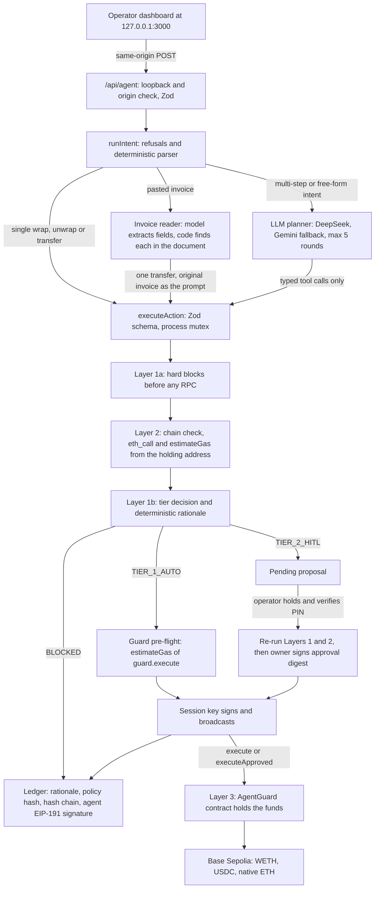

# 01 — Technical documentation

AegisWallet is an agent wallet on Base Sepolia (chain 84532). A language model, or a deterministic parser, turns an operator's instruction into a typed proposal. Deterministic code then decides whether the proposal executes autonomously, waits for a human, or is refused. This document explains how an instruction does or does not become a signed transaction. It also covers the on-chain AgentGuard contract, the audit ledger and deployment. The security analysis is in [05 — Security self-assessment](05_SECURITY_SELF_ASSESSMENT.md). Blockchain terms are explained in the [glossary](#glossary) at the end.

## 1. Design summary

Before value moves, three independent layers must all accept it.

| Layer                    | Runs in                                                 | Enforces                                                                                                                                                                                                                                                                                                                                                                            | Holds against                                                                                                                                           |
| ------------------------ | ------------------------------------------------------- | ----------------------------------------------------------------------------------------------------------------------------------------------------------------------------------------------------------------------------------------------------------------------------------------------------------------------------------------------------------------------------------- | ------------------------------------------------------------------------------------------------------------------------------------------------------- |
| 1. Policy engine         | Server, `src/lib/security/policyEngine.ts`              | Tier decision: whitelist and blacklist, single-transaction and rolling 24-hour USD caps, gas ceiling, prompt-injection heuristics, reserve-runway floor, verification of payee against the vendor book                                                                                                                                                                              | Model error and manipulated instructions. The model proposes; it does not decide.                                                                       |
| 2. Pre-flight simulation | Server to RPC, `simulate()` in `src/lib/agent/tools.ts` | Chain ID 84532; `eth_call` and `estimateGas` of the exact call from the address that holds the funds; ERC-20 transfers must return `true`. A failure is recorded as one sentence: the shortfall when the holder lacks the balance (for example "Insufficient ETH: the wallet holds 0.0008 ETH, this needs 0.001 ETH."), otherwise viem's short message rather than the raw RPC dump | Calls that would revert, wrong network, malformed calldata                                                                                              |
| 3. AgentGuard            | Base Sepolia, `contracts/AgentGuard.sol`                | Session-key expiry, per-asset per-transaction and per-UTC-day caps, target, recipient and selector allowlists, owner-signed approvals                                                                                                                                                                                                                                               | Compromise of the LLM, the agent logic, the off-chain policy, or the session key itself. It does not hold against compromise of the owner key (see 05). |

The planner, the tool executor and the policy gate are separate code paths in one Node process. They are not separately deployed services. All signing happens server-side with viem. The browser never holds a key.

### Components

| Path                               | Role                                                                                                                             |
| ---------------------------------- | -------------------------------------------------------------------------------------------------------------------------------- |
| `src/app/api/agent/route.ts`       | The only API. Loopback host and exact same-origin checks, Zod-validated request bodies                                           |
| `src/lib/agent/runner.ts`          | Intent routing, deterministic demo parser, bounded LLM tool-calling planner                                                      |
| `src/lib/agent/invoice.ts`         | Invoice reading: model extraction with a strict schema, a deterministic fallback parser, and the document check                  |
| `src/lib/agent/tools.ts`           | Typed tools: validation, simulation, policy evaluation, guard pre-flight, reservation, broadcast, approvals                      |
| `src/lib/security/policyEngine.ts` | Pure tier decision and deterministic rationale. No I/O                                                                           |
| `src/lib/security/bytecode.ts`     | Static bytecode heuristics for the address-audit tool. Advisory only; not part of the tier decision                              |
| `src/lib/chain.ts`                 | viem clients, token constants, call encoding, guard call wrapping, owner-approval signing, guard error decoding, portfolio reads |
| `src/lib/store.ts`                 | Atomic JSON persistence, process-wide mutex, ledger sealing and verification                                                     |
| `contracts/AgentGuard.sol`         | On-chain session-key guard                                                                                                       |
| `scripts/`                         | Wallet setup, guard compile, deploy, renew and emergency stop, compromised-key attack demo                                       |
| `data/policy.json`                 | Committed default policy. `data/audit_log.json` (the ledger) is private and git-ignored                                          |

## 2. Architecture

### Account and session management

`src/lib/auth/accountStore.ts` maintains `data/accounts.json` under the existing `exclusive()` mutex. It seeds the default master record from `AGENT_PRIVATE_KEY`, with role `INSTITUTIONAL_ADMIN`, PIN `884210`, and metadata status `HSM_ENV_ISOLATED`. That status denotes environment isolation in this software prototype, not a hardware HSM. The “Pre-Funded” name is a preset; live RPC balances are authoritative.

Provisioning generates a viem keypair, derives a 256-bit key with scrypt from the chosen PIN, a unique account salt and a separately persisted server salt (`data/auth_salt.json`), then encrypts the private key using AES-256-GCM. A fresh 96-bit IV, authentication tag and account identity as additional authenticated data prevent silent ciphertext or identity substitution. A constant-time HMAC verifier checks the PIN without retaining plaintext PINs or derived encryption keys. No private key, verifier or salt is sent to the browser.

Account unlock creates a random 256-bit session token, delivered in an HttpOnly, SameSite=Strict cookie (Secure on HTTPS). The server keeps decrypted keys only in memory for a 30-minute session. The cookie survives a restart to show a locked account chooser rather than silently falling back to master. The no-cookie default is the local master, for judge onboarding. This remains a trusted-loopback demonstration, not a public multi-tenant service.

`auth/context.ts` uses AsyncLocalStorage to bind a request's account key and policy path. Master operations retain the configured AgentGuard. New account requests explicitly use EOA mode; they cannot operate the master's guard. Master policy stays in `data/policy.json`; each new account gets `data/accounts/<id>/policy.json`. Presets set single/daily USD caps to 1/5, 2/10 or 10/50, inheriting other starting policy settings. The API requires the expected account ID on intents, approvals and policy saves, rejecting stale-tab requests after switching.

Pending proposals, audit entries and rolling budgets are account-bound. Historical entries with no account ID belong to the master. The combined audit chain retains one stable master environment signer, so switching a transaction signer does not invalidate earlier seals. The API filters the active account's entries and proposals, while verifying the entire combined chain. The navbar shows the selected account's public address, live balances, key custody mode, and actual guard/EOA session status. Account changes clear the previous conversation and reset the policy form.

Approval and policy mutation perform a fresh, operation-bound PIN check inside `exclusive()`, logging `TIER_2_AUTH_SUCCESS` or `TIER_2_AUTH_FAILED`. A PIN is not a reusable approval grant. Five failures trigger a persistent five-minute lockout. Approval then revalidates the stored proposal with fresh policy, simulation and, where configured, the on-chain guard. UI cancellation sends no mutation.

### Optional onboarding gas

`autoDrip` uses a server-only `fund_account` action through `executeAction`; it does not directly sign. It atomically consumes a provisioned destination's one-time drip eligibility, requires exactly 0.0003 native ETH, and checks the master EOA has strictly more than 0.002 ETH using bigint base units. No retry is allowed after a crash or uncertain send. The transaction uses the master EOA's gas reserve, rather than withdrawing from AgentGuard.

The deterministic policy recognizes only the reserved onboarding recipient for this exact capability. All hard checks, single/daily spend limits, human-confirmation setting and reserve-runway floor still apply. If it would require Tier 2, onboarding is blocked instead of auto-approving or changing a whitelist. Reservation, returned hash and receipt follow the existing `BROADCASTING → SUBMITTED → CONFIRMED/REVERTED` ledger sequence. Account metadata displays skips, blocks and unresolved outcomes without a success claim. Funding hash and transaction evidence live on the master's account audit trail; the new account's banner links to the same returned hash.



When `GUARD_ADDRESS` is not set, the wallet runs in EOA mode. Funds stay in the agent EOA, calls are sent directly, and Layer 3 is absent. The dashboard shows which mode is active. The rest of this document assumes guard mode unless stated otherwise.

## 3. From intent to transaction

### 3.1 Intent routing (`runIntent`)

The router applies these rules in order. The first match wins.

1. **Injection language with an address.** The prompt matches the shared adversarial pattern (`ignore all|previous`, `override`, `system prompt`, `developer mode`, `drain wallet`) and contains a full address. The router sends a transfer proposal to the policy engine with the amount stated in the prompt, or `0` if there is none, so that the block is evaluated and recorded. The policy engine blocks it unless the recipient is whitelisted. A whitelisted recipient still goes through the normal tiers. Nothing is invented: a missing amount stays `0`, which is always blocked.
2. **Injection language asking for the whole balance, with no address.** Refused with an error. Nothing is signed.
3. **Swap, yield, staking or bridging wording.** Refused before any parsing. So is a USDC–ETH conversion worded without "swap" ("convert my USDC to ETH", "sell USDC for ETH"); ETH to WETH stays a 1:1 wrap. Neither the deterministic parser nor the planner can reinterpret such a request as a transfer.
4. **A pasted invoice.** The text contains "invoice" (or 发票) and at least one labelled field such as `From:`, `Total due:` or `Pay to:`. It goes to the invoice reader (section 3.4). Rule 1 runs first, so an invoice that carries instructions for the agent is blocked before any model reads it.
5. **One amount and token, with no multi-step wording.** Handled by the deterministic parser:
   - The amount must be the only number-and-unit in the prompt and written plainly (`1,5 USDC`, `.5 ETH` and `1e3 USDC` do not count), and the verb must not be negated (`don't send`). Otherwise the prompt falls through.
   - `unwrap` requires a WETH amount and produces `unwrap_weth`.
   - `wrap` or `rebalance` requires an ETH amount and produces `wrap_eth`.
   - `send`, `transfer` or `pay` produces `transfer_token` to the address in the prompt, or to `VAULT_ADDRESS` when no address is given.
   - Any other verb falls through, so no transfer is ever inferred.
   - `simulate` or `dry run` in the prompt makes the call a dry run.
6. **`portfolio`, `balance` or `gas`.** A Tier 0 portfolio read.
7. **`audit` with an address.** The bytecode audit tool.
8. **Anything else.** The LLM planner (section 6), if an API key is configured. Otherwise the request is refused with an explanation.

Between rules 1 and 2, a request for keys, PINs, seed phrases, API keys, environment files or the system prompt is refused, whether written in English, in a common translation or in base64. It is never parsed or sent to the LLM provider. No tool can read a secret in any case.

### 3.2 The permission algorithm (`executeAction`)

Every agent write goes through `executeAction`, whether it comes from the parser, the planner, the setup script's evidence steps, the ledger anchor script or an approval. The only code that signs outside it is the two operator scripts, `deploy-guard.ts` and `attack-demo.ts` (sections 9 and 05). The whole function runs inside `exclusive()`, the process-wide mutex. Policy evaluation, reservation and broadcast therefore cannot interleave.

1. **Validate.** The Zod `actionSchema` accepts:
   - `kind` in `wrap_eth`, `unwrap_weth`, `transfer_token`
   - `token` in `ETH`, `WETH`, `USDC`
   - `amount` as a decimal string with at most 18 fractional digits
   - `recipient` as a valid address
   - `prompt` of at most 4,000 characters

   Reads are not accepted here; they have their own tools. Wrap and unwrap are normalised to the canonical WETH contract and token. The two ledger-anchor kinds are not in `actionSchema` either: they enter only through the operator-only `anchorLedger` (section 5.4), so planner arguments can never select them.

2. **Bind the approval.** On an approval, the pending proposal must still be `AWAITING_HITL_APPROVAL`. Proposals are single-use and bound to an account. A fresh six-digit PIN check is required before approval, and execution uses the stored proposal action.
3. **Value the action.**
   - Reference USD is the amount × $2,500 for ETH and WETH, or × $1 for USDC.
   - Rolling autonomous spend is the sum of Tier 1 operations whose latest status is `BROADCASTING`, `SUBMITTED` or `CONFIRMED` within the last 24 hours. Unresolved broadcasts count. Tier 2 spend was explicitly authorised and is excluded.
4. **Apply hard blocks before any RPC call.**
   - A transfer whose recipient is the WETH or USDC contract is blocked, because tokens sent there are lost.
   - The policy engine then runs with the simulation provisionally marked as passed. It blocks blacklisted recipients, injection language paired with a non-whitelisted recipient, a payee mismatch, and non-positive or non-finite values.
5. **Simulate (Layer 2).**
   - The RPC must report chain ID 84532.
   - `estimateGas` and `eth_call` run on the inner call from the holding address (the guard in guard mode).
   - An ERC-20 transfer must return `true`.
   - The current gas price is read.
   - For `transfer_token`, when a treasury profile is configured, live holdings are read for the runway check.
6. **Decide the tier (Layer 1).** The policy engine runs again with the simulation result, the gas price and the holdings. The checks are listed in the table below.
7. **Guard pre-flight (Layer 3, off-chain mirror).** For a Tier 1 decision in guard mode, `estimateGas` runs on `guard.execute(target, value, data)` from the session key. Any revert is decoded to the contract's error name, for example `On-chain guard rejected: RecipientNotAllowed`, and the decision becomes `BLOCKED`.
8. **Dispose.** The outcome depends on the decision:
   - A dry run is recorded as `DRY_RUN`.
   - `BLOCKED` is recorded as blocked.
   - `TIER_2_HITL` creates a pending proposal and an `AWAITING_HITL_APPROVAL` entry.
   - Only `TIER_1_AUTO`, or a proposal being approved, may reach signing. Anything else is refused.
9. **Broadcast.**
   1. For an approval in guard mode, the owner key signs the approval digest (section 4.4). The guard pre-flight then runs again against `executeApproved` with that signature. A failure at this point is recorded as `BLOCKED` at approval, and nothing is broadcast.
   2. A `BROADCASTING` entry with a fresh `operationId` is persisted. This reserves the spend.
   3. The transaction is sent. The hash is persisted as `SUBMITTED` before the receipt is awaited, with a 60-second timeout.
   4. The receipt status is recorded as `CONFIRMED` or `REVERTED`.
   5. On any exception the reservation stays in place, and the error tells the operator to inspect the wallet. Nothing is retried automatically.

#### Policy evaluation order (`evaluateTransactionPolicy`)

| Order | Check                                                                                                                                                                                                                | Outcome                                                                                        |
| ----- | -------------------------------------------------------------------------------------------------------------------------------------------------------------------------------------------------------------------- | ---------------------------------------------------------------------------------------------- |
| 1     | Recipient is on the blacklist                                                                                                                                                                                        | `BLOCKED`                                                                                      |
| 2     | Prompt matches the adversarial pattern and the recipient is not whitelisted                                                                                                                                          | `BLOCKED`                                                                                      |
| 3     | `kind` is `read`                                                                                                                                                                                                     | `TIER_0`. This branch is reached only by direct callers; `executeAction` does not accept reads |
| 4     | A transfer whose stored prompt names a vendor in the vendor book, paid to an address that is not that vendor's (verification of payee, section 3.4)                                                                  | `BLOCKED`, naming both addresses and flagging a lookalike                                      |
| 5     | USD value is not finite or is ≤ 0                                                                                                                                                                                    | `BLOCKED`                                                                                      |
| 6     | Simulation failed                                                                                                                                                                                                    | `BLOCKED`                                                                                      |
| 7     | Gas price is non-finite or above `maxGasGwei`                                                                                                                                                                        | `BLOCKED`                                                                                      |
| 8     | Soft reasons, collected together: recipient not whitelisted; value above the single-transaction cap; rolling spend plus value above the 24-hour cap; runway after the transfer below the floor; "always ask" enabled | Any reason gives `TIER_2_HITL` (risk 65). No reason gives `TIER_1_AUTO` (risk 10)              |

Hard blocks (rows 1, 2, 4, 5, 6 and 7) cannot be overridden by approval. Approval re-runs the whole algorithm against the current policy and a fresh simulation. When the recipient is a vendor-book address, the row 8 reason reads "Verified payee <name>, not whitelisted for autonomous payment" instead of "Recipient is not whitelisted", and the rationale names the payee.

A ledger anchor leaves this table after row 2 and takes its own fixed branch (section 5.4). It is `TIER_1_AUTO` or `BLOCKED`, never `TIER_2_HITL`, so "always ask" does not hold it.

**Reserve-runway floor.** For `transfer_token` and `fund_account` (a wrap does not leave the wallet), the engine computes:

```
runway months = (fiatReserveUsd + on-chain holdings USD − transfer USD) / monthlyExpensesUsd
```

If the result is below `minRunwayMonths`, the transfer needs a human. The fiat figures are an operator-entered profile in `data/policy.json`, not a live bank feed. On-chain holdings are the holder's ETH and WETH at the reference price plus USDC. The runway is shown truncated, never rounded up, to one decimal.

#### Committed default policy (`data/policy.json`)

| Setting                           | Value                                                                                      |
| --------------------------------- | ------------------------------------------------------------------------------------------ |
| Single-transaction cap (Tier 1)   | $20                                                                                        |
| Rolling 24-hour autonomous budget | $50                                                                                        |
| Gas price ceiling                 | 25 gwei                                                                                    |
| Whitelist                         | WETH (the wrap and unwrap target), the demo vault address                                  |
| Blacklist                         | `0x000000000000000000000000000000000000dead`, `0xBadC0de000000000000000000000000000000000` |
| Always ask before signing         | off                                                                                        |
| Treasury profile                  | $8,990 fiat reserve, $3,000 monthly expenses, 3-month floor                                |
| Vendor book                       | Two fictional demo vendors, Northwind Cloud Ltd and Lumen Data Services (section 3.4)      |

`pnpm setup-wallets` appends the operator's own vault address to the whitelist. In Guardrails & Policy, the operator can edit the caps, gas ceiling, whitelist, blacklist, vendor book and "always ask" switch. A vendor-book entry needs a name with at least three identifying characters and an address that passes strict EIP-55 checksum validation. Every save requires a fresh account PIN; the API validates address syntax and bounds every value. Each saved change is recorded as a sealed `POLICY_UPDATE` ledger entry carrying the old and new policy hashes. Blacklist precedence remains a hard block. The Portfolio & Runway calculator previews a treasury profile locally without saving it; persist that profile in the account's policy file. The policy file is read on every request.

### 3.3 Deterministic rationale

Every ledger entry carries a one-sentence rationale built by `explainDecision` from the same inputs the decision used. It is a template filled with numbers, never model output. Its shape by tier:

- Tier 1: `TIER_1_AUTO: wrap 0.001 ETH (~$2.50). Within $20 single-transaction cap; $… of $50 rolling 24h autonomous budget used. Pre-flight simulation passed.`
- Tier 2: `TIER_2_HITL: transfer … Held for human approval: <reasons>. Pre-flight simulation passed.`
- Blocked: `BLOCKED: … Blocked: <reason>. Nothing was signed.`

When the planner finishes, its closing message is model text. It is shown in the activity feed and is never written to the ledger.

### 3.4 Invoice payments and verification of payee

Accounts payable is a job finance teams do by hand: read the invoice, key the payee and amount into a payment, and check that the payee is who the invoice claims. The commonest large payment fraud targets that last step: an invoice, often a real-looking one from a known supplier, announces "our bank details have changed". Banks answer it with a payee-name check before any transfer: Confirmation of Payee in the UK, and Verification of Payee, mandatory in the euro area since 9 October 2025 under Regulation (EU) 2024/886. AegisWallet applies the same check to an agent.

The Intent Studio's **Pay an invoice** inbox sends the invoice text as an ordinary intent, and the router hands it to `payInvoice` in `runner.ts`:

1. **Read.** The configured model (section 6) extracts six fields: vendor, invoice number, due date, total, currency (USDC, ETH or WETH) and the pay-to address. The system prompt marks the invoice as untrusted data. Gemini and OpenAI answer under a strict JSON schema; DeepSeek, which rejects `json_schema`, answers in JSON-object mode. Every reply must pass the Zod `invoiceSchema`. If no model is configured, or none returns usable fields, the deterministic parser reads the labelled lines (`From:`, `Total due:`, `Pay to:`, `Due date:`) instead. The reader's name is shown with the result, for example "Gemini (gemini-3.5-flash-lite)" or "Deterministic parser".
2. **Check against the document.** `ungroundedField` requires the pay-to address to appear in the invoice text, the amount and currency to appear together as a cleanly written number (`1,5 USDC` and `.5 ETH` never match), and the vendor name to appear in the text. A field that is not in the document is refused before anything else runs: a model may misread, but it may not add. The invoice number and due date are shown only when the document contains them.
3. **Checksum.** The address is taken exactly as the document writes it. A mixed-case address whose EIP-55 checksum fails is refused, because one altered character is a sign of tampering.
4. **Execute.** One `transfer_token` action goes through `executeAction`, with the original invoice text as the stored prompt. The model's output becomes only the amount, token and recipient, exactly as any planner tool call would.

**The payee check** (`verifyPayee` in `policyEngine.ts`, row 4 above) uses the policy's `payees` list, the vendor book. Names are compared on their identifying words: case, punctuation and legal forms such as Ltd, Limited, Inc or GmbH are ignored, and a name must match as whole words ("Northwind Cloudburst" is not "Northwind Cloud"). If the stored prompt names a registered vendor, the recipient must be that vendor's registered address, or the transfer is blocked. The reason names both full addresses; it does not shorten them, because a lookalike is built to survive shortening. When the recipient shares the registered address's first four and last four hex characters, the reason also calls it a lookalike, the address-poisoning pattern. The check reads the operator's stored prompt and never the model's output, so a misled model cannot talk its way past it. It applies only to `transfer_token`, and it can only make a decision stricter. A test checks that no combination of prompt, recipient and policy gets a looser tier with the vendor book than without it.

A vendor that matches but is not whitelisted is still a Tier 2 payment: the agent prepares it and a human approves it, the maker-checker control. In guard mode the approval becomes an owner signature that AgentGuard verifies (section 4.4). Changing a vendor's address is a vendor-book edit, which requires the operator PIN and is recorded as a `POLICY_UPDATE` with old and new policy hashes. An invoice cannot change it.

The demo vendors are fictional. Each address is the last 20 bytes of `keccak256("AegisWallet demo vendor: <name>")`, so anyone can recompute it and no one holds its key:

| Vendor              | Registered address                           |
| ------------------- | -------------------------------------------- |
| Northwind Cloud Ltd | `0x48dEA0E20183257aaCf0784385C92d56DD2a5Bd5` |
| Lumen Data Services | `0x88DFB817871BC015C3F576aD2e7b6caEc16b53B6` |

The inbox holds three sample invoices, each labelled with its intended outcome (live policy still decides). The genuine Northwind invoice is held for approval with a verified payee. The "our wallet has changed" Northwind invoice pays `0x48dea051c4Ca3BfC062FAcB98F33F206362a5Bd5`, which copies the first six and last six characters of Northwind's address; it is blocked as a payee mismatch. The Lumen invoice hides an instruction for the agent in an HTML comment; it is blocked by rule 1 of section 3.1 before any model reads it. The operator can edit the text before sending, and exactly the edited text is what the agent reads.

## 4. AgentGuard contract specification

`contracts/AgentGuard.sol` is compiled with solc 0.8.37, optimiser on (200 runs), target EVM `cancun`. It is a minimal guarded account. The contract holds the funds. The agent holds only an expiring session key, which can make a small set of call shapes within per-asset limits. Anything else needs the owner's signature.

**It is not an ERC-4337 account.** There is no EntryPoint, bundler or paymaster. The session key is an ordinary EOA that submits transactions and pays its own gas. The contract is not upgradeable, has no `delegatecall`, and has an immutable owner.

### 4.1 State

| Field                         | Meaning                                                                               |
| ----------------------------- | ------------------------------------------------------------------------------------- |
| `owner` (immutable)           | The only key that can authorise anything outside the session policy                   |
| `sessionKey`, `sessionExpiry` | The agent EOA and the Unix time after which `execute` reverts                         |
| `allowedTarget[address]`      | Contracts the session key may call with calldata                                      |
| `allowedRecipient[address]`   | Addresses that may receive native ETH or tokens via `transfer`                        |
| `limits[asset]`               | `perTx`, `perDay`, `spent`, `day` per asset. Native ETH is tracked under `address(0)` |
| `usedNonce[uint256]`          | Owner-approval nonces already consumed                                                |

### 4.2 Functions

| Function                                                               | Caller                        | Behaviour                                                                                                                                                                                                                                                                                                        |
| ---------------------------------------------------------------------- | ----------------------------- | ---------------------------------------------------------------------------------------------------------------------------------------------------------------------------------------------------------------------------------------------------------------------------------------------------------------- |
| `execute(target, value, data)`                                         | Session key                   | Reverts if the session has expired. Enforces the call policy (4.3), books the spend, makes the call, and checks a `transfer` return value. Emits `Executed(..., ownerApproved = false)`                                                                                                                          |
| `executeApproved(target, value, data, nonce, deadline, signature)`     | Session key                   | Requires `block.timestamp ≤ deadline`, an unused nonce and an owner signature over `approvalDigest`. Marks the nonce used, then makes the call. Session limits do not apply, because the owner's signature is the authority. Works with an expired session, which is how an owner-signed `setSession` renews one |
| `approvalDigest(target, value, data, nonce, deadline)`                 | View                          | `keccak256(abi.encode(chainid, address(this), target, value, keccak256(data), nonce, deadline))`                                                                                                                                                                                                                 |
| `ownerExecute(target, value, data)`                                    | Owner                         | Arbitrary call, sent and paid for by the owner directly                                                                                                                                                                                                                                                          |
| `setSession`, `revokeSession`, `setTarget`, `setRecipient`, `setLimit` | Owner, or the contract itself | Administration. "Itself" lets the session key relay an owner-signed admin call through `executeApproved` with `target = address(this)`                                                                                                                                                                           |
| `remaining(asset)`                                                     | View                          | What the session key may still spend of `asset` in the current UTC day                                                                                                                                                                                                                                           |

### 4.3 Session-key call policy (`execute`)

| Call shape                                                           | Requirements                                                                                              | Spend booked against                          |
| -------------------------------------------------------------------- | --------------------------------------------------------------------------------------------------------- | --------------------------------------------- |
| Empty calldata (native ETH send)                                     | `target` is an allowed recipient                                                                          | ETH (`address(0)`), `value`                   |
| `transfer(to, amount)` (`0xa9059cbb`)                                | `target` is an allowed target with a configured limit, `value == 0`, decoded `to` is an allowed recipient | That token, `amount`                          |
| `deposit()` (`0xd0e30db0`)                                           | `target` is an allowed target                                                                             | ETH, `value`                                  |
| `withdraw(uint256)` (`0x2e1a7d4d`)                                   | `target` is an allowed target, `value == 0`                                                               | Nothing (unwrapping returns ETH to the guard) |
| Any other selector, including `approve`, `transferFrom` and `permit` | —                                                                                                         | Reverts `SelectorNotAllowed`                  |

Calldata shorter than four bytes maps to selector zero and is rejected. The guard is not an allowed target of itself, so the session key cannot reach the admin functions through `execute`.

**Limits.** `_spend` reverts with `PerTxLimitExceeded` when `amount > perTx`. It reverts with `DailyLimitExceeded` when the day's running total would exceed `perDay`. The day is `block.timestamp / 1 days`, a UTC calendar day, and the counter resets lazily on the first spend of a new day. The spend is booked before the external call (checks-effects-interactions). A reverted call reverts the booking with it.

### 4.4 Owner approvals (Tier 2 in guard mode)

1. The operator approves a pending proposal in the dashboard.
2. The server re-runs Layers 1 and 2, then calls `signOwnerApproval` (`src/lib/chain.ts`):
   1. It checks that the guard's on-chain `owner` equals the address of `VAULT_PRIVATE_KEY`.
   2. It draws a random 256-bit nonce and sets `deadline = now + 600 s`.
   3. It reads `approvalDigest` from the contract and recomputes it locally. It refuses to sign if the two differ, so the RPC is never trusted with what the owner signs.
   4. It signs the digest as an EIP-191 personal message.
3. The session key submits `executeApproved`. The contract recovers the signer with `ecrecover`. It rejects signatures that are not 65 bytes, high-`s` (malleable) signatures, `v` other than 27 or 28, and a zero recovered address. The signer must equal `owner`.

Replay protection: the digest binds chain ID, guard address, target, value, calldata hash, nonce and deadline. Each nonce can be used once. Only the current session key can submit, so `revokeSession` also blocks any signature not yet submitted. A restore with `setSession` before that signature's 10-minute deadline makes it valid again.

### 4.5 Errors and events

Errors: `NotSessionKey`, `NotOwner`, `SessionExpired`, `TargetNotAllowed`, `RecipientNotAllowed`, `SelectorNotAllowed`, `ValueNotAllowed`, `PerTxLimitExceeded`, `DailyLimitExceeded`, `BadSignature`, `ApprovalExpired`, `NonceUsed`, `TokenTransferFailed`, `CallFailed(bytes)`, `LengthMismatch`. The server decodes these, and an inner `CallFailed` reason, into readable messages through `decodeGuardError`.

Events: `Executed(target, value, selector, ownerApproved)`, `SessionSet(sessionKey, expiry)`, `LimitSet(asset, perTx, perDay)`. `setTarget` and `setRecipient` emit no event.

### 4.6 Deployed configuration (`scripts/deploy-guard.ts`)

| Parameter          | Value                                          |
| ------------------ | ---------------------------------------------- |
| Owner              | Address of `VAULT_PRIVATE_KEY`                 |
| Session key        | The agent EOA (`AGENT_PRIVATE_KEY`)            |
| Session expiry     | Deployment time + `SESSION_HOURS` (default 24) |
| Allowed targets    | WETH, USDC                                     |
| Allowed recipients | `VAULT_ADDRESS` only                           |
| ETH limit          | 0.01 per transaction, 0.02 per UTC day         |
| WETH limit         | 0.01 per transaction, 0.02 per UTC day         |
| USDC limit         | 20 per transaction, 50 per UTC day             |

The on-chain limits are a backstop, not a mirror of Layer 1. They are per asset, in token units, while the off-chain caps are in reference USD across all assets.

## 5. Explainable, tamper-evident ledger

### 5.1 Entries

`data/audit_log.json` holds `logs`, the append-only entry list, and `pending`, the Tier 2 proposals.

| Field                                                                                  | Content                                                                                                                                                                                                                                                          |
| -------------------------------------------------------------------------------------- | ---------------------------------------------------------------------------------------------------------------------------------------------------------------------------------------------------------------------------------------------------------------- |
| `id`, `timestamp`                                                                      | Assigned when the entry is appended                                                                                                                                                                                                                              |
| `operationId`                                                                          | Shared by the `BROADCASTING`, `SUBMITTED` and `CONFIRMED`/`REVERTED` entries of one broadcast                                                                                                                                                                    |
| `intent`                                                                               | The operator's original prompt, never model arguments                                                                                                                                                                                                            |
| `tier`, `status`, `reasons`, `riskScore`, `usd`, `simulation`, `gasEstimate`, `txHash` | The decision, its inputs and the outcome                                                                                                                                                                                                                         |
| `rationale`                                                                            | The deterministic sentence from section 3.3, or a fixed sentence for reads, rejections, policy changes and operator setup steps                                                                                                                                  |
| `policyHash`                                                                           | keccak256 of the canonical JSON of the policy in force. Present on every entry written by `executeAction`, and on `POLICY_UPDATE` entries (which also list the previous hash). Tier 0 reads, operator rejections, setup steps and attack-demo entries carry none |
| `prevHash`, `hash`                                                                     | Hash chain                                                                                                                                                                                                                                                       |
| `signature`, `signer`                                                                  | EIP-191 signature over `hash` by the agent key, and the signing address                                                                                                                                                                                          |

A status change never edits an entry. A new entry is appended, any seal copied from the previous entry is stripped, and the fields are deep-copied so that later in-memory changes cannot alter an entry that is already sealed.

### 5.2 Sealing (`saveLedger`)

Before each write, every unsealed entry is sealed in order:

1. `prevHash` is set to the previous entry's `hash`, or 32 zero bytes for the first entry.
2. `hash` is keccak256 of the entry serialised as canonical JSON (keys sorted at every depth), excluding `hash`, `signature` and `signer`. Because `prevHash` is inside the hashed body, each entry commits to the whole history before it.
3. The agent key signs `hash` as an EIP-191 personal message, and `signature` and `signer` are stored. If no agent key is configured, the entry is hash-chained but unsigned.

The file is then replaced atomically: written to a temporary file, then renamed.

### 5.3 Verification (`verifyLedger`)

Every dashboard refresh (`GET /api/agent`) re-verifies the whole chain. Execution Evidence shows "Ledger verified · N sealed", or the first broken entry and the reason. For each entry in order:

1. It must be sealed, and its `prevHash` must equal the previous entry's `hash`.
2. Recomputing the hash must reproduce `hash`.
3. The signature must recover to the recorded `signer`.
4. The `signer` must be the currently configured agent key.
5. When an agent key is configured, an unsigned entry fails as stripped or forged. Without an agent key, unsigned entries are accepted only before the first signed entry.

Boundaries of this guarantee:

- **Pending proposals are not in the chain.** The creation of each proposal is a sealed `AWAITING_HITL_APPROVAL` entry, but the mutable proposal records in `pending` are not hashed.
- **Rotating the agent key breaks verification of earlier history.** This is by design: entries signed by any key other than the configured agent key fail.
- **The seal does not protect against the key holder.** It makes edits by anyone without the agent key detectable. Whoever holds the agent key can rewrite and re-seal the history, and removing the newest entries leaves a valid shorter chain. The EAS anchor (section 5.4) closes this gap for history up to the last anchor. Entries newer than the last anchor are still unanchored.

### 5.4 External anchor on EAS (`pnpm ledger:anchor`)

An operator step attests the ledger head on the Ethereum Attestation Service, using the Base Sepolia predeploys (EAS v1.2.0): EAS at `0x4200000000000000000000000000000000000021` and the SchemaRegistry at `0x4200000000000000000000000000000000000020`.

- **Schema.** `bytes32 ledgerHead,uint64 entryCount,bytes32 policyHash`, with no resolver and not revocable. Its UID is fixed: `keccak256(abi.encodePacked(schema, resolver, revocable))` = `0x27a1aeb47c1be07b5f370719d1f7c31e00258cafdc56658c700395cc543f3d44`. The script reads `getSchema` and registers the schema only if it is missing.
- **Data.** `ledgerHead` is the hash of the last sealed entry, `entryCount` the number of entries it covers, and `policyHash` the current policy hash. All three come from the ledger loaded inside `exclusive()`, after `verifyLedger` passes; a broken chain is never anchored. Any `anchor` field in the input is stripped by Zod. Neither the prompt nor the model can supply it.
- **Path.** `anchorLedger` builds the fixed action and calls `executeAction`, so the chain check, simulation, policy, reservation, hash-before-receipt and no-retry rules all apply. The planner has no anchor tool.
- **Policy.** The engine decodes the calldata that will be signed. It returns `TIER_1_AUTO` only when the call value and the attestation request value are 0, the target is the EAS predeploy (or the SchemaRegistry for registration), the schema UID is ours, simulation passed and gas is under the ceiling. Anything else is `BLOCKED`.
- **Guard mode.** AgentGuard's target allowlist excludes EAS, so `guard.execute` would revert. An anchor is therefore sent and simulated directly from the agent EOA, with no guard pre-flight. It cannot move funds; it spends only the EOA's gas ETH.
- **Record.** The usual `BROADCASTING` → `SUBMITTED` → `CONFIRMED` entries (intent `LEDGER_ANCHOR`, or `LEDGER_ANCHOR_SCHEMA` for registration). The rationale names the anchored head and count. Once the receipt is mined, the final entry adds `EAS attestation UID <uid>` from the `Attested` event. While an earlier anchor is still `BROADCASTING` or `SUBMITTED` (for up to 24 hours), a new one is refused.
- **Checking.** Open the attestation on `https://base-sepolia.easscan.org`. Its `ledgerHead` must equal the `hash` of entry number `entryCount` in the exported ledger. `verifyLedger` does not read EAS automatically. Judge proof can read an explicitly selected EAS UID and compare the full ledger prefix; filtered account exports cannot prove that prefix.

## 6. LLM planner

| Aspect                   | Implementation                                                                                                                                                                                                                                                                                                                                                                                                                                                                                                                                                                                                                                                                                                                                                                                                                                                                                                |
| ------------------------ | ------------------------------------------------------------------------------------------------------------------------------------------------------------------------------------------------------------------------------------------------------------------------------------------------------------------------------------------------------------------------------------------------------------------------------------------------------------------------------------------------------------------------------------------------------------------------------------------------------------------------------------------------------------------------------------------------------------------------------------------------------------------------------------------------------------------------------------------------------------------------------------------------------------- |
| Provider                 | DeepSeek chat completions (`api.deepseek.com/chat/completions`), model `DEEPSEEK_MODEL`, default `deepseek-flash` (DeepSeek-V4.1-Flash). Fallbacks, each used only when its key is set: Gemini through its OpenAI-compatible endpoint (`generativelanguage.googleapis.com/v1beta/openai/chat/completions`, `GEMINI_MODEL`, default `gemini-3.5-flash-lite`), then OpenAI (`OPENAI_MODEL`, default `gpt-4.1-mini`). The next provider is tried only when a request fails (network error, timeout, non-2xx status or no message), and only in the first round. From then on the plan stays with the provider that answered, so no model continues another's tool calls and tool results reach one provider only. The invoice reader tries the same providers in the same order. DeepSeek reads in JSON-object mode because it rejects `json_schema`. The Zod schema and the document check apply to every reply |
| Tools                    | `get_wallet_portfolio`, `execute_token_transfer`, `simulate_transaction`, `audit_contract_address`, `execute_eth_weth_rebalance`. Each maps to a function in `tools.ts`, and every write goes through `executeAction`                                                                                                                                                                                                                                                                                                                                                                                                                                                                                                                                                                                                                                                                                         |
| Bounds                   | At most 5 model rounds and 4 tool calls per request. Tool calls are serial (`parallel_tool_calls: false`). The plan stops at the first Tier 2 hold, the first block, or the first broadcast, so the model never gets a chance to resubmit a transaction                                                                                                                                                                                                                                                                                                                                                                                                                                                                                                                                                                                                                                                       |
| What the model cannot do | Sign anything; approve a pending proposal (approval exists only as an operator API call); trigger a ledger anchor (an operator script only); call an untyped function; replace the stored prompt (the server overwrites `prompt` in every tool call with the operator's original text); bypass refusals for swaps, yield, staking or bridging, which are applied before the planner runs                                                                                                                                                                                                                                                                                                                                                                                                                                                                                                                      |
| Without an LLM           | The demo scenarios, single wraps and transfers, portfolio reads and audits all run through the deterministic parser with no API key                                                                                                                                                                                                                                                                                                                                                                                                                                                                                                                                                                                                                                                                                                                                                                           |

The five dashboard scenarios use the deterministic parser. The planner is needed only for multi-step or free-form requests. The vault scenario selects an available asset using bigint base units: 1 USDC, otherwise 0.0001 WETH, otherwise 0.0001 ETH with a positive gas remainder, otherwise the remaining partial USDC. An unavailable or untrusted vault disables that scenario. This is a proposal convenience, not a policy exception.

### Operator console and execution progress

The dashboard occupies one viewport. GodUI Sidebar selects Command Center (portfolio, allocation, pending approvals and the latest five audit events), Portfolio & Runway, Guardrails & Policy, or Execution Evidence. The center view and permanent right Intent Studio scroll independently beneath the account header and compact live telemetry. The copilot can expand to 640px; below 1024px it opens in a GodUI Sheet. `/agent` redirects to `/`. The conversation and draft survive center-view switches; Clear Thread removes only client conversation state. Evidence filters change the displayed rows, while Export includes the selected account's full history.

GodUI Lab Bento Grid/Card compose the center panels, Breadcrumbs tracks the selected view, and Agent Timeline/Step presents recent events and execution progress with collapsible details. Evidence uses Lab Filter Bar: selections within tier, status or pre-flight facets are combined with OR, while different facets and text search are combined with AND. No filter changes stored audit entries. The Number Ticker starts at the actual returned reference portfolio value. GodUI Radio Group supplies keyboard-accessible risk preset selection during provisioning.

Intent and approval requests can negotiate `application/x-ndjson`. The same local-origin, account, PIN and execution boundaries apply to streamed and JSON requests. An AsyncLocalStorage observer reports actual policy decisions, EVM simulation, durable broadcast submission and receipt outcomes from the execution path. Read-only tools report a Tier 0 check without inventing simulation or broadcast events. A hash is emitted only after the returned hash is persisted. Observer failures and client disconnects do not interrupt a reserved transaction; the audit ledger remains authoritative. The client never automatically retries an interrupted stream and directs the operator to Evidence if no final result arrives.

## 7. Integrations and addresses

| Item       | Value                                                                                                                                                                                                                                |
| ---------- | ------------------------------------------------------------------------------------------------------------------------------------------------------------------------------------------------------------------------------------ |
| Network    | Base Sepolia, chain ID 84532                                                                                                                                                                                                         |
| RPC        | `BASE_SEPOLIA_RPC_URL`, default `https://sepolia.base.org` (15 s timeout, one retry)                                                                                                                                                 |
| Explorer   | `https://sepolia.basescan.org`                                                                                                                                                                                                       |
| WETH       | `0x4200000000000000000000000000000000000006`, 18 decimals. `deposit`, `withdraw`, `transfer`, `balanceOf`                                                                                                                            |
| USDC       | `0x036CbD53842c5426634e7929541eC2318f3dCF7e`, 6 decimals. `transfer`, `balanceOf`                                                                                                                                                    |
| Native ETH | Value transfer with empty calldata                                                                                                                                                                                                   |
| EAS        | v1.2.0 predeploys: EAS `0x4200000000000000000000000000000000000021` (`attest`) and SchemaRegistry `0x4200000000000000000000000000000000000020` (`register`, `getSchema`). Used only by the operator's ledger anchor (section 5.4)    |
| AgentGuard | Deployed per operator. The address is written to `GUARD_ADDRESS` in `.env.local` and linked from the dashboard. Deployment and transaction hashes: see the Deliverable 06 evidence export (`data/audit_log.json` → dashboard Export) |
| Valuation  | Fixed reference prices: ETH = WETH = $2,500, USDC = $1. Not an oracle                                                                                                                                                                |

The only other contract calls are the two fixed, zero-value EAS calls of the operator's ledger anchor (section 5.4): `SchemaRegistry.register` once, and `EAS.attest`. There are no token approvals, no swaps and no yield integrations. A target-ratio "rebalance" between ETH and WETH uses canonical 1:1 wrapping and carries no slippage.

## 8. Storage, concurrency and the API boundary

- **Storage.** `data/policy.json` and `data/audit_log.json` are written atomically (temp file and rename, mode 0600).
- **Concurrency.** A promise-chain mutex stored on `globalThis` serialises every ledger and policy write, and it survives development hot reloads. This is correct for exactly one Node process. Horizontal scaling would need a transactional database and distributed nonce management.
- **API.** `GET` and `POST /api/agent` accept only a loopback host (`localhost`, `127.0.0.1`, `[::1]`). `POST` also requires an `Origin` header exactly equal to the request's own origin. Bodies are a Zod discriminated union. Execution operations include `intent` (≤ 4,000 characters), `approval` (proposal UUID and a boolean) and `policy` (bounded numbers, at most 100 whitelisted addresses and 50 vendor-book entries). Account create/switch, treasury preview/execute, read-only policy comparison and evidence verification are also schema-validated and account-bound; read-only operations never enter the execution stream.
- **Dev server.** `pnpm dev` and `pnpm start` bind to `127.0.0.1`.

## 9. Deployment

Prerequisites: a current Node.js release (developed on Node 24) and pnpm 11 (pinned in `packageManager`).

```powershell
pnpm install --frozen-lockfile
pnpm setup-wallets     # creates .env.local (agent key, vault key and address) without printing keys
# Fund the printed agent address with Base Sepolia ETH and USDC.
pnpm setup-wallets     # optional: once funded, runs two small evidence transactions, each attempted once
pnpm guard:compile     # rebuilds src/lib/guard/AgentGuard.json from contracts/AgentGuard.sol
pnpm guard:deploy      # deploys AgentGuard, writes GUARD_ADDRESS, moves funds into the guard
pnpm ledger:anchor     # optional: attests the ledger head on EAS (--dry-run to only simulate)
pnpm dev               # http://127.0.0.1:3000
```

- **`pnpm setup-wallets`.**
  - Generates `AGENT_PRIVATE_KEY` if it is missing.
  - If `VAULT_ADDRESS` is missing, generates a vault key and stores both `VAULT_PRIVATE_KEY` and `VAULT_ADDRESS`.
  - Never replaces an existing vault key, which is the guard's immutable owner. A configured `VAULT_ADDRESS` must match it.
  - Writes `.env.local` with mode 0600 and adds the vault to the whitelist.
  - Once the holder has at least 0.0003 ETH and 0.5 USDC, sends 0.50 USDC to the vault and wraps 0.0002 ETH through `executeAction`. Neither step repeats if it was already attempted.
- **`pnpm guard:compile`** compiles with the pinned `solc` npm package and writes `{ abi, bytecode }`. The artifact is committed, so this step reproduces it from source.
- **`pnpm guard:deploy`.**
  - Checks that the RPC is on chain 84532.
  - Deploys with the configuration in section 4.6 and writes `GUARD_ADDRESS` to `.env.local`.
  - Moves `--eth` ETH (default 0.002) and, unless `--usdc` is given, the agent's whole USDC balance into the guard.
  - Records each step in the ledger as a `SETUP` entry.
  - The agent EOA keeps the rest of its ETH for gas.

  Options:
  - `--fund-only` tops up an existing guard.
  - `--renew` extends the session through an owner-signed `setSession` relayed by the session key.
  - `--revoke` is the emergency stop: the owner calls `revokeSession`, which zeroes the session key, so every later `execute` or `executeApproved` reverts with `NotSessionKey`. The owner EOA sends it when it holds gas; otherwise the session key relays it, owner-signed. After a revoke nothing can be relayed, so `--renew` detects the zero session key and has the owner send `setSession` itself, paying its own gas. Both steps simulate first, refuse on a failed simulation or a key with no gas (naming the address and the ETH it needs), and record a `SETUP` entry.
  - `--force` redeploys; funds in the old guard then need an owner-signed call to recover.

  This is an operator step, so it signs with the agent key directly rather than through `executeAction`. `--revoke`, and `--renew` after a revoke, may sign with the owner key instead.

- **`pnpm ledger:anchor`** registers the anchor schema if `getSchema` shows it missing, then attests the current ledger head (section 5.4). Both go through `executeAction` from the agent EOA. Like the other scripts, it is a second ledger writer, so run it while the dashboard is idle.

- **Restart** `pnpm dev` after changing `.env.local`.

Verification commands: `pnpm test`, `pnpm typecheck`, `pnpm build`, and `pnpm attacks` for the offline attack suite. Two read-only checks need no keys: `pnpm guard:verify` publishes the AgentGuard source to Sourcify (the deployed guard is verified there and on Blockscout), and `pnpm verify:evidence <file>` independently re-checks a ledger or evidence export (hash chain, EIP-191 signatures, and each receipt on Base Sepolia). Live evidence requires a funded wallet. An unfunded checkout produces no transaction hashes, and the dashboard shows none.

## 10. Limitations

The prototype is testnet-only, single-process and single-operator. It values assets at a fixed reference price with floating-point USD arithmetic. The off-chain budget is a rolling 24 hours, while the on-chain limits use UTC calendar days. The owner key sits on the same server as the agent key. The known-risk list and mitigations are in [05](05_SECURITY_SELF_ASSESSMENT.md#3-known-risk-list).

## Glossary

| Term                      | Meaning here                                                                                                                                                                                             |
| ------------------------- | -------------------------------------------------------------------------------------------------------------------------------------------------------------------------------------------------------- |
| Base Sepolia              | Base's public test network (chain ID 84532). Its tokens have no monetary value                                                                                                                           |
| AgentGuard                | Our smart contract. It holds the funds and checks every payment against its own limits on-chain                                                                                                          |
| Session key               | The agent's signing key. It can only ask AgentGuard for small, pre-approved payments, and it expires                                                                                                     |
| Owner key                 | The key that controls AgentGuard (the vault key). Its signature is required for anything outside the session limits, including every Tier 2 approval                                                     |
| Allowlist / whitelist     | The recipients, contracts and call types that are permitted. Anything not listed is refused or sent to a human                                                                                           |
| Vendor book               | The operator's list of suppliers and the one address each may be paid at. An instruction that names a supplier but pays elsewhere is blocked (verification of payee)                                     |
| Address poisoning         | A scam address made to share the first and last characters of a real one, so a quick visual check passes                                                                                                 |
| Function selector         | The first four bytes of a contract call, naming the function. From the session key, AgentGuard accepts only plain ETH sends, `transfer`, `deposit` and `withdraw`, so the agent can never call `approve` |
| Simulation                | A dry run of the exact transaction against the live chain (`eth_call`, `estimateGas`). It predicts success or failure without sending anything                                                           |
| EIP-191 signature         | A standard Ethereum signature over a message. Anyone can check which key signed it                                                                                                                       |
| WETH                      | ETH wrapped as a token. Wrapping and unwrapping convert 1:1, with no price risk                                                                                                                          |
| Hash chain (sealed entry) | Each ledger entry contains the fingerprint of the one before it, so editing any entry breaks every later fingerprint                                                                                     |
| EAS anchor                | A record on the Ethereum Attestation Service, a public on-chain registry. We post the ledger's latest fingerprint there, so history up to that point cannot be quietly rewritten                         |
| ERC-4337                  | The standard for smart-contract wallets with bundlers and paymasters. AgentGuard applies the same session-key idea without that infrastructure                                                           |

## Local execution pause

`executionPaused` is an optional policy flag. The pure gate checks it before every write branch, including onboarding and anchors. Tier 2 approval re-reads policy and cannot override the pause. The dashboard changes the flag through the existing account-bound, PIN-protected policy API inside `exclusive()`, recording the policy hash transition. Read-only tools remain available. This is a local process control, not an on-chain key revocation.

### Reserve-aware treasury workflow

`src/lib/treasury/calculate.ts` derives a vault transfer from a requested maximum, a gas reserve and a selected asset. The integer calculation takes the minimum of the requested USD cap, the stored single-transaction cap, the rolling daily remainder and the reserve/runway surplus. A conservative fee projection uses twice the observed gas price at 300,000 units; it is a projection, not a fee guarantee. Guard custody and session-key gas balances are treated separately. Existing floating-point gate valuations remain a documented limitation.

`previewMandate` checks chain 84532 and returns live facts, constraints and a five-minute quote. Quotes are held in server memory, capped at 200 and invalidated on process restart. `executeMandate` consumes the account-bound quote before awaiting execution. Only the server-stored action reaches `executeAction`. `Proposal.mandate` retains expiry, policy hash and reserve constraints through HITL. Revalidation runs inside `exclusive()` on execution and approval, then normal simulation, reservation and broadcast rules apply. The public operations are `treasury_preview` and `treasury_execute`; neither permits browser-supplied calldata or arbitrary destinations.

### Read-only policy comparison

`comparePolicy` reuses the same `inspect` function as execution. It validates a bounded hypothetical limits object, reads current policy and spend, and simulates the exact transfer from the current holder. It compares both policies with the same context. A current hard block is retained; a hypothetical Tier 1 result also needs the independent AgentGuard pre-flight. Only single/daily USD caps and `requireApproval` may vary; address lists, gas ceiling, payee rules and the pause cannot be supplied as overrides. No ledger write, pending proposal, key operation or reservation occurs. Results are snapshots, not executable quotes.

### Independent evidence and checkpoint verification

The independent verifier core lives in `src/lib/evidence/verify.ts`; `scripts/verify-evidence.ts` is its CLI shell and re-exports the existing API. The core deliberately does not import `store.ts`, signing clients or environment keys. Both CLI and dashboard independently recompute canonical hashes and recover EIP-191 signers. Online mode verifies chain 84532, receipt status, the master sender (or recorded guard owner for setup), and recorded transfer recipients/guard routes. It does not prove business purpose or comprehensively match every calldata argument.

`evidence_verify` accepts JSON text and an explicit expected public signer, never a path or remote URL. Input is bounded to 2 MB text, 1,000 entries and 50 distinct online hashes. Imported contents are not saved; response rows omit prompts and arbitrary fields. The API retains the local-only, same-origin, active-account boundary. Empty evidence cannot pass. Offline results explicitly omit receipt verification; RPC failure never becomes success.

Optional EAS checkpoint verification reads `getAttestation` at the fixed Base Sepolia EAS predeploy. It checks UID, schema, expected attester, non-revocability, revocation/expiry, then decodes the head/count/policy hash. A full ledger must match the anchored hash at exactly the attested count. A shorter ledger fails; a longer ledger reports the unanchored suffix. A filtered account array cannot establish complete prefix coverage even when the head appears in it. The policy hash is displayed as historical checkpoint metadata; it is not asserted equal to today's policy. This is an operator-selected checkpoint, not an automatic query on every refresh. ABI reference: [EAS IEAS](https://github.com/ethereum-attestation-service/eas-contracts/blob/master/contracts/IEAS.sol) and [Common.Attestation](https://github.com/ethereum-attestation-service/eas-contracts/blob/master/contracts/Common.sol).

`judgeReadiness` derives status from returned public configuration and live data. It does not contact model providers or deploy/fund/renew anything. The downloaded judge report is a timestamped snapshot, not a certification or a signed security assessment.

For exports without a deployment record, the verifier accepts an explicit expected public guard address (`--guard` in the CLI). This address is shown as user-supplied trust context; the contract owner is read on-chain. Normal direct EOA transactions are still checked as direct calls. A wrong guard cannot make an unrelated transaction match its recipient or guard route. This supports historical account exports without inventing a missing deployment event.

### Invoice safety and reproducible checks

Invoice payment routing refuses `NEGATED` text before contacting a model. A request containing `simulate` or `dry-run` passes `dryRun=true` into `executeAction`, so the decision is logged as `DRY_RUN` without a proposal or broadcast. The collaborator's invoice regression tests cover both cases. The same boundary applies alongside the what-if lab; unlike a lab comparison, an execution dry run is an auditable ledger event.

The GitHub verification workflow uses Node 24 and the pinned pnpm package manager, installs the frozen dependency graph, then runs tests, TypeScript and a credential-free production build. Repository token permissions are read-only and checkout credentials are not persisted. It does not run operator scripts, call model providers or publish transaction evidence.
