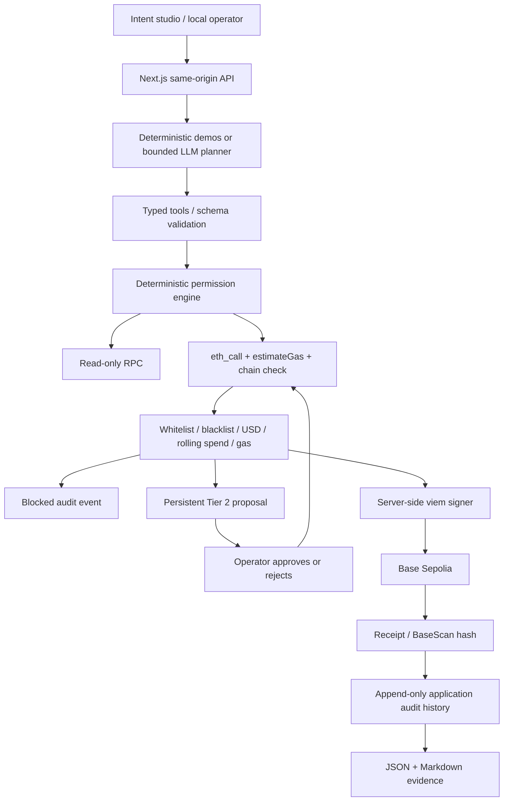

# 01 — Technical documentation

## Architecture

The planner, tool executor and deterministic gate are distinct logical roles, not independently deployed agents. The planner can call portfolio, transaction, address audit and target-ratio rebalance tools in at most five rounds. It stops at policy rejection or approval. The original user prompt is retained by the server and cannot be replaced by model arguments. Explicit demo patterns also work without an API key.

## Permission algorithm

1. Validate tool input with Zod and normalize canonical wrap/unwrap targets.
2. Reject blacklisted recipients and suspicious instructions paired with unverified recipients before RPC execution.
3. Require chain ID 84532; estimate gas and perform `eth_call`. Token transfers must return true.
4. Reject failed simulation, invalid value or excessive gas.
5. Tier 1 requires an approved recipient, value <= $2 and rolling autonomous spend <= $5 by default. Any other valid transfer requires Tier 2 approval. A global confirmation toggle forces Tier 2.
6. Serialize policy evaluation, ledger reservation and broadcast. Include unresolved and submitted Tier 1 reservations in daily spend. Tier 2 spend is explicitly authorized and excluded from the autonomous budget.
7. Persist transaction hash before receipt polling. Record success or revert. Uncertain broadcasts stay reserved and are never blindly retried.

Approval requests are single-use within the serialized critical section. Approval uses the stored action, current policy and a fresh simulation. Current hard blocks and gas ceilings remain binding.

## Integrations

Network: Base Sepolia, chain 84532, default RPC `https://sepolia.base.org`, explorer `https://sepolia.basescan.org`. WETH: `0x4200000000000000000000000000000000000006`, 18 decimals, deposit/withdraw/transfer/balanceOf. USDC: `0x036CbD53842c5426634e7929541eC2318f3dCF7e`, 6 decimals, transfer/balanceOf. ETH transfer uses native value. No arbitrary contract execution, approvals or swaps are exposed.

Portfolio reads ETH/WETH/USDC concurrently and refreshes every 30 seconds in the UI. Ratios and USD values use fixed ETH=$2,500 and USDC=$1 references. Wrapping has no swap slippage. Target-ratio rebalance may fail simulation if insufficient ETH remains for gas; it never silently spends additional assets.

## Storage and operation

`data/policy.json` stores policy. `data/audit_log.json` stores events and pending proposals in one atomic replacement file. A process-global promise mutex serializes writes, including development reloads. The application appends events but the file is not cryptographically immutable or protected against the local operator. Use one process and a persistent local filesystem. Horizontal scaling requires a transactional database and distributed nonce coordination.

The UI shows only actual returned balances and hashes. Setup creates credentials, prints public funding addresses and executes a 0.50 USDC transfer plus a 0.0002 ETH wrap once funded. Export produces Deliverable 06 evidence as JSON and Markdown. Review receipt status as well as transaction hash.
