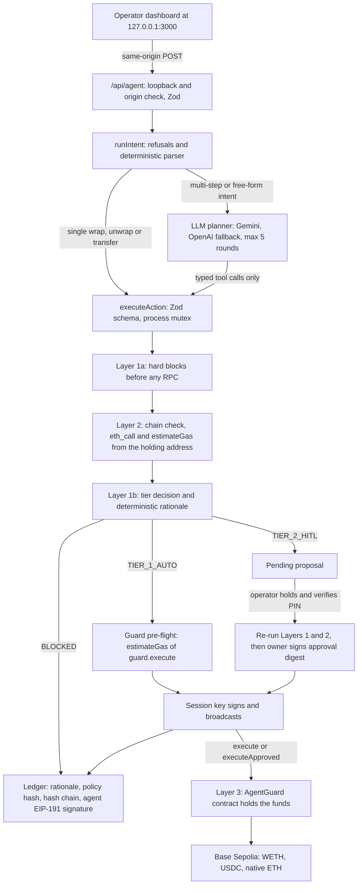

# 01 — Technical documentation

AegisWallet is an agent wallet on Base Sepolia (chain 84532). A language model, or a deterministic parser, turns an operator's instruction into a typed proposal. Deterministic code then decides whether the proposal executes autonomously, waits for a human, or is refused. This document explains how an instruction does or does not become a signed transaction. It also covers the on-chain AgentGuard contract, the audit ledger and deployment. The security analysis is in [05 — Security self-assessment](05_SECURITY_SELF_ASSESSMENT.md).

## 1. Design summary

Before value moves, three independent layers must all accept it.

| Layer                    | Runs in                                                 | Enforces                                                                                                                                                                                                                                                                                                                                                                            | Holds against                                                                                                                                           |
| ------------------------ | ------------------------------------------------------- | ----------------------------------------------------------------------------------------------------------------------------------------------------------------------------------------------------------------------------------------------------------------------------------------------------------------------------------------------------------------------------------- | ------------------------------------------------------------------------------------------------------------------------------------------------------- |
| 1. Policy engine         | Server, `src/lib/security/policyEngine.ts`              | Tier decision: whitelist and blacklist, single-transaction and rolling 24-hour USD caps, gas ceiling, prompt-injection heuristics, reserve-runway floor                                                                                                                                                                                                                             | Model error and manipulated instructions. The model proposes; it does not decide.                                                                       |
| 2. Pre-flight simulation | Server to RPC, `simulate()` in `src/lib/agent/tools.ts` | Chain ID 84532; `eth_call` and `estimateGas` of the exact call from the address that holds the funds; ERC-20 transfers must return `true`. A failure is recorded as one sentence: the shortfall when the holder lacks the balance (for example "Insufficient ETH: the wallet holds 0.0008 ETH, this needs 0.001 ETH."), otherwise viem's short message rather than the raw RPC dump | Calls that would revert, wrong network, malformed calldata                                                                                              |
| 3. AgentGuard            | Base Sepolia, `contracts/AgentGuard.sol`                | Session-key expiry, per-asset per-transaction and per-UTC-day caps, target, recipient and selector allowlists, owner-signed approvals                                                                                                                                                                                                                                               | Compromise of the LLM, the agent logic, the off-chain policy, or the session key itself. It does not hold against compromise of the owner key (see 05). |

The planner, the tool executor and the policy gate are separate code paths in one Node process. They are not separately deployed services. All signing happens server-side with viem. The browser never holds a key.

### Components

| Path                               | Role                                                                                                                             |
| ---------------------------------- | -------------------------------------------------------------------------------------------------------------------------------- |
| `src/app/api/agent/route.ts`       | The only API. Loopback host and exact same-origin checks, Zod-validated request bodies                                           |
| `src/lib/agent/runner.ts`          | Intent routing, deterministic demo parser, bounded LLM tool-calling planner                                                      |
| `src/lib/agent/tools.ts`           | Typed tools: validation, simulation, policy evaluation, guard pre-flight, reservation, broadcast, approvals                      |
| `src/lib/security/policyEngine.ts` | Pure tier decision and deterministic rationale. No I/O                                                                           |
| `src/lib/security/bytecode.ts`     | Static bytecode heuristics for the address-audit tool. Advisory only; not part of the tier decision                              |
| `src/lib/chain.ts`                 | viem clients, token constants, call encoding, guard call wrapping, owner-approval signing, guard error decoding, portfolio reads |
| `src/lib/store.ts`                 | Atomic JSON persistence, process-wide mutex, ledger sealing and verification                                                     |
| `contracts/AgentGuard.sol`         | On-chain session-key guard                                                                                                       |
| `scripts/`                         | Wallet setup, guard compile, deploy, renew and emergency stop, compromised-key attack demo                                       |
| `data/policy.json`                 | Committed default policy. `data/audit_log.json` (the ledger) is private and git-ignored                                          |

## 2. Architecture

### Account and session management

`src/lib/auth/accountStore.ts` maintains `data/accounts.json` under the existing `exclusive()` mutex. It seeds the default master record from `AGENT_PRIVATE_KEY`, with role `INSTITUTIONAL_ADMIN`, PIN `884210`, and metadata status `HSM_ENV_ISOLATED`. That status denotes environment isolation in this software prototype, not a hardware HSM. The “Pre-Funded” name is a preset; live RPC balances are authoritative.

Provisioning generates a viem keypair, derives a 256-bit key with scrypt from the chosen PIN, a unique account salt and a separately persisted server salt (`data/auth_salt.json`), then encrypts the private key using AES-256-GCM. A fresh 96-bit IV, authentication tag and account identity as additional authenticated data prevent silent ciphertext or identity substitution. A constant-time HMAC verifier checks the PIN without retaining plaintext PINs or derived encryption keys. No private key, verifier or salt is sent to the browser.

Account unlock creates a random 256-bit session token, delivered in an HttpOnly, SameSite=Strict cookie (Secure on HTTPS). The server keeps decrypted keys only in memory for a 30-minute session. The cookie survives a restart to show a locked account chooser rather than silently falling back to master. The no-cookie default is the local master, for judge onboarding. This remains a trusted-loopback demonstration, not a public multi-tenant service.

`auth/context.ts` uses AsyncLocalStorage to bind a request's account key and policy path. Master operations retain the configured AgentGuard. New account requests explicitly use EOA mode; they cannot operate the master's guard. Master policy stays in `data/policy.json`; each new account gets `data/accounts/<id>/policy.json`. Presets set single/daily USD caps to 1/5, 2/10 or 10/50, inheriting other starting policy settings. The API requires the expected account ID on intents, approvals and policy saves, rejecting stale-tab requests after switching.

Pending proposals, audit entries and rolling budgets are account-bound. Historical entries with no account ID belong to the master. The combined audit chain retains one stable master environment signer, so switching a transaction signer does not invalidate earlier seals. The API filters the active account's entries and proposals, while verifying the entire combined chain. The navbar shows the selected account's public address, live balances, key custody mode, and actual guard/EOA session status. Account changes clear the previous conversation and reset the policy form.

Approval and policy mutation perform a fresh, operation-bound PIN check inside `exclusive()`, logging `TIER_2_AUTH_SUCCESS` or `TIER_2_AUTH_FAILED`. A PIN is not a reusable approval grant. Five failures trigger a persistent five-minute lockout. Approval then revalidates the stored proposal with fresh policy, simulation and, where configured, the on-chain guard. UI cancellation sends no mutation.

### Optional onboarding gas

`autoDrip` uses a server-only `fund_account` action through `executeAction`; it does not directly sign. It atomically consumes a provisioned destination's one-time drip eligibility, requires exactly 0.0003 native ETH, and checks the master EOA has strictly more than 0.002 ETH using bigint base units. No retry is allowed after a crash or uncertain send. The transaction uses the master EOA's gas reserve, rather than withdrawing from AgentGuard.

The deterministic policy recognizes only the reserved onboarding recipient for this exact capability. All hard checks, single/daily spend limits, human-confirmation setting and reserve-runway floor still apply. If it would require Tier 2, onboarding is blocked instead of auto-approving or changing a whitelist. Reservation, returned hash and receipt follow the existing `BROADCASTING → SUBMITTED → CONFIRMED/REVERTED` ledger sequence. Account metadata displays skips, blocks and unresolved outcomes without a success claim. Funding hash and transaction evidence live on the master's account audit trail; the new account's banner links to the same returned hash.



When `GUARD_ADDRESS` is not set, the wallet runs in EOA mode. Funds stay in the agent EOA, calls are sent directly, and Layer 3 is absent. The dashboard shows which mode is active. The rest of this document assumes guard mode unless stated otherwise.

## 3. From intent to transaction

### 3.1 Intent routing (`runIntent`)

The router applies these rules in order. The first match wins.

1. **Injection language with an address.** The prompt matches the shared adversarial pattern (`ignore all|previous`, `override`, `system prompt`, `developer mode`, `drain wallet`) and contains a full address. The router sends a transfer proposal to the policy engine with the amount stated in the prompt, or `0` if there is none, so that the block is evaluated and recorded. The policy engine blocks it unless the recipient is whitelisted. A whitelisted recipient still goes through the normal tiers. Nothing is invented: a missing amount stays `0`, which is always blocked.
2. **Injection language asking for the whole balance, with no address.** Refused with an error. Nothing is signed.
3. **Swap, yield, staking or bridging wording.** Refused before any parsing. Neither the deterministic parser nor the planner can reinterpret such a request as a transfer.
4. **One amount and token, with no multi-step wording.** Handled by the deterministic parser:
   - `unwrap` requires a WETH amount and produces `unwrap_weth`.
   - `wrap` or `rebalance` requires an ETH amount and produces `wrap_eth`.
   - `send`, `transfer` or `pay` produces `transfer_token` to the address in the prompt, or to `VAULT_ADDRESS` when no address is given.
   - Any other verb falls through, so no transfer is ever inferred.
   - `simulate` or `dry run` in the prompt makes the call a dry run.
5. **`portfolio`, `balance` or `gas`.** A Tier 0 portfolio read.
6. **`audit` with an address.** The bytecode audit tool.
7. **Anything else.** The LLM planner (section 6), if an API key is configured. Otherwise the request is refused with an explanation.

### 3.2 The permission algorithm (`executeAction`)

Every agent write goes through `executeAction`, whether it comes from the parser, the planner, the setup script's evidence steps or an approval. The only code that signs outside it is the two operator scripts, `deploy-guard.ts` and `attack-demo.ts` (sections 9 and 05). The whole function runs inside `exclusive()`, the process-wide mutex. Policy evaluation, reservation and broadcast therefore cannot interleave.

1. **Validate.** The Zod `actionSchema` accepts:
   - `kind` in `wrap_eth`, `unwrap_weth`, `transfer_token`
   - `token` in `ETH`, `WETH`, `USDC`
   - `amount` as a decimal string with at most 18 fractional digits
   - `recipient` as a valid address
   - `prompt` of at most 4,000 characters

   Reads are not accepted here; they have their own tools. Wrap and unwrap are normalised to the canonical WETH contract and token.

2. **Bind the approval.** On an approval, the pending proposal must still be `AWAITING_HITL_APPROVAL`. Proposals are single-use and bound to an account. A fresh six-digit PIN check is required before approval, and execution uses the stored proposal action.
3. **Value the action.**
   - Reference USD is the amount × $2,500 for ETH and WETH, or × $1 for USDC.
   - Rolling autonomous spend is the sum of Tier 1 operations whose latest status is `BROADCASTING`, `SUBMITTED` or `CONFIRMED` within the last 24 hours. Unresolved broadcasts count. Tier 2 spend was explicitly authorised and is excluded.
4. **Apply hard blocks before any RPC call.**
   - A transfer whose recipient is the WETH or USDC contract is blocked, because tokens sent there are lost.
   - The policy engine then runs with the simulation provisionally marked as passed. It blocks blacklisted recipients, injection language paired with a non-whitelisted recipient, and non-positive or non-finite values.
5. **Simulate (Layer 2).**
   - The RPC must report chain ID 84532.
   - `estimateGas` and `eth_call` run on the inner call from the holding address (the guard in guard mode).
   - An ERC-20 transfer must return `true`.
   - The current gas price is read.
   - For `transfer_token`, when a treasury profile is configured, live holdings are read for the runway check.
6. **Decide the tier (Layer 1).** The policy engine runs again with the simulation result, the gas price and the holdings. The checks are listed in the table below.
7. **Guard pre-flight (Layer 3, off-chain mirror).** For a Tier 1 decision in guard mode, `estimateGas` runs on `guard.execute(target, value, data)` from the session key. Any revert is decoded to the contract's error name, for example `On-chain guard rejected: RecipientNotAllowed`, and the decision becomes `BLOCKED`.
8. **Dispose.** The outcome depends on the decision:
   - A dry run is recorded as `DRY_RUN`.
   - `BLOCKED` is recorded as blocked.
   - `TIER_2_HITL` creates a pending proposal and an `AWAITING_HITL_APPROVAL` entry.
   - Only `TIER_1_AUTO`, or a proposal being approved, may reach signing. Anything else is refused.
9. **Broadcast.**
   1. For an approval in guard mode, the owner key signs the approval digest (section 4.4). The guard pre-flight then runs again against `executeApproved` with that signature. A failure at this point is recorded as `BLOCKED` at approval, and nothing is broadcast.
   2. A `BROADCASTING` entry with a fresh `operationId` is persisted. This reserves the spend.
   3. The transaction is sent. The hash is persisted as `SUBMITTED` before the receipt is awaited, with a 60-second timeout.
   4. The receipt status is recorded as `CONFIRMED` or `REVERTED`.
   5. On any exception the reservation stays in place, and the error tells the operator to inspect the wallet. Nothing is retried automatically.

#### Policy evaluation order (`evaluateTransactionPolicy`)

| Order | Check                                                                                                                                                                                                                | Outcome                                                                                        |
| ----- | -------------------------------------------------------------------------------------------------------------------------------------------------------------------------------------------------------------------- | ---------------------------------------------------------------------------------------------- |
| 1     | Recipient is on the blacklist                                                                                                                                                                                        | `BLOCKED`                                                                                      |
| 2     | Prompt matches the adversarial pattern and the recipient is not whitelisted                                                                                                                                          | `BLOCKED`                                                                                      |
| 3     | `kind` is `read`                                                                                                                                                                                                     | `TIER_0`. This branch is reached only by direct callers; `executeAction` does not accept reads |
| 4     | USD value is not finite or is ≤ 0                                                                                                                                                                                    | `BLOCKED`                                                                                      |
| 5     | Simulation failed                                                                                                                                                                                                    | `BLOCKED`                                                                                      |
| 6     | Gas price is non-finite or above `maxGasGwei`                                                                                                                                                                        | `BLOCKED`                                                                                      |
| 7     | Soft reasons, collected together: recipient not whitelisted; value above the single-transaction cap; rolling spend plus value above the 24-hour cap; runway after the transfer below the floor; "always ask" enabled | Any reason gives `TIER_2_HITL` (risk 65). No reason gives `TIER_1_AUTO` (risk 10)              |

Hard blocks (rows 1, 2, 4, 5 and 6) cannot be overridden by approval. Approval re-runs the whole algorithm against the current policy and a fresh simulation.

**Reserve-runway floor.** For `transfer_token` and `fund_account` (a wrap does not leave the wallet), the engine computes:

```
runway months = (fiatReserveUsd + on-chain holdings USD − transfer USD) / monthlyExpensesUsd
```

If the result is below `minRunwayMonths`, the transfer needs a human. The fiat figures are an operator-entered profile in `data/policy.json`, not a live bank feed. On-chain holdings are the holder's ETH and WETH at the reference price plus USDC. The runway is shown truncated, never rounded up, to one decimal.

#### Committed default policy (`data/policy.json`)

| Setting                           | Value                                                                                      |
| --------------------------------- | ------------------------------------------------------------------------------------------ |
| Single-transaction cap (Tier 1)   | $20                                                                                        |
| Rolling 24-hour autonomous budget | $50                                                                                        |
| Gas price ceiling                 | 25 gwei                                                                                    |
| Whitelist                         | WETH (the wrap and unwrap target), the demo vault address                                  |
| Blacklist                         | `0x000000000000000000000000000000000000dead`, `0xBadC0de000000000000000000000000000000000` |
| Always ask before signing         | off                                                                                        |
| Treasury profile                  | $8,990 fiat reserve, $3,000 monthly expenses, 3-month floor                                |

`pnpm setup-wallets` appends the operator's own vault address to the whitelist. In the dashboard, the operator can edit the caps, the gas ceiling, the whitelist and the "always ask" switch. The API bounds every value. Each saved change is recorded as a sealed `POLICY_UPDATE` ledger entry carrying the old and new policy hashes. The blacklist cannot be changed through the API, and the treasury profile has no dashboard editor; change it in `data/policy.json`. The policy file is read on every request.

### 3.3 Deterministic rationale

Every ledger entry carries a one-sentence rationale built by `explainDecision` from the same inputs the decision used. It is a template filled with numbers, never model output. Its shape by tier:

- Tier 1: `TIER_1_AUTO: wrap 0.001 ETH (~$2.50). Within $20 single-transaction cap; $… of $50 rolling 24h autonomous budget used. Pre-flight simulation passed.`
- Tier 2: `TIER_2_HITL: transfer … Held for human approval: <reasons>. Pre-flight simulation passed.`
- Blocked: `BLOCKED: … Blocked: <reason>. Nothing was signed.`

When the planner finishes, its closing message is model text. It is shown in the activity feed and is never written to the ledger.

## 4. AgentGuard contract specification

`contracts/AgentGuard.sol` is compiled with solc 0.8.37, optimiser on (200 runs), target EVM `cancun`. It is a minimal guarded account. The contract holds the funds. The agent holds only an expiring session key, which can make a small set of call shapes within per-asset limits. Anything else needs the owner's signature.

**It is not an ERC-4337 account.** There is no EntryPoint, bundler or paymaster. The session key is an ordinary EOA that submits transactions and pays its own gas. The contract is not upgradeable, has no `delegatecall`, and has an immutable owner.

### 4.1 State

| Field                         | Meaning                                                                               |
| ----------------------------- | ------------------------------------------------------------------------------------- |
| `owner` (immutable)           | The only key that can authorise anything outside the session policy                   |
| `sessionKey`, `sessionExpiry` | The agent EOA and the Unix time after which `execute` reverts                         |
| `allowedTarget[address]`      | Contracts the session key may call with calldata                                      |
| `allowedRecipient[address]`   | Addresses that may receive native ETH or tokens via `transfer`                        |
| `limits[asset]`               | `perTx`, `perDay`, `spent`, `day` per asset. Native ETH is tracked under `address(0)` |
| `usedNonce[uint256]`          | Owner-approval nonces already consumed                                                |

### 4.2 Functions

| Function                                                               | Caller                        | Behaviour                                                                                                                                                                                                                                                                                                        |
| ---------------------------------------------------------------------- | ----------------------------- | ---------------------------------------------------------------------------------------------------------------------------------------------------------------------------------------------------------------------------------------------------------------------------------------------------------------- |
| `execute(target, value, data)`                                         | Session key                   | Reverts if the session has expired. Enforces the call policy (4.3), books the spend, makes the call, and checks a `transfer` return value. Emits `Executed(..., ownerApproved = false)`                                                                                                                          |
| `executeApproved(target, value, data, nonce, deadline, signature)`     | Session key                   | Requires `block.timestamp ≤ deadline`, an unused nonce and an owner signature over `approvalDigest`. Marks the nonce used, then makes the call. Session limits do not apply, because the owner's signature is the authority. Works with an expired session, which is how an owner-signed `setSession` renews one |
| `approvalDigest(target, value, data, nonce, deadline)`                 | View                          | `keccak256(abi.encode(chainid, address(this), target, value, keccak256(data), nonce, deadline))`                                                                                                                                                                                                                 |
| `ownerExecute(target, value, data)`                                    | Owner                         | Arbitrary call, sent and paid for by the owner directly                                                                                                                                                                                                                                                          |
| `setSession`, `revokeSession`, `setTarget`, `setRecipient`, `setLimit` | Owner, or the contract itself | Administration. "Itself" lets the session key relay an owner-signed admin call through `executeApproved` with `target = address(this)`                                                                                                                                                                           |
| `remaining(asset)`                                                     | View                          | What the session key may still spend of `asset` in the current UTC day                                                                                                                                                                                                                                           |

### 4.3 Session-key call policy (`execute`)

| Call shape                                                           | Requirements                                                                                              | Spend booked against                          |
| -------------------------------------------------------------------- | --------------------------------------------------------------------------------------------------------- | --------------------------------------------- |
| Empty calldata (native ETH send)                                     | `target` is an allowed recipient                                                                          | ETH (`address(0)`), `value`                   |
| `transfer(to, amount)` (`0xa9059cbb`)                                | `target` is an allowed target with a configured limit, `value == 0`, decoded `to` is an allowed recipient | That token, `amount`                          |
| `deposit()` (`0xd0e30db0`)                                           | `target` is an allowed target                                                                             | ETH, `value`                                  |
| `withdraw(uint256)` (`0x2e1a7d4d`)                                   | `target` is an allowed target, `value == 0`                                                               | Nothing (unwrapping returns ETH to the guard) |
| Any other selector, including `approve`, `transferFrom` and `permit` | —                                                                                                         | Reverts `SelectorNotAllowed`                  |

Calldata shorter than four bytes maps to selector zero and is rejected. The guard is not an allowed target of itself, so the session key cannot reach the admin functions through `execute`.

**Limits.** `_spend` reverts with `PerTxLimitExceeded` when `amount > perTx`. It reverts with `DailyLimitExceeded` when the day's running total would exceed `perDay`. The day is `block.timestamp / 1 days`, a UTC calendar day, and the counter resets lazily on the first spend of a new day. The spend is booked before the external call (checks-effects-interactions). A reverted call reverts the booking with it.

### 4.4 Owner approvals (Tier 2 in guard mode)

1. The operator approves a pending proposal in the dashboard.
2. The server re-runs Layers 1 and 2, then calls `signOwnerApproval` (`src/lib/chain.ts`):
   1. It checks that the guard's on-chain `owner` equals the address of `VAULT_PRIVATE_KEY`.
   2. It draws a random 256-bit nonce and sets `deadline = now + 600 s`.
   3. It reads `approvalDigest` from the contract and recomputes it locally. It refuses to sign if the two differ, so the RPC is never trusted with what the owner signs.
   4. It signs the digest as an EIP-191 personal message.
3. The session key submits `executeApproved`. The contract recovers the signer with `ecrecover`. It rejects signatures that are not 65 bytes, high-`s` (malleable) signatures, `v` other than 27 or 28, and a zero recovered address. The signer must equal `owner`.

Replay protection: the digest binds chain ID, guard address, target, value, calldata hash, nonce and deadline. Each nonce can be used once. Only the current session key can submit, so `revokeSession` also invalidates any signature not yet submitted.

### 4.5 Errors and events

Errors: `NotSessionKey`, `NotOwner`, `SessionExpired`, `TargetNotAllowed`, `RecipientNotAllowed`, `SelectorNotAllowed`, `ValueNotAllowed`, `PerTxLimitExceeded`, `DailyLimitExceeded`, `BadSignature`, `ApprovalExpired`, `NonceUsed`, `TokenTransferFailed`, `CallFailed(bytes)`, `LengthMismatch`. The server decodes these, and an inner `CallFailed` reason, into readable messages through `decodeGuardError`.

Events: `Executed(target, value, selector, ownerApproved)`, `SessionSet(sessionKey, expiry)`, `LimitSet(asset, perTx, perDay)`. `setTarget` and `setRecipient` emit no event.

### 4.6 Deployed configuration (`scripts/deploy-guard.ts`)

| Parameter          | Value                                          |
| ------------------ | ---------------------------------------------- |
| Owner              | Address of `VAULT_PRIVATE_KEY`                 |
| Session key        | The agent EOA (`AGENT_PRIVATE_KEY`)            |
| Session expiry     | Deployment time + `SESSION_HOURS` (default 24) |
| Allowed targets    | WETH, USDC                                     |
| Allowed recipients | `VAULT_ADDRESS` only                           |
| ETH limit          | 0.01 per transaction, 0.02 per UTC day         |
| WETH limit         | 0.01 per transaction, 0.02 per UTC day         |
| USDC limit         | 20 per transaction, 50 per UTC day             |

The on-chain limits are a backstop, not a mirror of Layer 1. They are per asset, in token units, while the off-chain caps are in reference USD across all assets.

## 5. Explainable, tamper-evident ledger

### 5.1 Entries

`data/audit_log.json` holds `logs`, the append-only entry list, and `pending`, the Tier 2 proposals.

| Field                                                                                  | Content                                                                                                                                                                                                                                                          |
| -------------------------------------------------------------------------------------- | ---------------------------------------------------------------------------------------------------------------------------------------------------------------------------------------------------------------------------------------------------------------- |
| `id`, `timestamp`                                                                      | Assigned when the entry is appended                                                                                                                                                                                                                              |
| `operationId`                                                                          | Shared by the `BROADCASTING`, `SUBMITTED` and `CONFIRMED`/`REVERTED` entries of one broadcast                                                                                                                                                                    |
| `intent`                                                                               | The operator's original prompt, never model arguments                                                                                                                                                                                                            |
| `tier`, `status`, `reasons`, `riskScore`, `usd`, `simulation`, `gasEstimate`, `txHash` | The decision, its inputs and the outcome                                                                                                                                                                                                                         |
| `rationale`                                                                            | The deterministic sentence from section 3.3, or a fixed sentence for reads, rejections, policy changes and operator setup steps                                                                                                                                  |
| `policyHash`                                                                           | keccak256 of the canonical JSON of the policy in force. Present on every entry written by `executeAction`, and on `POLICY_UPDATE` entries (which also list the previous hash). Tier 0 reads, operator rejections, setup steps and attack-demo entries carry none |
| `prevHash`, `hash`                                                                     | Hash chain                                                                                                                                                                                                                                                       |
| `signature`, `signer`                                                                  | EIP-191 signature over `hash` by the agent key, and the signing address                                                                                                                                                                                          |

A status change never edits an entry. A new entry is appended, any seal copied from the previous entry is stripped, and the fields are deep-copied so that later in-memory changes cannot alter an entry that is already sealed.

### 5.2 Sealing (`saveLedger`)

Before each write, every unsealed entry is sealed in order:

1. `prevHash` is set to the previous entry's `hash`, or 32 zero bytes for the first entry.
2. `hash` is keccak256 of the entry serialised as canonical JSON (keys sorted at every depth), excluding `hash`, `signature` and `signer`. Because `prevHash` is inside the hashed body, each entry commits to the whole history before it.
3. The agent key signs `hash` as an EIP-191 personal message, and `signature` and `signer` are stored. If no agent key is configured, the entry is hash-chained but unsigned.

The file is then replaced atomically: written to a temporary file, then renamed.

### 5.3 Verification (`verifyLedger`)

Every dashboard refresh (`GET /api/agent`) re-verifies the whole chain. The Evidence tab shows "Ledger verified · N sealed", or the first broken entry and the reason. For each entry in order:

1. It must be sealed, and its `prevHash` must equal the previous entry's `hash`.
2. Recomputing the hash must reproduce `hash`.
3. The signature must recover to the recorded `signer`.
4. The `signer` must be the currently configured agent key.
5. When an agent key is configured, an unsigned entry fails as stripped or forged. Without an agent key, unsigned entries are accepted only before the first signed entry.

Boundaries of this guarantee:

- **Pending proposals are not in the chain.** The creation of each proposal is a sealed `AWAITING_HITL_APPROVAL` entry, but the mutable proposal records in `pending` are not hashed.
- **Rotating the agent key breaks verification of earlier history.** This is by design: entries signed by any key other than the configured agent key fail.
- **The seal does not protect against the key holder.** It makes edits by anyone without the agent key detectable. Whoever holds the agent key can rewrite and re-seal the history, and removing the newest entries leaves a valid shorter chain. An external anchor for the latest hash would close this gap; it is not implemented.

## 6. LLM planner

| Aspect                   | Implementation                                                                                                                                                                                                                                                                                                                                                 |
| ------------------------ | -------------------------------------------------------------------------------------------------------------------------------------------------------------------------------------------------------------------------------------------------------------------------------------------------------------------------------------------------------------- |
| Provider                 | Gemini through its OpenAI-compatible endpoint (`generativelanguage.googleapis.com/v1beta/openai/chat/completions`), model `GEMINI_MODEL`, default `gemini-3.5-flash-lite`. If `GEMINI_API_KEY` is not set and `OPENAI_API_KEY` is, OpenAI chat completions with `OPENAI_MODEL`, default `gpt-4.1-mini`. This is a configuration choice, not a runtime failover |
| Tools                    | `get_wallet_portfolio`, `execute_token_transfer`, `simulate_transaction`, `audit_contract_address`, `execute_eth_weth_rebalance`. Each maps to a function in `tools.ts`, and every write goes through `executeAction`                                                                                                                                          |
| Bounds                   | At most 5 model rounds and 4 tool calls per request. Tool calls are serial (`parallel_tool_calls: false`). The plan stops at the first Tier 2 hold, the first block, or the first broadcast, so the model never gets a chance to resubmit a transaction                                                                                                        |
| What the model cannot do | Sign anything; approve a pending proposal (approval exists only as an operator API call); call an untyped function; replace the stored prompt (the server overwrites `prompt` in every tool call with the operator's original text); bypass refusals for swaps, yield, staking or bridging, which are applied before the planner runs                          |
| Without an LLM           | The demo scenarios, single wraps and transfers, portfolio reads and audits all run through the deterministic parser with no API key                                                                                                                                                                                                                            |

The five dashboard scenarios use the deterministic parser. The planner is needed only for multi-step or free-form requests.

## 7. Integrations and addresses

| Item       | Value                                                                                                                                                                                                                                |
| ---------- | ------------------------------------------------------------------------------------------------------------------------------------------------------------------------------------------------------------------------------------ |
| Network    | Base Sepolia, chain ID 84532                                                                                                                                                                                                         |
| RPC        | `BASE_SEPOLIA_RPC_URL`, default `https://sepolia.base.org` (15 s timeout, one retry)                                                                                                                                                 |
| Explorer   | `https://sepolia.basescan.org`                                                                                                                                                                                                       |
| WETH       | `0x4200000000000000000000000000000000000006`, 18 decimals. `deposit`, `withdraw`, `transfer`, `balanceOf`                                                                                                                            |
| USDC       | `0x036CbD53842c5426634e7929541eC2318f3dCF7e`, 6 decimals. `transfer`, `balanceOf`                                                                                                                                                    |
| Native ETH | Value transfer with empty calldata                                                                                                                                                                                                   |
| AgentGuard | Deployed per operator. The address is written to `GUARD_ADDRESS` in `.env.local` and linked from the dashboard. Deployment and transaction hashes: see the Deliverable 06 evidence export (`data/audit_log.json` → dashboard Export) |
| Valuation  | Fixed reference prices: ETH = WETH = $2,500, USDC = $1. Not an oracle                                                                                                                                                                |

No other contract can be called by the agent. There are no token approvals, no swaps and no yield integrations. A target-ratio "rebalance" between ETH and WETH uses canonical 1:1 wrapping and carries no slippage.

## 8. Storage, concurrency and the API boundary

- **Storage.** `data/policy.json` and `data/audit_log.json` are written atomically (temp file and rename, mode 0600).
- **Concurrency.** A promise-chain mutex stored on `globalThis` serialises every ledger and policy write, and it survives development hot reloads. This is correct for exactly one Node process. Horizontal scaling would need a transactional database and distributed nonce management.
- **API.** `GET` and `POST /api/agent` accept only a loopback host (`localhost`, `127.0.0.1`, `[::1]`). `POST` also requires an `Origin` header exactly equal to the request's own origin. Bodies are a Zod discriminated union of three operations: `intent` (≤ 4,000 characters), `approval` (proposal UUID and a boolean) and `policy` (bounded numbers, at most 100 whitelisted addresses).
- **Dev server.** `pnpm dev` and `pnpm start` bind to `127.0.0.1`.

## 9. Deployment

Prerequisites: a current Node.js release (developed on Node 24) and pnpm 11 (pinned in `packageManager`).

```powershell
pnpm install --frozen-lockfile
pnpm setup-wallets     # creates .env.local (agent key, vault key and address) without printing keys
# Fund the printed agent address with Base Sepolia ETH and USDC.
pnpm setup-wallets     # optional: once funded, runs two small evidence transactions, each attempted once
pnpm guard:compile     # rebuilds src/lib/guard/AgentGuard.json from contracts/AgentGuard.sol
pnpm guard:deploy      # deploys AgentGuard, writes GUARD_ADDRESS, moves funds into the guard
pnpm dev               # http://127.0.0.1:3000
```

- **`pnpm setup-wallets`.**
  - Generates `AGENT_PRIVATE_KEY` if it is missing.
  - If `VAULT_ADDRESS` is missing, generates a vault key and stores both `VAULT_PRIVATE_KEY` and `VAULT_ADDRESS`.
  - Never replaces an existing vault key, which is the guard's immutable owner. A configured `VAULT_ADDRESS` must match it.
  - Writes `.env.local` with mode 0600 and adds the vault to the whitelist.
  - Once the holder has at least 0.0003 ETH and 0.5 USDC, sends 0.50 USDC to the vault and wraps 0.0002 ETH through `executeAction`. Neither step repeats if it was already attempted.
- **`pnpm guard:compile`** compiles with the pinned `solc` npm package and writes `{ abi, bytecode }`. The artifact is committed, so this step reproduces it from source.
- **`pnpm guard:deploy`.**
  - Checks that the RPC is on chain 84532.
  - Deploys with the configuration in section 4.6 and writes `GUARD_ADDRESS` to `.env.local`.
  - Moves `--eth` ETH (default 0.002) and, unless `--usdc` is given, the agent's whole USDC balance into the guard.
  - Records each step in the ledger as a `SETUP` entry.
  - The agent EOA keeps the rest of its ETH for gas.

  Options:
  - `--fund-only` tops up an existing guard.
  - `--renew` extends the session through an owner-signed `setSession` relayed by the session key.
  - `--revoke` is the emergency stop: the owner calls `revokeSession`, which zeroes the session key, so every later `execute` or `executeApproved` reverts with `NotSessionKey`. The owner EOA sends it when it holds gas; otherwise the session key relays it, owner-signed. After a revoke nothing can be relayed, so `--renew` detects the zero session key and has the owner send `setSession` itself, paying its own gas. Both steps simulate first, refuse on a failed simulation or a key with no gas (naming the address and the ETH it needs), and record a `SETUP` entry.
  - `--force` redeploys; funds in the old guard then need an owner-signed call to recover.

  This is an operator step, so it signs with the agent key directly rather than through `executeAction`. `--revoke`, and `--renew` after a revoke, may sign with the owner key instead.

- **Restart** `pnpm dev` after changing `.env.local`.

Verification commands: `pnpm test`, `pnpm typecheck`, `pnpm build`. Live evidence requires a funded wallet. An unfunded checkout produces no transaction hashes, and the dashboard shows none.

## 10. Limitations

The prototype is testnet-only, single-process and single-operator. It values assets at a fixed reference price with floating-point USD arithmetic. The off-chain budget is a rolling 24 hours, while the on-chain limits use UTC calendar days. The owner key sits on the same server as the agent key. The known-risk list and mitigations are in [05](05_SECURITY_SELF_ASSESSMENT.md#3-known-risk-list).
