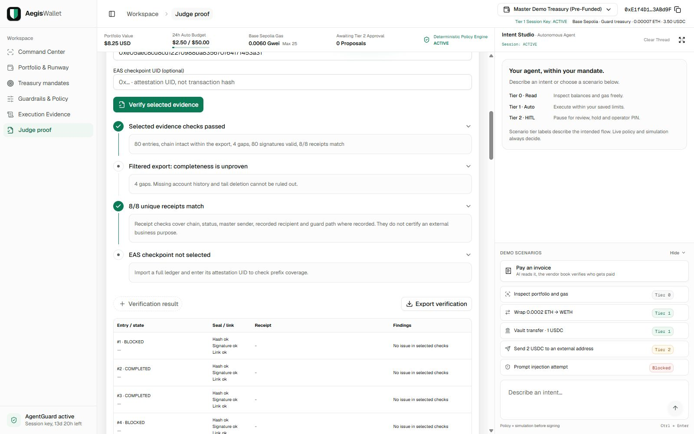

# Validation — 20 October 2026

Local environment: Node v26.7.0, pnpm 11.25.0, Next.js 15.5.28. The committed CI targets Node 24. No new transaction, funding, deployment or approval was signed during these checks.

## Automated checks

Actual output from the final combined test run, including the collaborator's invoice fixes:

```text
$ vitest run "--silent"

 Test Files  22 passed (22)
      Tests  356 passed (356)
   Start at  03:42:18
   Duration  8.27s (import 69%, tests 15%, environment 14%, transform 1%)
```

TypeScript completed with exit code 0:

```text
$ tsc --noEmit
```

Production build completed with exit code 0 (`AEGIS_BUILD_DIR=.next-verify`). A sandbox EPERM creating a generated types directory was resolved by rerunning the build with workspace write permission; no source or security setting was weakened.

```text
 ✓ Compiled successfully in 4.3s
   Linting and checking validity of types ...
   Collecting page data ...
 ✓ Generating static pages (6/6)
   Finalizing page optimization ...
   Collecting build traces ...

Route (app)                                 Size  First Load JS
┌ ○ /                                    18.2 kB         255 kB
├ ○ /_not-found                            996 B         104 kB
├ ○ /agent                                 128 B         104 kB
├ ƒ /api/agent                             128 B         104 kB
└ ○ /icon.svg                                0 B            0 B
```

`pnpm godui:check` completed with exit code 0 and registered `list_components`, `search_components` and `get_component`. The MCP was queried for the components used by the new compositions. Prettier reported:

```text
Checking formatting...
All matched files use Prettier code style!
```

## Browser verification

The production dashboard ran on an isolated loopback port; the operator's existing server was not stopped. Desktop verification used 1600×1000; mobile used 390×844. The mobile document width was 390px and Intent Studio opened in its Sheet.

- Treasury preview read real balances, showed the saved runway floor as the binding constraint and returned no eligible surplus. It did not sign or create a proposal.
- The policy comparison simulated a real 1 USDC transfer. Both current and hypothetical policies held it for the reserve-runway rule; only the current policy added its always-ask reason. No policy was changed and no execution evidence was written.
- Judge proof verified the current account export: **80 signatures valid, 8/8 unique receipts match, four account-filter gaps**. The full local ledger has 84 sealed entries; the account export omits four other-account entries. This is not a claim of complete history or EAS coverage.
- The current policy still requires approval for every write. The live readiness view marks this for review; it does not silently loosen it.

The eight existing transactions checked by the verifier are linked here so the receipt claim can be checked independently. This list supplements the separate operator run in Deliverable 06; it does not invent or merge private ledger history.

| Existing transaction | Base Sepolia receipt                                                                                                  |
| -------------------- | --------------------------------------------------------------------------------------------------------------------- |
| 1                    | [0xe9d9af…3b442c](https://sepolia.basescan.org/tx/0xe9d9afeaab638900273bf0b5bc5f08b3fef4cc5448489d7fdc506c576d3b442c) |
| 2                    | [0x8f7aed…3ad7fb](https://sepolia.basescan.org/tx/0x8f7aed2ff974fe9397ab43afc016c0de952f7d36dec4fd092a4cbf8be73ad7fb) |
| 3                    | [0x906451…c7ea1a](https://sepolia.basescan.org/tx/0x906451f67f9f2ed348b5c7bd25df4a4ffc7fa5e9b4febc9d9381239291c7ea1a) |
| 4                    | [0x80db24…1a633d](https://sepolia.basescan.org/tx/0x80db248e4bf1a8e29047e93b7f1858d73d415266d9c476ffb698142ab91a633d) |
| 5                    | [0xd8e1a0…72d083](https://sepolia.basescan.org/tx/0xd8e1a0aa32456c4fa0bcf99bed43627a5545528c065b5f9c1fbc1f335772d083) |
| 6                    | [0xaf60e0…409e02](https://sepolia.basescan.org/tx/0xaf60e02e9d610afb3a7515573e7d4eb3568c2096e091e9d26c7a8e0381409e02) |
| 7                    | [0xd5f39f…0a50f5](https://sepolia.basescan.org/tx/0xd5f39fd895e216b1b4387f9af0d77599af0f2e0f1f4c0c1149b5014afc0a50f5) |
| 8                    | [0xaf99a7…332ba1](https://sepolia.basescan.org/tx/0xaf99a70ec4d5d38eea0f43a5a539ae9d097e0abe397d16f3c4c6bc8f8d332ba1) |

EAS coverage is tested with clearly marked synthetic fixtures for matching prefixes, tail deletion, unanchored suffixes, wrong schema/attester, expiration, revocation, filtered exports and unavailable reads. No matching live full-ledger checkpoint is claimed for this local run. The final overall verifier result requires every selected check, including any selected checkpoint, to pass.

## Remaining submission work

Use `docs/JUDGE_WALKTHROUGH.md` for the live sequence. The actual presentation deck and optional recorded video remain separate artifacts. A winning score is not guaranteed by a test count or feature list. Production limitations, including co-located owner keys, fixed pricing, legacy floating-point gate valuation and process-local storage, remain documented in the security assessment.


